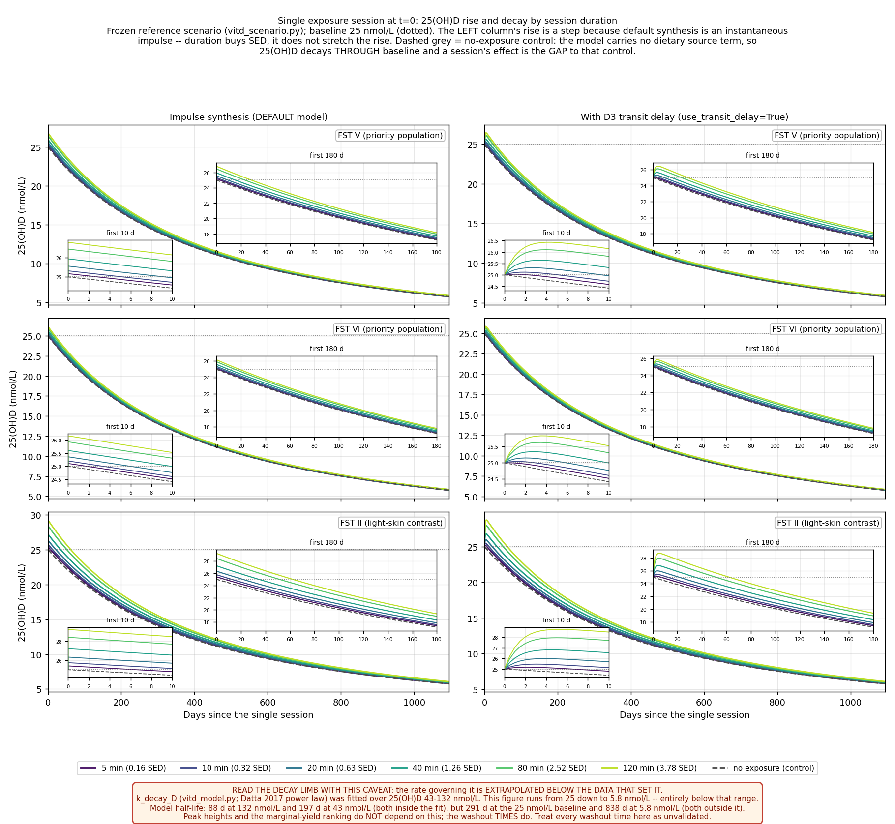
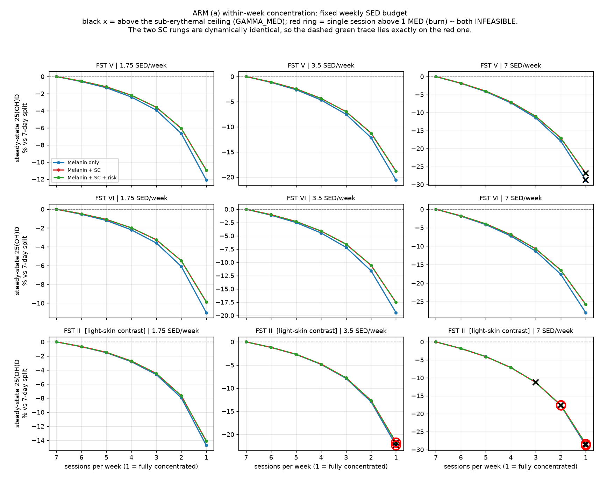
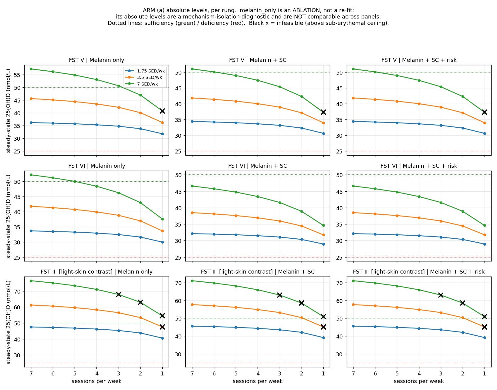
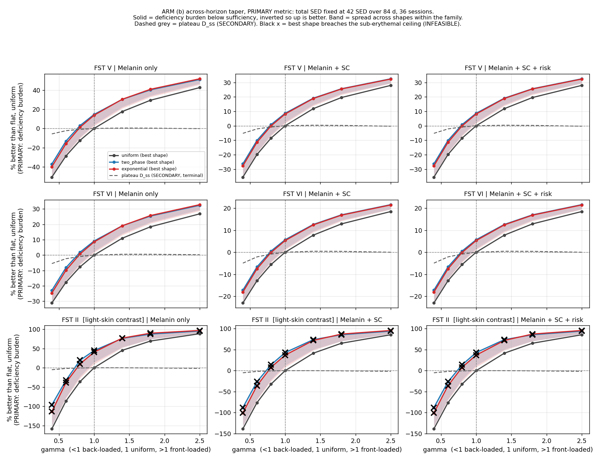
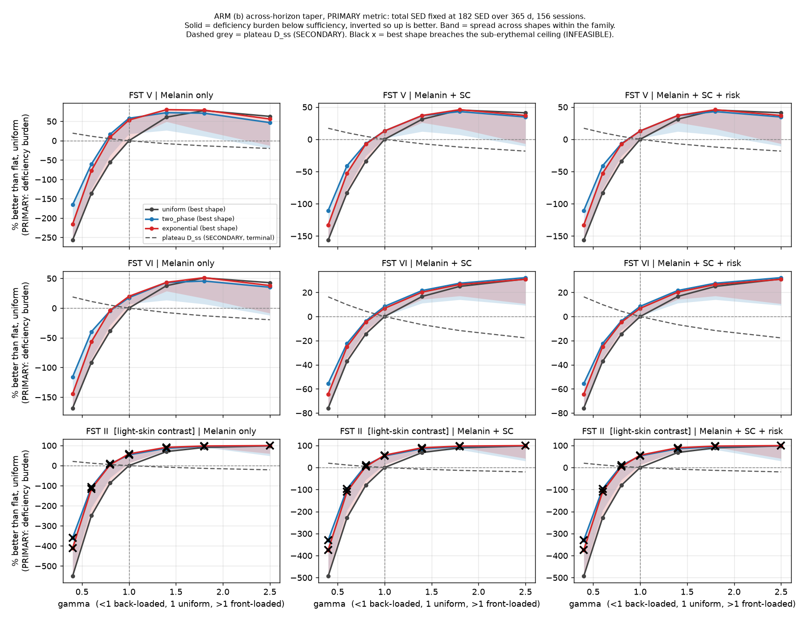
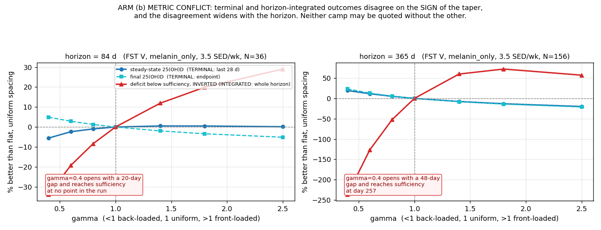
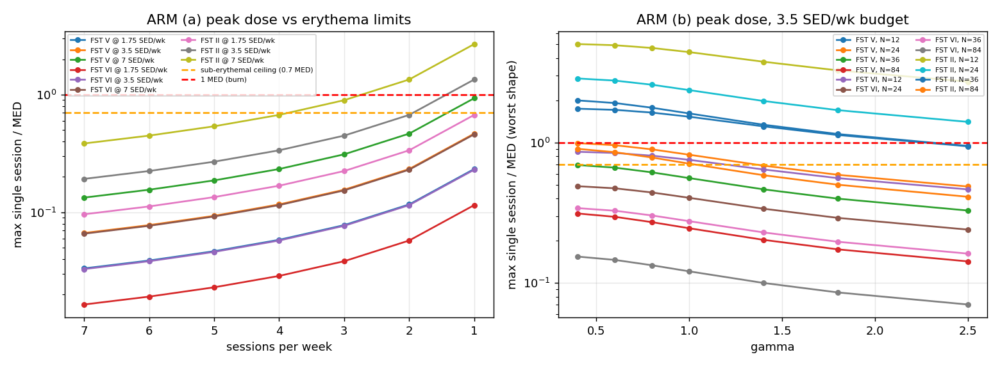
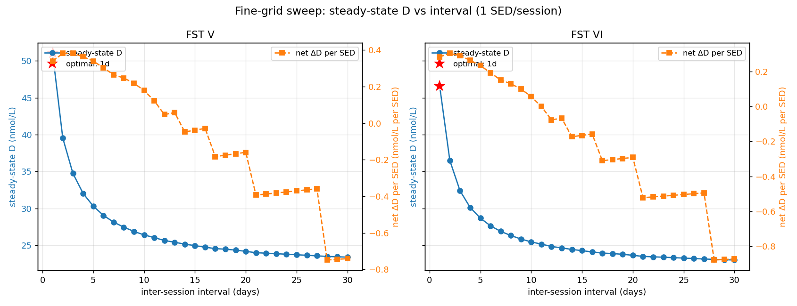

# Vitamin D Scheduling Model — Results

> **AUTO-GENERATED FILE — DO NOT HAND-EDIT.** Rewritten in full on every `run_all.py` run. Any manual edits here will be silently overwritten on the next run.

This report is generated by `run_all.py`. It captures the validation suite output, parameter sweeps, and a brief interpretation.

## Run provenance

```
generated          : 2026-09-21T10:17:33-04:00
git commit         : 6a1585f (working tree dirty)
python             : 3.12.10
pandas / numpy     : 3.0.3 / 2.4.4
--baseline-source  : preset
--run-macro-scripts: False
feedback_mode      : biphasic
```

## Scope and reference conditions — read with section 0

On 2026-08-21 this repository was cut back to the model it can actually defend. The location-based dosimetry chain (solar position → ambient UV index → posture/site geometry → exposed BSA), the genotype presets, the behavioural multiplier and the NHANES preprocessing were **retired to `exploratory/`**. They still exist and their tests still pass; nothing they produce reaches any number in this report. What was retired, why, and the un-retirement procedure are in [`exploratory/README.md`](exploratory/README.md).

Every schedule below is evaluated under one frozen scenario, identical on every exposure day:

```
FROZEN REFERENCE SCENARIO
  ambient UV index      : 6
  geometry factor       : 0.35 (horizontal ambient -> personal, Cockell 2001)
  exposed BSA           : 35% (t-shirt and shorts with partial coverage (face, neck, forearms, hands and part of the legs bare))
  erythemal SED/minute  : 0.0315 (derived)
  held constant on every exposure day; see vitd_scenario.py
```

**Limitation.** All results assume a fixed ambient UV index of 6, a horizontal-to-personal geometry factor of 0.35, and 35% exposed body surface area (t-shirt and shorts with partial coverage (face, neck, forearms, hands and part of the legs bare)), held constant on every exposure day. Real ambient UV varies with latitude, season, time of day, altitude, cloud and ozone, and real personal dose varies with posture and clothing. We do not model that variation. Every duration reported here should therefore be read as a duration under these reference conditions, not as a calendar recommendation for a specific place or date.

These values were chosen so that **no recalibration was required**: each was already the reference value somewhere in the codebase, and the exposed-BSA figure is `vitd_model.BSA_REF`, at which the BSA factor is exactly 1.0 and every existing calibration is untouched. The clothing description is a description of that existing value, not a new choice — the midpoint of the retired module's `short_sleeves` (0.165) and `shorts_and_tshirt` (0.495) presets is 0.33, within 6% of it.

## 0. Which number is the answer — the objective hierarchy

**Read this section before any other.** This repository carries eight schedule-scoring functions, and has twice published a headline "optimum" from a metric with no interior optimum. The ranking below is not prose: it is generated from `vitd_objectives.OBJECTIVE_HIERARCHY`, and report code that tries to present a `DIAGNOSTIC`-tier metric as advice raises rather than prints (`assert_reportable_as_headline`).

- **PRIMARY** — minimum dose and fewest sessions to *reach and hold* sufficiency. One objective. Everything reported as advice comes from here.
- **SECONDARY** — the tri-objective frontier (section 13d) and the fixed-budget risk minimisation (sections 13b/13c, 14b). These refine a recommendation; they never replace it.
- **DIAGNOSTIC** — `gross_synth_per_SED` and `net_final_D_change_per_SED`. Informative about the *model*, barred from being reported as advice.

The `gross_synth_per_SED` failure is **recomputed on every run** rather than quoted: the log below reports its argmax under three different search bounds (a real peak does not move when the bound moves) and the final 25(OH)D at that argmax against the starting value. It selects a schedule that ends *below* baseline — a net loss of vitamin D scored as maximal efficiency — which is why it is background only.

Infeasible cells in the primary table are **results**. Nothing was relaxed to fill them; they say that this skin type cannot hold sufficiency on sun alone at that session budget without burning (C1) or without a session longer than anyone will sit through (C7, 120 min). FST VI is the priority population for this project and is included throughout.

```
==========================================================================
SCHEDULING METRIC HIERARCHY -- which number is the answer
==========================================================================

Generated from vitd_objectives.OBJECTIVE_HIERARCHY. When a section
below reports a number, its tier here is what that number means.

--------------------------------------------------------------------------
PRIMARY
--------------------------------------------------------------------------

  [1] min_dose_min_sessions_to_hold_sufficiency
      asks     : What is the LEAST I have to do -- fewest sessions, smallest dose -- to reach 50 nmol/L and then stay there?
      minimise : n_sessions, total_sed
      s.t.     : C3 sufficiency floor holds for every day after ramp-in
                 C1 per-session dose <= GAMMA_MED * MED(FST)
                 C7 per-session dose deliverable in PRACTICAL_MAX_MINUTES
      from     : vitd_optimization.minimum_schedule_for_sufficiency
      status   : HEADLINE. Infeasible cells are a RESULT -- dark skin at low session budgets -- not a gap to be filled by relaxing C1/C7.

--------------------------------------------------------------------------
SECONDARY
--------------------------------------------------------------------------

  [2] tri_objective_sessions_spacing_risk
      asks     : Among the schedules that do work, which trades fewest sessions against shortest gaps against least skin-cancer risk, and how steep is that trade?
      minimise : n_sessions, max_gap_days, risk_within_fst_ratio
      s.t.     : C3 sufficiency floor holds for every day after ramp-in
                 C1 per-session dose <= GAMMA_MED * MED(FST)
                 C7 per-session dose deliverable in PRACTICAL_MAX_MINUTES
      from     : vitd_optimization.tri_objective_frontier
      status   : A frontier, not advice. The three axes genuinely conflict: fewer sessions forces longer gaps AND a larger per-session dose, which the intermittency term punishes cubically.

  [3] min_risk_at_fixed_session_budget
      asks     : I can manage exactly N sessions a year. What is the lowest-cancer-risk way to spend them?
      minimise : combined_risk
      s.t.     : C3 sufficiency floor holds for every day after ramp-in
                 C1 per-session dose <= GAMMA_MED * MED(FST)
                 session budget fixed by the user
      from     : vitd_optimization.optimise_joint_schedule / optimise_variable_dose / optimal_interval_risk_constrained
      status   : Conditional on a budget the user supplies. Cross-skin-type comparisons of the index VALUES inherit the weaker susceptibility axis; rankings within one skin type do not.

--------------------------------------------------------------------------
DIAGNOSTIC
--------------------------------------------------------------------------

  [4] gross_synth_per_SED
      asks     : How much D is synthesised per unit of UV delivered?
      from     : scripts/metric_redundancy.py (local copy; deleted from vitd_model.py 2026-07-31); failure reproduced by vitd_optimization.gross_synth_per_SED_diagnostic
      status   : BACKGROUND / DIAGNOSTIC ONLY. No interior optimum -- rises monotonically as dosing approaches zero, so its argmax tracks the search bound. At its reported optimum final 25(OH)D is BELOW baseline: a net LOSS of vitamin D scored as maximal efficiency. Never a recommendation.

  [5] net_final_D_change_per_SED
      asks     : How much net 25(OH)D does a schedule leave per unit of UV?
      from     : vitd_model.net_final_D_change_per_SED
      status   : Diagnostic. It repairs gross_synth's net-loss failure (it is signed) but is still a ratio with no floor constraint, so it can still prefer a schedule that never reaches sufficiency.


==========================================================================
PRIMARY RESULT: least you have to do to reach AND hold sufficiency
==========================================================================

  What is the LEAST I have to do -- fewest sessions, smallest dose -- to reach 50 nmol/L and then stay there?

  Constraints, none relaxed:
    C3 sufficiency floor holds for every day after ramp-in
    C1 per-session dose <= GAMMA_MED * MED(FST)
    C7 per-session dose deliverable in PRACTICAL_MAX_MINUTES

  Reference conditions for the minutes column: UV index 6.0, 120 min ceiling,
  geometry factor 0.35 (vitd_objectives.PERSONAL_DOSE_GEOMETRY_FACTOR).

  Full grid, UNIFORM spacing. INFEASIBLE cells are results, not gaps.

   FST  N/yr  SED/sesh  min/sesh   totSED  t->suff      risk  status
  ------------------------------------------------------------------------------
     I    52        --        --       --       --        --  INFEASIBLE: C1 erythema (70% MED)
     I   104     0.836      26.5     87.0      84d    1.6736  ok
     I   146     0.544      17.3     79.4      85d    0.9618  ok
     I   183     0.407      12.9     74.4      88d    0.6596  ok
     I   260     0.272       8.6     70.6      88d    0.4103  ok
     I   365     0.188       6.0     68.6      88d    0.2735  ok

    II    52        --        --       --       --        --  INFEASIBLE: C1 erythema (70% MED)
    II   104     1.052      33.4    109.5      84d    2.0707  ok
    II   146     0.670      21.3     97.8      85d    1.1323  ok
    II   183     0.496      15.7     90.7      88d    0.7573  ok
    II   260     0.327      10.4     85.1      88d    0.4591  ok
    II   365     0.225       7.1     82.2      88d    0.3009  ok

   III    52        --        --       --       --        --  INFEASIBLE: C1 erythema (70% MED)
   III   104     1.393      44.2    144.8      84d    2.7800  ok
   III   146     0.860      27.3    125.5      85d    1.4148  ok
   III   183     0.627      19.9    114.7      88d    0.9132  ok
   III   260     0.408      12.9    106.0      88d    0.5339  ok
   III   365     0.278       8.8    101.3      88d    0.3420  ok

    IV    52        --        --       --       --        --  INFEASIBLE: C1 erythema (70% MED)
    IV   104     2.407      76.4    250.3      84d    2.1790  ok
    IV   146     1.376      43.7    200.9      85d    0.9264  ok
    IV   183     0.966      30.7    176.8      88d    0.5474  ok
    IV   260     0.605      19.2    157.3      88d    0.2927  ok
    IV   365     0.402      12.8    146.8      88d    0.1772  ok

     V    52        --        --       --       --        --  INFEASIBLE: C1 erythema (70% MED)
     V   104        --        --       --       --        --  INFEASIBLE: C7 session length (>120 min)
     V   146     2.221      70.5    324.3      85d    1.0280  ok
     V   183     1.490      47.3    272.6      88d    0.5453  ok
     V   260     0.891      28.3    231.6      88d    0.2617  ok
     V   365     0.575      18.3    209.9      88d    0.1479  ok

    VI    52        --        --       --       --        --  INFEASIBLE: C1 erythema (70% MED)
    VI   104        --        --       --       --        --  INFEASIBLE: C7 session length (>120 min)
    VI   146        --        --       --       --        --  INFEASIBLE: C7 session length (>120 min)
    VI   183     2.507      79.6    458.7      88d    0.3298  ok
    VI   260     1.396      44.3    363.0      88d    0.1339  ok
    VI   365     0.863      27.4    315.1      88d    0.0684  ok

  HEADLINE. Minimum session budget that reaches and holds 50 nmol/L,
  under uniform spacing and then with the spacing free:
   FST            uniform spacing                   free spacing   gamma
  ------------------------------------------------------------------------
     I     104/yr, 27 min, 87 SED         104/yr, 18 min, 59 SED    1.40
    II    104/yr, 33 min, 109 SED         104/yr, 22 min, 73 SED    1.40
   III    104/yr, 44 min, 145 SED         104/yr, 29 min, 93 SED    1.40
    IV    104/yr, 76 min, 250 SED        104/yr, 45 min, 149 SED    1.40
     V    146/yr, 71 min, 324 SED        104/yr, 74 min, 242 SED    1.40
    VI    183/yr, 80 min, 459 SED        146/yr, 69 min, 319 SED    1.40

  Least TOTAL UV (a different question from fewest sessions):
   FST            uniform spacing                   free spacing
  ----------------------------------------------------------------
     I       365/yr, 69 SED total           365/yr, 49 SED total
    II       365/yr, 82 SED total           365/yr, 58 SED total
   III      365/yr, 101 SED total           365/yr, 71 SED total
    IV      365/yr, 147 SED total          365/yr, 101 SED total
     V      365/yr, 210 SED total          365/yr, 141 SED total
    VI      365/yr, 315 SED total          365/yr, 206 SED total

  9 of 36 (skin type, session budget) cells are infeasible under uniform spacing;
  7 of 36 with the spacing free.

  SPACING CHANGES THE MINIMUM BUDGET -- this is a result, not a
  discrepancy with the uniform-spacing figures asserted in
  tests/test_vitd_optimization.py::TestRecalibratedFeasibility.
  Constraint C3 binds at the RAMP-IN BOUNDARY, not at the end of
  the year: under uniform spacing 25(OH)D is still climbing at
  day 90 and misses the floor by a fraction of a nmol/L, whereas
  a front-loaded schedule is already past it. Same budget, same
  ceiling, nothing relaxed -- only the order of the sessions.
    FST V    146/yr uniform -> 104/yr at gamma 1.40
    FST VI   183/yr uniform -> 146/yr at gamma 1.40

  Fewest-sessions and least-total-UV are DIFFERENT answers. Fewer
  sessions forces a larger per-session dose, and per-session yield
  saturates, so the fewest-sessions schedule generally costs more
  cumulative UV. Which one is 'the' minimum depends on whether the
  binding cost is getting outside or the UV itself.

  Saved tables/primary_minimum_schedule.csv

==========================================================================
BACKGROUND / DIAGNOSTIC TIER: gross_synth_per_SED
==========================================================================

  Reported here so it is on the record, and labelled so it cannot
  be read as advice. Both failures are RECOMPUTED from the current
  parameters on this run, not quoted from a previous one.

  1. No interior optimum. argmax by search bound: {30: 30, 60: 60, 90: 90}
     argmax tracks the search bound: True
     Spearman rho(interval, metric) = +0.9970 over 0.580-1.742; 4 local dips, largest 0.0103
     (the dips are integer-grid quantisation -- 365/interval is not
     a whole number of sessions -- not an interior peak)

  2. Net loss at its own optimum. At 90 d (FST III, 1 SED/session):
     start 25(OH)D 25.0 -> final 18.0 nmol/L (net -7.0)
     ends BELOW baseline: True

  A metric maximised by dosing less, whose selected schedule leaves
  the person worse off than when they started, is a statement about
  the model, not a schedule. It stays DIAGNOSTIC-tier.

```

## 1. Validation

**Required: 9 / 10. Warning-only: 4 / 4.** A single pooled "13 / 14" was reported here until this fix and conflated the two buckets. The evidence-tier split, orthogonal to both and the number that actually bounds what this suite licenses:

| tier | passed |
|---|---|
| INTERNAL | 4 / 4 |
| DIRECTIONAL | 3 / 3 |
| CIRCULAR | 3 / 3 |
| QUANTITATIVE | 1 / 2 |
| NOT_EVIDENCE | 2 / 2 |

Only the QUANTITATIVE row is an external numeric comparison; see the per-check `tier_note` in `vitd_validation.CHECK_REGISTRY` for why each check carries the tier it does, and **section 15**, which carries the only out-of-sample test and is not counted in any of the numbers above.

```
======================================================================
VALIDATION SUITE
======================================================================
[TIER: INTERNAL] Simulator checked against the analytic solution of its own ODE; half-life targets are a power-law fit to the same three Datta 2017 group means the model encodes. Tests that the code computes its documented math, not that the math matches unseen biology.
[Sanity 1] D-dependent decay half-life (Datta 2017 power-law fit)
  D=132: t_half=87.8d (expected 89d, ±10%): OK
  D=65:  t_half=146.2d (expected 148d, ±10%): OK
  D=43:  t_half=196.9d (expected 199d, ±10%): OK
  Sim vs analytic ODE, D0=132 @89d:  74.711 vs 74.751 (±1%): OK
  Sim vs analytic ODE, D0=43 @199d:  24.378 vs 24.384 (±1%): OK
  PASS

[TIER: INTERNAL] Docstring: "computation-integrity check ... NOT a literature check -- no external target." Expected value is rebuilt from the model's own live parameters.
[Sanity 2] Single bolus, FST III, untanned (computation-integrity check)
  A=4.125, K_const=1.15, M_III=0.3231, feedback_mode='biphasic', g(25)=0.8338
  delta-D = 1.64 nmol/L  (expected 1.64, ±2%)
  PASS

[TIER: INTERNAL] Docstring proves the measured quantity is an algebraic identity independent of K_const/A/D_max/feedback form. K_ATTEN is active and calibrated (reinstated 2026-08-21, re-derived 2026-08-25 to track M_TAN_HEADROOM), not pinned at 0, so this check measures the live value rather than being pinned to pass by construction. Docstring: "NOT evidence ... a drift guard sharing its evidence with the calibration."
[Sanity 3] Photoadaptation reduction (FST III, M 0.32 -> 0.56 [M_ceiling])
  untanned synthesis: 1.64  tanned synthesis: 1.53
  reduction = 6.6%  (guard range 0-10%; evaluated at structural ceiling M_ceiling)
  equivalent bracket: K_ATTEN in [0.000, 0.443]; K_ATTEN is ACTIVE and calibrated at 0.29 (reinstated 2026-08-21), so this measures the live parameter and is a drift guard sharing its evidence with the calibration, NOT an independent check.
  PASS

[TIER: DIRECTIONAL] Docstring: "Checks direction only ... Quantitative MI comparison is not possible." External de Boer 2025 protocol; asserts melanin up / SC up / synthesis down, no numeric target.
[Lit 1] de Boer 2025 - photoadaptation direction (replaces Matsuoka 1990)
  Protocol: 0.8 SED 3x/week x 9 weeks, FST III (de Boer 2025)
  Baseline M=0.323, After M=0.340, increased: YES
  Baseline SC=0.0, After SC=0.1419, increased: YES
  Untanned delta-D=1.394, Tanned delta-D=1.204
  Synthesis decreased after photoadaptation: YES
  PASS

[TIER: CIRCULAR] Docstring: "[C7-SC-FITTED] alpha_SC=0.12, SC_max_by_FST ... Calibrated with de Boer 2025 Supplementary Table S1." The SC parameters generating the model's trajectory were fitted to the same dataset this check compares that trajectory against.
[SC Check] de Boer 2025 SC validation (warning-only)
  Protocol: 0.8 SED 3x/week x 9 weeks (T1 = 35 d, T2 = 63 d)
  FST III (FP I-III proxy, SC_max=0.24): SC=0.1465 (increased: YES, range [0.08,0.24]: OK)
  FST V  (FP IV-VI proxy, SC_max=0.36): SC=0.2198 (increased: YES, range [0.14,0.36]: OK)
  SC_V >= SC_III * 0.8: YES
  SHAPE (reported, not asserted): model T1=+0.140 T2=+0.142 vs observed -0.259 / +0.293
    Observed SC dips ~26% BELOW baseline at week 5. Model cannot
    reproduce that at k_damage=0.0, which is deliberate: the
    parameter is unidentifiable from 3 group medians. See
    scripts/fit_sc_deboer2025.py and docs/SC_MODEL.md section 2.4.
  PASS (warning-only)

[TIER: CIRCULAR] Self-labelled "STATUS: DEBUGGING_TARGET ... must not be reported as an independent validation pass until structural and source-data verification are complete." E_source=2.5 is a per-study placeholder tuned to this trial.
[Lit 2] Bogh 2012 - quantitative NB-UVB validation  [C1]
  Protocol: 18 sessions 3x/week x 6 weeks, cohort FST mix, baseline 19.2
  Dose: 9.0 J/cm2 cumulative -> 49.5 erythemal SED (TL-01 x5.5), E_source=2.44, BSA=0.9
  Model D_final = 69.3 nmol/L (delta = +50.1)
  Study observed: 19.2 -> 75.0 nmol/L, delta +55.8 nmol/L
  Acceptance: |delta - 55.8| <= 10.0 nmol/L  (range 45.8-65.8)
  PASS

[TIER: QUANTITATIVE] Real numeric comparison (D_final and delta bounds in nmol/L) against an external FST V trial. Not a direct K_const/A fitting target, but vitd_model.py's A entry records this check's pass/fail as a "MEASURED CONSEQUENCE" of the 2026-08-18 A recalibration (FAIL -> PASS) -- partly informed, not fully independent. The strongest tier this suite has; read with that caveat.
[Lit 3] Farrar 2013 - FST V, 1.95 SED 3x/week x 6 weeks, baseline 30.0  [C2]
  Baseline proxy <50 nmol/L constraint: YES
  D_final = 43.6 nmol/L  (observed ~39.2 nmol/L; target 25-55)
  delta   = 13.6 nmol/L  (observed ~21.7 nmol/L; target 10-35)
  D_final in [25,55]: YES   delta in [10,35]: YES
  PASS

[TIER: DIRECTIONAL] Docstring: "Direction check only ... exact coefficient match is not required." Tests the SIGN of the baseline effect against Bogh 2010/P5's regression; the ratio band [1.2, 3.0] is wide enough to be near-guaranteed by the feedback function's own monotonicity.
[Lit 4] Bogh 2010/P5 - baseline-dependent synthesis direction  [C4]
  1 SED, FST III, SC=0:
    delta at D=20:  1.749 nmol/L
    delta at D=80:  0.648 nmol/L
  direction (low-baseline > high-baseline): YES
  model ratio = 2.70  (P5-implied feedback ratio ~1.86; target 1.2-3.0)
  Note: full BSA term (5.5*ln(%BSA)) not modeled; direction check only
  PASS

[TIER: DIRECTIONAL] Docstring: "Direction, not magnitude, is what this check licenses: a baseline-dependent SIGN REVERSAL is a strong constraint on feedback shape." Uses external Karppinen 2017 numbers to set a sign-reversal target with a wide bracket around them, not a tight numeric match.
[Lit 5] Karppinen 2017/P33 - baseline feedback calibration target
  Protocol: 1.18 SED/day x 10 days, FST III, BSA=0.07, E_source=2.0
  DEFAULT feedback mode ('biphasic'):
    Low baseline (62.4 nmol/L) change:  +4.80 nmol/L (observed +6.0)
    High baseline (116.9 nmol/L) change: -4.65 nmol/L (observed -6.7)
    Low baseline increased: YES
    High baseline decreased: YES
    Within target bounds: YES
  PASS

[TIER: INTERNAL] Pure internal sanity: AUC-above-sufficiency is 0 when D never crosses the threshold, AUC-above-baseline is >0 when D rises. No external data of any kind.
[New Check] Metric ordering and sanity assertions
  Mild schedule (0.1 SED every 7d, D0=25.0):
    auc_above_sufficiency (threshold 50): 0.0000 (target: 0.0)
    AUC above sufficiency = 0: YES
  Standard schedule (1.0 SED every 2d, D0=25.0):
    auc_above_baseline: 39.4851 (target: > 0.0)
    AUC above baseline > 0: YES
  PASS

[TIER: NOT_EVIDENCE] Self-labelled in source: "STATUS: EXPLORATORY_ONLY. Invalid as physiological validation of K_ATTEN. Retained only for future behavioral modeling."

[K_ATTEN seasonal amplitude] NH White vs NH Black seasonal rise
  Protocol: daily 0.333 SED x 84d, E_source=1.89, BSA=0.3
  NH White (FST=2, code 3): observed amplitude = 6.46, model amplitude = 13.15
  NH Black (FST=5, code 4): observed amplitude = 4.45, model amplitude = 14.22
  Observed ratio (White/Black): 1.449
  Model ratio (White/Black):    0.925
  Difference: -36.2% (target: within +/-50%)
  PASS

[TIER: CIRCULAR] DEMOTED to warning-only 2026-08-21 (was required, band included zero). Kift 2013 is one of the four within-study/field routes K_const (1.15 as of 2026-09-06, was 0.98) was fitted to (vitd_model.py K_const entry; scripts/kconst_recalibration.py). See function docstring for the full argument and the option-(a)-vs-(b) decision.
[Lit 6, WARNING-ONLY / CIRCULAR] Kift 2013 - UK South Asian naturalistic exposure (FST V)
  Protocol: ~1.0 SED/wk (0.333 SED 3x/wk) x 12 weeks, FST V, BSA=0.14, baseline 22.5 nmol/L
  Model D_final = 27.3 nmol/L (delta = +4.8 nmol/L)
  Target bounds: D_final in [20, 40]: YES, delta in [0, 15]: YES
  CIRCULAR: Kift 2013 is one of the 4 routes K_const (1.15 as of 2026-09-06) was fitted to; band
  also includes zero, so a null model would pass. Demoted to warning-only,
  not counted toward the required pass/fail score. See docstring.
  [REPORTED, NOT GATED] Kift's own observed winter->summer amplitude: 14.5 -> 22.5 = 8.0 nmol/L (confirmed independently by Webb 2018).
  Note D0 above is the study's SUMMER value, not its winter baseline, so this
  simulation does not reproduce that transition -- flagged, not fixed.
  PASS (warning-only; not counted toward required score)

[TIER: NOT_EVIDENCE] Docstring: "NOT independent vitamin-D evidence ... must not be counted or reported as such." Compares the model's minutes ratio to an erythema-MED table run through Hollick's rule, not to a vitamin-D measurement.
[Held-out, WARNING-ONLY] Kallioglu 2024 erythema-MED-derived ratio
  NOT vitamin-D evidence -- reported ratio is Table 3's MED table
  run through Hollick's rule; see this function's docstring.
  1000 IU/d, 25% BSA, annual mean, Antalya 37N / Istanbul 41N
   FST  reported  rep ratio  model min  mod ratio
     1      5.05       1.00        2.7       1.00
     2      6.30       1.25        3.2       1.19
     3      7.60       1.50        3.9       1.46
     4     11.35       2.25        5.4       2.04
     5     15.15       3.00        7.7       2.88
     6     25.25       5.00       11.4       4.28
  FST VI:I  reported 5.00  model 4.28
  FST V:II  reported 2.40  model 2.42
  PASS - model's minutes ratio vs the MED-table-derived ratio (advisory only, not a vitamin-D check)

[TIER: QUANTITATIVE] Cross-study multi-scenario benchmark: simulates all registered clinical trial protocols (Farrar 2013, Young 2021, Felton 2016, de Boer 2025, etc.) and checks physiological bounds, synthesis deltas, and cancer risk metrics.
[Reference Scenarios Benchmark] Clinical Trial Protocols vs Model Predictions:
  Scenario                    FST    D0  Model dD   Obs dD    SCC  Interm  Burn%  Status
  ----------------------------------------------------------------------------------
  deboer2025_barrier            3  25.0    +21.4      N/A   0.21    0.07     0%    PASS
  farrar2013_fst5_uk            5  17.2    +21.9    +21.7   0.07    0.00     0%    PASS
  felton2016_fst2_matched       2  36.5    +27.0    +17.8   0.26    0.40     0%    PASS
  felton2016_fst5_matched       5  17.2    +21.9     +8.3   0.07    0.00     0%    FAIL
  summer_midday_reference       3  25.0    +38.1      N/A   0.50    0.18     0%    PASS
  webb2018_uk_guidance          2  25.0    +53.9      N/A   0.69    0.11     0%    PASS
  young2021_fst2_solar          2  34.6    +18.7    +36.1   0.06    0.40     0%    PASS
  FAIL

======================================================================
PASSED REQUIRED: 9 / 10
PASSED WARNING-ONLY: 4 / 4
Audit change tags active: C1 C2 C3 C4 C6 (see module docstring)
C5 C7 C8: see vitd_model.py docstring and parameter comments
======================================================================

EVIDENCE TIER BREAKDOWN -- all 14 checks, orthogonal to
the required/warning-only split above. See the per-check tier_note
in CHECK_REGISTRY: the REQUIRED count above is real but misleading --
most of what it counts is self-consistency, not biology.
  INTERNAL      4 / 4   (self-consistency / computation-integrity / wiring; not evidence about biology)
  DIRECTIONAL   3 / 3   (external literature data, direction or ordering only -- no quantitative comparison)
  QUANTITATIVE  1 / 2   (external literature data, a real numeric comparison -- see per-check circularity notes)
  CIRCULAR      3 / 3   (external data the model (or one of its parameters) was FITTED to; a pass is expected by construction)
  NOT_EVIDENCE  2 / 2   (retained for the finding it records, but its own docstring says it is not vitamin-D evidence, or that it is exploratory only)

HELD-OUT (not run inside this suite, un-gated by design):
  Webb/Kift 2018 -- RESULTS.md section 15, vitd_benchmark_webbkift.py.
  The one genuinely un-fitted external check in the pipeline. Gating
  is on the dose ratio only (geometry/climate-independent); the
  minutes ratio is diagnostic context, not a second pass/fail --
  see that module's docstring, 'ONE NUMBER, NOT TWO'. Recomputed on
  every run rather than quoted here, because a stale figure printed
  above the live section-15 number is exactly the drift this fix
  removes:
    PASS: model dose ratio 2.87x vs reported 2.5-3.0x (diagnostic minutes ratio 4.26 vs reported 2.78)
  See RESULTS.md section 15 for the full re-run.
======================================================================

```

## 1a. Single session: dose-response and washout

**The question this answers**, put by the project's advisor: *plot how vitamin D concentration changes with exposure duration for a single session, including how it decays once the session is over.* Everything above and below this section scores a *schedule*; this one scores a single exposure, which is the unit those schedules are built from. It is the dose-response and washout kernel behind the trajectories in section 12 and the interval orderings in sections 5 and 5a.

**What is held fixed.** One session at t = 0 and nothing afterwards, then an observation window long enough for the washout to complete. Session length in minutes is converted to erythemal SED under the single frozen reference scenario quoted at the top of this report (`vitd_scenario`) — no latitude, date or posture enters. Only the session DURATION varies between curves. Each panel also carries a no-exposure control run from the same baseline, because the model has no dietary or endogenous source term, so baseline 25(OH)D is an initial condition rather than a fixed point and the curves decay *through* it. The session's effect is therefore read as the GAP to that control, not as an absolute level.

**Headline, generated from this run's own output table.** For the darkest skin type carried here, under the default (impulse-synthesis) model, a 24-fold increase in session length (5 -> 120 minutes) buys only a 10.7-fold increase in the peak 25(OH)D gap over the no-exposure control: the marginal yield falls from 0.0319 to 0.0083 nmol/L per extra minute across that range. The washout is correspondingly slow — 8% of the peak gap from the longest session is still present at the end of the observation window. Longer sessions are subject to diminishing returns because per-session synthesis is logarithmic in dose; this is the single-session statement of the same concavity that makes frequent-and-small win in sections 5, 5a and 17.

**Limitation — the decay limb is an extrapolation, and the washout times are unvalidated.** The state-dependent decay rate `ModelParams.k_decay_D` (Datta 2017 power law) was fitted over a 25(OH)D range that this figure sits almost entirely *below*, so the half-life the power law returns here is longer than any half-life Datta measured. The script computes the fitted range and the model half-lives inside and outside it at run time and renders them both into the log below and onto the figure itself, so they cannot drift from the parameterisation:

- `k_decay_D` was fitted over 25(OH)D **43-132 nmol/L**; model half-life is **88 d** at 132 nmol/L and **197 d** at 43 nmol/L (both inside the fitted range), against **291 d** at the 25 nmol/L default baseline this figure starts from — outside it.

Peak heights and the marginal-yield ranking do **not** depend on that rate — they are set by the synthesis term at t = 0 — but every washout time in this section does, and should be treated as unvalidated. A second caveat is structural: in the default model a session's synthesis is credited to serum as an instantaneous impulse, so the rise is a vertical step rather than a ramp. That is a property of the impulse formulation, not a physiological claim; the transit-delay variant (`ModelParams.use_transit_delay`, whose half-life is flagged `[PRIOR]` in `vitd_model.py`) is plotted alongside it, and the default column is the one every other headline number in this report uses.

```
FROZEN REFERENCE SCENARIO
  ambient UV index      : 6
  geometry factor       : 0.35 (horizontal ambient -> personal, Cockell 2001)
  exposed BSA           : 35% (t-shirt and shorts with partial coverage (face, neck, forearms, hands and part of the legs bare))
  erythemal SED/minute  : 0.0315 (derived)
  held constant on every exposure day; see vitd_scenario.py

All results assume a fixed ambient UV index of 6, a horizontal-to-personal geometry factor of 0.35, and 35% exposed body surface area (t-shirt and shorts with partial coverage (face, neck, forearms, hands and part of the legs bare)), held constant on every exposure day. Real ambient UV varies with latitude, season, time of day, altitude, cloud and ozone, and real personal dose varies with posture and clothing. We do not model that variation. Every duration reported here should therefore be read as a duration under these reference conditions, not as a calendar recommendation for a specific place or date.

Baseline 25(OH)D (ModelParams.D0_default) : 25 nmol/L
Observation window                        : 1095 days
25(OH)D half-life at baseline             : 291 d   (from ModelParams.k_decay_D)
  half-life at the Datta fit's low end    : 197 d (D = 43 nmol/L)
  half-life at the Datta fit's high end   : 88 d (D = 132 nmol/L)
  *** EXTRAPOLATION: baseline 25 nmol/L is BELOW the 43-132 nmol/L range k_decay_D was fitted over, and the decay only goes lower. Every washout time below is off the low end of the source data. See this module's docstring. ***
Baseline-return tolerance                 : 1 nmol/L
PRACTICAL_MAX_MINUTES (vitd_objectives)   : 120 min
  All plotted durations are at or below the practical cap.

Integrator audit over 1095 d (0.5-d exponential-Euler vs closed form):
  FST 5  max relative error 2.33e-04
  FST 6  max relative error 2.30e-04
  FST 2  max relative error 2.46e-04
  worst 2.46e-04  ->  OK -- no meaningful drift
  D > 0 and monotone decreasing after the peak for all 36 runs
Wrote C:\Users\Ahaan\sunresearch\Sun-Exposure-Intervals\tables\single_session_response.csv
Wrote C:\Users\Ahaan\sunresearch\Sun-Exposure-Intervals\figs\single_session_response.png

--- Impulse synthesis (DEFAULT model) ---
  FST V (priority population)
        5 min   0.16 SED  peak  25.21  delta  0.21  gap  0.21  marginal 0.0423 nmol/L/extra-min  t_half(effect)   196 d  remaining at d1095  8.0%
       10 min   0.32 SED  peak  25.40  delta  0.40  gap  0.40  marginal 0.0369 nmol/L/extra-min  t_half(effect)   196 d  remaining at d1095  7.9%
       20 min   0.63 SED  peak  25.71  delta  0.71  gap  0.71  marginal 0.0310 nmol/L/extra-min  t_half(effect)   194 d  remaining at d1095  7.9%
       40 min   1.26 SED  peak  26.18  delta  1.18  gap  1.18  marginal 0.0236 nmol/L/extra-min  t_half(effect)   193 d  remaining at d1095  7.8%
       80 min   2.52 SED  peak  26.82  delta  1.82  gap  1.82  marginal 0.0160 nmol/L/extra-min  t_half(effect)   192 d  remaining at d1095  7.7%
      120 min   3.78 SED  peak  27.26  delta  2.26  gap  2.26  marginal 0.0111 nmol/L/extra-min  t_half(effect)   190 d  remaining at d1095  7.6%
  FST VI (priority population)
        5 min   0.16 SED  peak  25.16  delta  0.16  gap  0.16  marginal 0.0319 nmol/L/extra-min  t_half(effect)   196 d  remaining at d1095  8.0%
       10 min   0.32 SED  peak  25.30  delta  0.30  gap  0.30  marginal 0.0278 nmol/L/extra-min  t_half(effect)   196 d  remaining at d1095  7.9%
       20 min   0.63 SED  peak  25.53  delta  0.53  gap  0.53  marginal 0.0234 nmol/L/extra-min  t_half(effect)   195 d  remaining at d1095  7.9%
       40 min   1.26 SED  peak  25.89  delta  0.89  gap  0.89  marginal 0.0178 nmol/L/extra-min  t_half(effect)   194 d  remaining at d1095  7.8%
       80 min   2.52 SED  peak  26.37  delta  1.37  gap  1.37  marginal 0.0121 nmol/L/extra-min  t_half(effect)   192 d  remaining at d1095  7.8%
      120 min   3.78 SED  peak  26.70  delta  1.70  gap  1.70  marginal 0.0083 nmol/L/extra-min  t_half(effect)   192 d  remaining at d1095  7.7%
  FST II (light-skin contrast)
        5 min   0.16 SED  peak  25.41  delta  0.41  gap  0.41  marginal 0.0826 nmol/L/extra-min  t_half(effect)   195 d  remaining at d1095  7.9%
       10 min   0.32 SED  peak  25.77  delta  0.77  gap  0.77  marginal 0.0721 nmol/L/extra-min  t_half(effect)   194 d  remaining at d1095  7.9%
       20 min   0.63 SED  peak  26.38  delta  1.38  gap  1.38  marginal 0.0606 nmol/L/extra-min  t_half(effect)   192 d  remaining at d1095  7.8%
       40 min   1.26 SED  peak  27.30  delta  2.30  gap  2.30  marginal 0.0461 nmol/L/extra-min  t_half(effect)   190 d  remaining at d1095  7.6%
       80 min   2.52 SED  peak  28.55  delta  3.55  gap  3.55  marginal 0.0313 nmol/L/extra-min  t_half(effect)   187 d  remaining at d1095  7.4%
      120 min   3.78 SED  peak  29.42  delta  4.42  gap  4.42  marginal 0.0216 nmol/L/extra-min  t_half(effect)   185 d  remaining at d1095  7.3%

--- With D3 transit delay (use_transit_delay=True) ---
  FST V (priority population)
        5 min   0.16 SED  peak  25.05  delta  0.05  gap  0.20  marginal 0.0410 nmol/L/extra-min  t_half(effect)   208 d  remaining at d1095  8.3%
       10 min   0.32 SED  peak  25.18  delta  0.18  gap  0.38  marginal 0.0357 nmol/L/extra-min  t_half(effect)   207 d  remaining at d1095  8.2%
       20 min   0.63 SED  peak  25.43  delta  0.43  gap  0.68  marginal 0.0301 nmol/L/extra-min  t_half(effect)   206 d  remaining at d1095  8.2%
       40 min   1.26 SED  peak  25.86  delta  0.86  gap  1.14  marginal 0.0229 nmol/L/extra-min  t_half(effect)   205 d  remaining at d1095  8.1%
       80 min   2.52 SED  peak  26.45  delta  1.45  gap  1.76  marginal 0.0155 nmol/L/extra-min  t_half(effect)   204 d  remaining at d1095  8.0%
      120 min   3.78 SED  peak  26.86  delta  1.86  gap  2.19  marginal 0.0107 nmol/L/extra-min  t_half(effect)   202 d  remaining at d1095  7.9%
  FST VI (priority population)
        5 min   0.16 SED  peak  25.02  delta  0.02  gap  0.15  marginal 0.0309 nmol/L/extra-min  t_half(effect)   208 d  remaining at d1095  8.3%
       10 min   0.32 SED  peak  25.10  delta  0.10  gap  0.29  marginal 0.0269 nmol/L/extra-min  t_half(effect)   208 d  remaining at d1095  8.2%
       20 min   0.63 SED  peak  25.29  delta  0.29  gap  0.52  marginal 0.0227 nmol/L/extra-min  t_half(effect)   207 d  remaining at d1095  8.2%
       40 min   1.26 SED  peak  25.59  delta  0.59  gap  0.86  marginal 0.0172 nmol/L/extra-min  t_half(effect)   206 d  remaining at d1095  8.1%
       80 min   2.52 SED  peak  26.03  delta  1.03  gap  1.33  marginal 0.0117 nmol/L/extra-min  t_half(effect)   204 d  remaining at d1095  8.0%
      120 min   3.78 SED  peak  26.34  delta  1.34  gap  1.65  marginal 0.0081 nmol/L/extra-min  t_half(effect)   204 d  remaining at d1095  8.0%
  FST II (light-skin contrast)
        5 min   0.16 SED  peak  25.19  delta  0.19  gap  0.40  marginal 0.0800 nmol/L/extra-min  t_half(effect)   207 d  remaining at d1095  8.2%
       10 min   0.32 SED  peak  25.49  delta  0.49  gap  0.75  marginal 0.0698 nmol/L/extra-min  t_half(effect)   206 d  remaining at d1095  8.2%
       20 min   0.63 SED  peak  26.04  delta  1.04  gap  1.34  marginal 0.0587 nmol/L/extra-min  t_half(effect)   204 d  remaining at d1095  8.0%
       40 min   1.26 SED  peak  26.90  delta  1.90  gap  2.23  marginal 0.0447 nmol/L/extra-min  t_half(effect)   202 d  remaining at d1095  7.9%
       80 min   2.52 SED  peak  28.09  delta  3.09  gap  3.44  marginal 0.0303 nmol/L/extra-min  t_half(effect)   199 d  remaining at d1095  7.7%
      120 min   3.78 SED  peak  28.91  delta  3.91  gap  4.28  marginal 0.0209 nmol/L/extra-min  t_half(effect)   196 d  remaining at d1095  7.6%

```



Per-duration table: [`tables/single_session_response.csv`](tables/single_session_response.csv).

## 2. Alpha sensitivity sweep (Priority 1 completed in Session 2)

Varies the photoadaptation rise rate (alpha) and checks whether the optimal inter-session interval shifts. Alpha was calibrated from light-skin Miyamura 2011 data; whether it is larger in FST V-VI is untested, which is the reason for the sweep.

```

======================================================================
ANALYSIS A: alpha sensitivity sweep
======================================================================

Optimal interval by alpha (steady-state 25(OH)D framing, fixed 1 SED/session):

FST 5:
  alpha=0.010:  optimal interval = 1d (ss D 54.8, net_eff 0.39)
  alpha=0.025:  optimal interval = 1d (ss D 54.5, net_eff 0.38)
  alpha=0.050:  optimal interval = 1d (ss D 54.2, net_eff 0.38)
  alpha=0.100:  optimal interval = 1d (ss D 53.9, net_eff 0.38)
  alpha=0.200:  optimal interval = 1d (ss D 53.8, net_eff 0.37)
  alpha=0.400:  optimal interval = 1d (ss D 53.7, net_eff 0.37)

FST 6:
  alpha=0.010:  optimal interval = 1d (ss D 48.6, net_eff 0.31)
  alpha=0.025:  optimal interval = 1d (ss D 48.3, net_eff 0.30)
  alpha=0.050:  optimal interval = 1d (ss D 48.0, net_eff 0.30)
  alpha=0.100:  optimal interval = 1d (ss D 47.8, net_eff 0.30)
  alpha=0.200:  optimal interval = 1d (ss D 47.7, net_eff 0.30)
  alpha=0.400:  optimal interval = 1d (ss D 47.6, net_eff 0.30)

```


## 3. beta sensitivity sweep (tanning decay rate, NEW)

Varies beta (tanning decay rate). Ravnbak et al. 2008 (PMID 18480919) measured UVB tanning fade of 4-5 months in Scandinavians and Indians/Pakistanis. The prior citation (Tadokoro 2005, PMID 15955111) only measured 0-7 days post-exposure and does not report a decay timescale. The 56-day half-life (default beta) is a mid-range estimate compatible with Ravnbak 2008 if complete fading requires ~3 e-folding times. The sweep covers half-lives of 21-120 days.

```

======================================================================
ANALYSIS E: beta sensitivity sweep (tanning decay rate)
======================================================================

Optimal interval by beta half-life (steady-state 25(OH)D framing, fixed 1 SED/session):

FST 5:
  t1/2= 21d:  opt interval=1d (D 55.1, net_eff 0.39)
  t1/2= 30d:  opt interval=1d (D 55.1, net_eff 0.39)
  t1/2= 56d:  opt interval=1d (D 55.1, net_eff 0.39)
  t1/2= 80d:  opt interval=1d (D 55.1, net_eff 0.39)
  t1/2=120d:  opt interval=1d (D 55.1, net_eff 0.39)

FST 6:
  t1/2= 21d:  opt interval=1d (D 48.8, net_eff 0.31)
  t1/2= 30d:  opt interval=1d (D 48.8, net_eff 0.31)
  t1/2= 56d:  opt interval=1d (D 48.8, net_eff 0.31)
  t1/2= 80d:  opt interval=1d (D 48.8, net_eff 0.31)
  t1/2=120d:  opt interval=1d (D 48.8, net_eff 0.31)

```


## 4. K_ATTEN sensitivity sweep

Varies the melanin attenuation coefficient `K_ATTEN`, the *induced*-pigment term. Its calibrated value and provenance live in the `vitd_model.py` module docstring and are not restated here; the value this run used is **0.288972**, read from `ModelParams()` at report time so this line cannot drift from the code. The sweep explores sensitivity around it.

Note that `K_ATTEN` is the coefficient on *acquired* melanin `exp(-K_ATTEN * (M - M_baseline))`; the constitutive skin-type penalty is `K_const`, a separate parameter, and the two are jointly unidentifiable from the present data (section 16).

```

======================================================================
ANALYSIS B: K_ATTEN sensitivity sweep
======================================================================

Optimal interval by K_ATTEN (steady-state 25(OH)D framing):

FST 5:
  K=0.2:  opt interval=1d (D 55.1, net_eff 0.39)
  K=0.5:  opt interval=1d (D 55.0, net_eff 0.39)
  K=1.0:  opt interval=1d (D 54.8, net_eff 0.39)
  K=2.0:  opt interval=1d (D 54.5, net_eff 0.38)
  K=4.0:  opt interval=1d (D 53.8, net_eff 0.37)
  K=8.0:  opt interval=1d (D 52.5, net_eff 0.35)

FST 6:
  K=0.2:  opt interval=1d (D 48.8, net_eff 0.31)
  K=0.5:  opt interval=1d (D 48.8, net_eff 0.31)
  K=1.0:  opt interval=1d (D 48.6, net_eff 0.31)
  K=2.0:  opt interval=1d (D 48.3, net_eff 0.30)
  K=4.0:  opt interval=1d (D 47.8, net_eff 0.30)
  K=8.0:  opt interval=1d (D 46.7, net_eff 0.28)

```


## 5. Two-framing schedule comparison

Central handoff finding: the optimal interval depends on what's being optimized. A schedule claim only means something relative to what is held fixed, so the conditions come first and the claim is stated conditioned on them.

### What is held fixed

Identical across **every row of both framings**. Each value is read from `vitd_analyses`' module constants or `vitd_model.ModelParams()` at report time, so this list cannot drift from the code that ran:

- **Horizon**: 84 days (12 weeks), `vitd_analyses.PROTOCOL_DAYS`. Every schedule is scored over the same window, and steady-state D is read from the end of it.
- **Baseline 25(OH)D**: every arm starts at `ModelParams.D0_default` = 25 nmol/L. No arm is given a head start.
- **Exposed BSA**: `ModelParams.exposed_bsa` = 0.35 of body surface, the same in every arm. Posture, clothing and body-site geometry are not varied, so a longer interval buys no extra skin.
- **Skin types**: FST 5, 6 only (`vitd_analyses.TWO_FRAMING_FSTS`) - the dark-skin target population. FST I-IV are not in this table and nothing here should be read as a light-skin result.
- **Feedback mode**: `ModelParams.feedback_mode` = 'biphasic'. Substrate feedback is active, so a large single dose is penalised for landing on an already-higher 25(OH)D.
- **UV source**: `ModelParams.E_source` = 1, the broadband solar reference. This section does **not** use the `solar_summer` calibration that section 11 uses, so absolute D values here are not comparable with section 11's.
- **Spacing is uniform only**: sessions come from `vitd_model.build_pulse_schedule`, which emits equally spaced pulses from day 0. Irregular, clustered and burst schedules are never tested here. The intervals compared are the fixed grid 1, 2, 3, 5, 7, 10, 14, 21 days (`vitd_analyses.INTERVALS_DAYS`).
- **Both photoadaptation channels are active**: induced melanin and stratum-corneum thickening both run at their `ModelParams()` defaults, starting from `M = M_baseline(FST)` and `SC = 0`. Neither is ablated, so the penalty for concentrating UV into few large sessions carries both mechanisms.
- **Doses are absolute SED, not a fraction of MED.** Both framings specify UV in SED and neither rescales by the individual MED. Under fractional-MED framing the skin-type response pattern differs materially (section 0), so these rows do not transfer to it.

### What each framing varies

- **Framing 1**: matched cumulative SED - a fixed 42 SED budget spread over the 84-day horizon. Total UV is the constraint and the only free choice is how to distribute it, so a longer interval necessarily means a larger per-session dose.
- **Framing 2**: matched per-session dose - 1 SED every session regardless of interval. Per-session dose is the constraint; cumulative UV falls as the interval lengthens, so these arms are *not* matched on total exposure.

### The claim, conditioned

**Under Framing 1 - at fixed total UV over the horizon, with everything in the list above held fixed - daily dosing beats every longer spacing tested.** It wins on steady-state D, final D, net delta-D per SED and AUC above baseline per SED, for both skin types. The relationship is **monotone in interval across the whole tested grid**: every step from daily toward wider spacing is worse than the step before it, and there is no interior optimum. The finding is therefore 'as often as you can manage', not 'an optimal gap of N days'.

Two qualifications, both visible in the log below. First, part of what rules out the widest spacing is **dose safety, not vitamin D efficiency**: concentrating the whole budget into the longest-interval schedule pushes a single session above one MED, flagged as an overdose on the safety line. Second, the monotonicity is a Framing-1 property. Under Framing 2 daily still reaches the highest 25(OH)D, but only by delivering far more total UV than the wide-interval arms (compare the `cumulative_SED` column), and on the per-SED efficiency columns Framing 2 has an **interior** optimum at an intermediate interval where daily is not the most UV-efficient choice. 'Daily is best' and 'daily is most efficient per unit UV' are different claims, and only the first survives both framings.

### Out of scope for this section

Both framings vary the **interval**. Neither holds frequency fixed while varying the per-session dose, so nothing here addresses **daily small doses versus daily large doses** - that comparison is not in the table and this section cannot answer it. The dose axis is treated elsewhere: section 10 compares one session against a split one at a matched UV rate, and section 13b frees the per-session dose while holding the session count fixed.

```

======================================================================
ANALYSIS C: two-framing schedule comparison
======================================================================

Framing 1 (matched cumulative SED = 42):
 FST  interval_days  sed_per_session  n_sessions  cumulative_SED  steady_state_D  final_D  final_M  net_final_D_change_per_SED  auc_above_baseline_per_SED  auc_above_sufficiency_per_SED
   5              1             0.50          84           42.00           44.98    47.07     0.77                        0.53                       26.98                           0.00
   5              2             1.00          42           42.00           42.41    44.15     0.77                        0.46                       23.54                           0.00
   5              3             1.50          28           42.00           40.53    41.97     0.77                        0.40                       21.06                           0.00
   5              5             2.47          17           42.00           37.85    39.02     0.77                        0.33                       17.56                           0.00
   5              7             3.50          12           42.00           36.12    36.74     0.78                        0.28                       15.40                           0.00
   5             10             4.67           9           42.00           34.01    35.22     0.79                        0.24                       12.73                           0.00
   5             14             7.00           6           42.00           32.69    32.48     0.80                        0.18                       11.17                           0.00
   5             21            10.50           4           42.00           30.78    30.27     0.82                        0.13                        9.15                           0.00
   6              1             0.50          84           42.00           40.17    41.88     1.01                        0.40                       20.26                           0.00
   6              2             1.00          42           42.00           38.01    39.40     1.01                        0.34                       17.43                           0.00
   6              3             1.50          28           42.00           36.45    37.57     1.01                        0.30                       15.41                           0.00
   6              5             2.47          17           42.00           34.25    35.12     1.02                        0.24                       12.59                           0.00
   6              7             3.50          12           42.00           32.85    33.26     1.02                        0.20                       10.86                           0.00
   6             10             4.67           9           42.00           31.16    32.01     1.03                        0.17                        8.74                           0.00
   6             14             7.00           6           42.00           30.10    29.83     1.04                        0.11                        7.51                           0.00
   6             21            10.50           4           42.00           28.59    28.07     1.06                        0.07                        5.92                           0.00

Framing 2 (matched 1 SED per session):
 FST  interval_days  sed_per_session  n_sessions  cumulative_SED  steady_state_D  final_D  final_M  net_final_D_change_per_SED  auc_above_baseline_per_SED  auc_above_sufficiency_per_SED
   5              1             1.00          84           84.00           55.07    57.77     0.78                        0.39                       20.77                           1.77
   5              2             1.00          42           42.00           42.41    44.15     0.77                        0.46                       23.54                           0.00
   5              3             1.00          28           28.00           36.98    38.14     0.76                        0.47                       24.17                           0.00
   5              5             1.00          17           17.00           31.90    32.54     0.76                        0.44                       22.98                           0.00
   5              7             1.00          12           12.00           29.38    29.53     0.76                        0.38                       21.08                           0.00
   5             10             1.00           9            9.00           27.34    27.69     0.76                        0.30                       15.90                           0.00
   5             14             1.00           6            6.00           25.87    25.46     0.76                        0.08                       10.58                           0.00
   5             21             1.00           4            4.00           24.50    23.94     0.76                       -0.27                        3.42                           0.00
   6              1             1.00          84           84.00           48.82    51.20     1.02                        0.31                       16.19                           0.07
   6              2             1.00          42           42.00           38.01    39.40     1.01                        0.34                       17.43                           0.00
   6              3             1.00          28           28.00           33.56    34.40     1.01                        0.34                       17.19                           0.00
   6              5             1.00          17           17.00           29.48    29.87     1.00                        0.29                       15.02                           0.00
   6              7             1.00          12           12.00           27.50    27.49     1.00                        0.21                       12.35                           0.00
   6             10             1.00           9            9.00           25.92    26.05     1.00                        0.12                        7.05                           0.00
   6             14             1.00           6            6.00           24.79    24.33     1.00                       -0.11                        2.01                           0.00
   6             21             1.00           4            4.00           23.74    23.17     1.00                       -0.46                        1.27                           0.00
  Safety [FST 5, framing 1, 21d interval, 10.5 SED/session]: max single dose = 140.0% MED (10.50 SED), cumulative = 42.0 SED over 4 sessions *** OVERDOSE ***
  Safety [FST 5, framing 2, 21d interval, 1.0 SED/session]: max single dose = 13.3% MED (1.00 SED), cumulative = 4.0 SED over 4 sessions

```


## 5a. Front-load or split? A fixed UV budget, three mechanism rungs

**The question this answers**, put by the project's advisor: *for a fixed total exposure time per week, is it better to front load rather than split time across days?* — and, explicitly, *answer it with just melanin dynamics first, then add skin thickening, then add skin cancer risk.* That staging is why this section is run at three rungs of `vitd_ablation` rather than once: `melanin_only`, `melanin_plus_sc`, and `melanin_sc_risk`.

Section 5 varies the **interval** at a fixed budget. This section separates the two distinct things "front-loading" can mean and reports them as separate arms:

- **Arm (a), within-week concentration.** The weekly SED budget is held fixed and only the number of days it is spread over changes, from a session every day down to one session a week. The pattern repeats every week, so nothing is front-loaded across the horizon — only within each week. This is the advisor's question read literally.
- **Arm (b), across-horizon taper.** The total SED over the whole horizon is held fixed and the dose *profile* is varied from flat to front-loaded-and-tapering (two-phase and exponential families), crossed with a monotone spacing warp (`gamma = 1` is uniform, `> 1` front-loaded). Every profile is rescaled to deliver exactly the same total SED, so only the shape is swept.

**What is held fixed.** The same frozen reference scenario as every other section; the same baseline; FST V and VI as the priority population with FST II carried only as an explicitly-labelled light-skin contrast; and, within each comparison, the SED budget. The method is a **deterministic grid sweep with no constraint applied** — deliberately not the risk-constrained optimisers of sections 13b/13c, whose sufficiency floor and erythema cap would silently delete exactly the concentrated arms the question is about. Because no cap is applied, every row instead carries the largest single session as a fraction of MED, checked against the sub-erythemal ceiling (70% MED) and against a frank burn at 1.0 MED. An arm that wins while requiring a burn has not won, and is flagged as such in the CSV, the console summary and the plots.

**The answer in one line, because the two arms answer different halves of it.** The steady-state *plateau* is set by the budget and by how finely it is split across days (arm a); rearranging the same budget over the horizon does not move it (arm b, a null that gets cleaner at the longer horizon). What front-loading actually buys is the *transient*: reaching sufficiency fast and minimising the deficiency accumulated on the way. Arm (b) is therefore ranked on accumulated deficiency below sufficiency - a horizon-integrated measure - with steady-state and final 25(OH)D retained as reported secondary terminal measures. Limitation 1 below says why that choice is not cosmetic.

**Arm (a) - within-week concentration. Splitting beats concentrating, monotonically.** Holding the weekly SED budget fixed, going from a session every day to one session a week changes steady-state 25(OH)D by between -11.6% and -29.0% across the 9 skin-type x budget cells, and steady-state 25(OH)D rises monotonically with sessions per week in 9 of those 9 cells. This is the advisor's question read literally, and the sign is unambiguous: at fixed weekly UV, front-loading into fewer days is worse. It is also unsafe at the concentrated end - the worst arm on the grid (FST 2, 7 SED/week, 1 session(s) per week) reaches 269% of one MED in a single session, i.e. a frank burn.

**Rung provenance and invariance.** Every generated figure and sentence in this section is read off the **`melanin_only`** rung, which `vitd_ablation.py` flags as an uncalibrated mechanism-isolation ablation: its absolute 25(OH)D levels must not be quoted and only within-rung schedule rankings are valid. What transfers is the SIGN, and it does: arm (a)'s monotonicity holds in `melanin_only` 9/9, `melanin_plus_sc` 9/9, `melanin_sc_risk` 9/9 cells respectively, across all 3 rungs. `melanin_sc_risk` is dynamically identical to `melanin_plus_sc` by construction (`vitd_ablation` docstring), so those two are not two independent confirmations of the third.

**Arm (b) - the plateau is a null, and the longer horizon makes it cleaner, not weaker.** Every arm is referenced to the flat, uniformly spaced arm at the *same* session count, so the session-count effect is divided out and only dose shape and spacing remain:

- **84-day horizon**: over 36 matched-N cells (2052 front-loaded arms), the best front-loaded profile differs from flat-and-uniform on steady-state 25(OH)D by a mean of +0.30% and at best +0.95%. The largest POSITIVE plateau gain available anywhere on the front-loaded half of the grid is **+0.95%**.
- **365-day horizon**: over 36 matched-N cells (2052 front-loaded arms), the best front-loaded profile differs from flat-and-uniform on steady-state 25(OH)D by a mean of -7.63% and at best -6.54%. The largest POSITIVE plateau gain available anywhere on the front-loaded half of the grid is **+0.00%**.

Giving the three-parameter shape families four times the horizon to express themselves did not produce a plateau gain; it removed what little there was. That forecloses the obvious objection that the shapes simply had no room to work. **The steady-state level is set by the budget and by how finely that budget is split (arm a). Arranging the same budget differently over the horizon does not move it.**

**But front-loading has large, real leverage on the TRANSIENT.** Ranked on accumulated deficiency below sufficiency - a horizon-integrated measure rather than a terminal one - the picture inverts from a null to a substantial effect:

- **84-day horizon**: mean **56.8% reduction** in accumulated deficiency below sufficiency versus flat-and-uniform at the same session count (max 99.0%); mean 52.2% when the search is restricted to sub-erythemal arms only. The deficit-optimal spacing exponent is 2.5 - front-loaded - and reaches sufficiency in a median of 5 days, against 42 days at the spacing that maximises the terminal plateau instead.
- **365-day horizon**: mean **75.1% reduction** in accumulated deficiency below sufficiency versus flat-and-uniform at the same session count (max 99.9%); mean 71.5% when the search is restricted to sub-erythemal arms only. The deficit-optimal spacing exponent is 1.4, 1.8, 2.5 - front-loaded - and reaches sufficiency in a median of 3 days, against 230 days at the spacing that maximises the terminal plateau instead.

**This is the section's headline.** What front-loading buys is not a higher plateau but a faster climb to one: reaching sufficiency in weeks rather than months, and spending far less time deficient on the way. The effect survives the erythema cap, so it is not bought with a burn.

**The large terminal 'gain' at the long horizon is an artefact and must not be quoted bare.**

- **84-day horizon**: no such artefact. The terminal winner here is gamma = 1.4 (front-loaded), it wins by only +1.0%, and its accumulated deficiency is 0.88x the flat reference - so the terminal and integrated measures are not being pulled apart at this horizon.
- **365-day horizon**: the arm that maximises the terminal plateau wins it by +22.3% - at gamma = 0.4, i.e. **back**-loading. It opens with a 35-day no-exposure gap and stacks dose underneath the final-28-day averaging window, and pays for it with **11.5x worse** accumulated deficiency than the flat reference. That is an artefact of the measurement window, not a schedule anyone should follow.

Steady-state 25(OH)D is a mean over the final 28 days, so at a 365-day horizon the averaging window is under 8% of the run, and any schedule that piles dose into the endpoint wins it. That is why arm (b) is ranked on deficit AUC with the terminal measures retained as reported secondaries.

**Metric-conflict caveat - no taper sign may be stated without naming the metric it was read off, and the conflict WIDENS with horizon.**

- **84-day horizon**: across the spacing exponent the terminal measure moves by ~6 percentage points while the horizon-integrated measure moves by ~130. The terminal argmax is gamma = 0.8, 1, 1.4, 1.8 and the integrated argmax is gamma = 2.5.
- **365-day horizon**: across the spacing exponent the terminal measure moves by ~40 percentage points while the horizon-integrated measure moves by ~433. The terminal argmax is gamma = 0.4 and the integrated argmax is gamma = 1.4, 1.8, 2.5.

Note what this rules out. `steady_state_D` and `final_D` are **both terminal measures**, and as the horizon grows the averaging window shrinks toward the endpoint, so the two converge on each other. Their agreement at the long horizon is co-movement between two views of the same instant, **not corroboration**, and must never be presented as two metrics independently confirming a result.

**Limitations — these three constrain what may be read off this section.**

1. **Session count must be matched before any taper claim is made, and the outcome measure must be named.** An unmatched comparison - one that lets the tapered arm also use a different number of sessions - shows a gain of several percent that is an artefact of the session-count difference, not of the dose shape. Referenced to the flat, uniformly spaced arm at the *same* N, the plateau effect is sub-percent at the protocol horizon and vanishes entirely at the longer one. Any "front-loading helps" claim taken from this material must therefore say (i) whether N was matched - if it was not, the claim is about how often you go outside, not about how the dose is shaped - and (ii) which outcome it was read off, because the sign of the taper depends on that choice and the dependence **widens with the horizon**. The terminal measures (`steady_state_D`, `final_D`) reward whatever sits nearest the endpoint; the horizon-integrated measure (deficit AUC below sufficiency) rewards getting there early. Arm (b) is ranked on the integrated measure for that reason, with the terminal measures retained as reported secondaries, and the disagreement is plotted rather than resolved by picking a favourite.
2. **The back-loaded winner on the terminal measure is an artefact, not a schedule.** At the long horizon the arm that maximises steady-state 25(OH)D does so by maximum back-loading: it opens with a long no-exposure gap, leaves the subject deficient for most of the year, and stacks dose underneath the final-28-day averaging window. The numbers that expose it - its deficit AUC relative to the flat reference, and its days-to-sufficiency - are generated above so the "gain" cannot be quoted bare.
3. **`melanin_only` is an ABLATION, not a re-fit.** Turning the stratum-corneum channel off does not re-estimate anything, so absolute 25(OH)D levels under that rung are a mechanism-isolation diagnostic and are **not comparable across rungs**. Only *within*-rung schedule rankings are defensible. This is why the headline figure plots each arm relative to its own rung's reference schedule and the absolute-level figure keeps the rungs in separate panels. Relatedly, `melanin_sc_risk` is dynamically **identical** to `melanin_plus_sc` — it is a *reporting* rung that obliges the analysis to show the skin-cancer indices `simulate()` computes anyway, not "cancer risk added to the model", and its trace sits exactly on top of `melanin_plus_sc` on every plot.

```

==============================================================================
ARM (a)  WITHIN-WEEK CONCENTRATION -- fixed weekly SED budget
==============================================================================

  rung: Melanin only (melanin_only)
    FST V                         1.75 SED/wk | 7-day split D_ss= 38.64 | 1-day concentrated D_ss= 33.65 (-12.92%)
      deficit<50 nmol/L.d: 7-day   1357.8 -> 1-day   1615.0 | days-to-suff: never -> never
      unconstrained best = 7/wk (D_ss=38.64, peak 3% MED)
      sub-erythemal best = 7/wk (D_ss=38.64, peak 3% MED)
    FST V                          3.5 SED/wk | 7-day split D_ss= 49.16 | 1-day concentrated D_ss= 38.70 (-21.28%)
      deficit<50 nmol/L.d: 7-day    760.1 -> 1-day   1325.4 | days-to-suff: 73.0 -> never
      unconstrained best = 7/wk (D_ss=49.16, peak 7% MED)
      sub-erythemal best = 7/wk (D_ss=49.16, peak 7% MED)
    FST V                            7 SED/wk | 7-day split D_ss= 61.78 | 1-day concentrated D_ss= 43.85 (-29.02%)
      deficit<50 nmol/L.d: 7-day    390.0 -> 1-day   1020.0 | days-to-suff: 36.0 -> never
      unconstrained best = 7/wk (D_ss=61.78, peak 13% MED)
      sub-erythemal best = 7/wk (D_ss=61.78, peak 13% MED)
    FST VI                        1.75 SED/wk | 7-day split D_ss= 34.91 | 1-day concentrated D_ss= 30.87 (-11.58%)
      deficit<50 nmol/L.d: 7-day   1565.6 -> 1-day   1771.1 | days-to-suff: never -> never
      unconstrained best = 7/wk (D_ss=34.91, peak 2% MED)
      sub-erythemal best = 7/wk (D_ss=34.91, peak 2% MED)
    FST VI                         3.5 SED/wk | 7-day split D_ss= 43.70 | 1-day concentrated D_ss= 34.93 (-20.06%)
      deficit<50 nmol/L.d: 7-day   1069.6 -> 1-day   1542.0 | days-to-suff: never -> never
      unconstrained best = 7/wk (D_ss=43.70, peak 3% MED)
      sub-erythemal best = 7/wk (D_ss=43.70, peak 3% MED)
    FST VI                           7 SED/wk | 7-day split D_ss= 54.72 | 1-day concentrated D_ss= 39.19 (-28.38%)
      deficit<50 nmol/L.d: 7-day    550.2 -> 1-day   1295.3 | days-to-suff: 51.0 -> never
      unconstrained best = 7/wk (D_ss=54.72, peak 7% MED)
      sub-erythemal best = 7/wk (D_ss=54.72, peak 7% MED)
    FST II  [light-skin contrast]  1.75 SED/wk | 7-day split D_ss= 50.71 | 1-day concentrated D_ss= 43.12 (-14.97%)
      deficit<50 nmol/L.d: 7-day    690.7 -> 1-day   1065.8 | days-to-suff: 66.0 -> never
      unconstrained best = 7/wk (D_ss=50.71, peak 10% MED)
      sub-erythemal best = 7/wk (D_ss=50.71, peak 10% MED)
    FST II  [light-skin contrast]   3.5 SED/wk | 7-day split D_ss= 65.41 | 1-day concentrated D_ss= 50.83 (-22.29%)
      deficit<50 nmol/L.d: 7-day    332.8 -> 1-day    628.9 | days-to-suff: 30.0 -> 63.0
      unconstrained best = 7/wk (D_ss=65.41, peak 19% MED)
      sub-erythemal best = 7/wk (D_ss=65.41, peak 19% MED)
    FST II  [light-skin contrast]     7 SED/wk | 7-day split D_ss= 81.37 | 1-day concentrated D_ss= 58.25 (-28.42%)
      deficit<50 nmol/L.d: 7-day    178.9 -> 1-day    391.7 | days-to-suff: 16.0 -> 42.0
      unconstrained best = 7/wk (D_ss=81.37, peak 38% MED)
      sub-erythemal best = 7/wk (D_ss=81.37, peak 38% MED)

  rung: Melanin + SC (melanin_plus_sc)
    FST V                         1.75 SED/wk | 7-day split D_ss= 36.60 | 1-day concentrated D_ss= 32.28 (-11.79%)
      deficit<50 nmol/L.d: 7-day   1456.3 -> 1-day   1679.4 | days-to-suff: never -> never
      unconstrained best = 7/wk (D_ss=36.60, peak 3% MED)
      sub-erythemal best = 7/wk (D_ss=36.60, peak 3% MED)
    FST V                          3.5 SED/wk | 7-day split D_ss= 44.98 | 1-day concentrated D_ss= 36.12 (-19.69%)
      deficit<50 nmol/L.d: 7-day    966.9 -> 1-day   1453.2 | days-to-suff: never -> never
      unconstrained best = 7/wk (D_ss=44.98, peak 7% MED)
      sub-erythemal best = 7/wk (D_ss=44.98, peak 7% MED)
    FST V                            7 SED/wk | 7-day split D_ss= 55.07 | 1-day concentrated D_ss= 39.92 (-27.50%)
      deficit<50 nmol/L.d: 7-day    504.2 -> 1-day   1225.1 | days-to-suff: 49.0 -> never
      unconstrained best = 7/wk (D_ss=55.07, peak 13% MED)
      sub-erythemal best = 7/wk (D_ss=55.07, peak 13% MED)
    FST VI                        1.75 SED/wk | 7-day split D_ss= 33.25 | 1-day concentrated D_ss= 29.78 (-10.42%)
      deficit<50 nmol/L.d: 7-day   1644.5 -> 1-day   1821.6 | days-to-suff: never -> never
      unconstrained best = 7/wk (D_ss=33.25, peak 2% MED)
      sub-erythemal best = 7/wk (D_ss=33.25, peak 2% MED)
    FST VI                         3.5 SED/wk | 7-day split D_ss= 40.17 | 1-day concentrated D_ss= 32.85 (-18.21%)
      deficit<50 nmol/L.d: 7-day   1249.3 -> 1-day   1643.8 | days-to-suff: never -> never
      unconstrained best = 7/wk (D_ss=40.17, peak 3% MED)
      sub-erythemal best = 7/wk (D_ss=40.17, peak 3% MED)
    FST VI                           7 SED/wk | 7-day split D_ss= 48.82 | 1-day concentrated D_ss= 35.96 (-26.35%)
      deficit<50 nmol/L.d: 7-day    745.9 -> 1-day   1461.5 | days-to-suff: 75.0 -> never
      unconstrained best = 7/wk (D_ss=48.82, peak 7% MED)
      sub-erythemal best = 7/wk (D_ss=48.82, peak 7% MED)
    FST II  [light-skin contrast]  1.75 SED/wk | 7-day split D_ss= 48.61 | 1-day concentrated D_ss= 41.60 (-14.42%)
      deficit<50 nmol/L.d: 7-day    767.3 -> 1-day   1139.4 | days-to-suff: 76.0 -> never
      unconstrained best = 7/wk (D_ss=48.61, peak 10% MED)
      sub-erythemal best = 7/wk (D_ss=48.61, peak 10% MED)
    FST II  [light-skin contrast]   3.5 SED/wk | 7-day split D_ss= 61.54 | 1-day concentrated D_ss= 48.15 (-21.76%)
      deficit<50 nmol/L.d: 7-day    368.0 -> 1-day    734.7 | days-to-suff: 35.0 -> 77.0
      unconstrained best = 7/wk (D_ss=61.54, peak 19% MED)
      sub-erythemal best = 7/wk (D_ss=61.54, peak 19% MED)
    FST II  [light-skin contrast]     7 SED/wk | 7-day split D_ss= 75.64 | 1-day concentrated D_ss= 54.38 (-28.10%)
      deficit<50 nmol/L.d: 7-day    199.0 -> 1-day    462.2 | days-to-suff: 19.0 -> 49.0
      unconstrained best = 7/wk (D_ss=75.64, peak 38% MED)
      sub-erythemal best = 7/wk (D_ss=75.64, peak 38% MED)

  rung: Melanin + SC + risk (melanin_sc_risk)
    FST V                         1.75 SED/wk | 7-day split D_ss= 36.60 | 1-day concentrated D_ss= 32.28 (-11.79%)
      deficit<50 nmol/L.d: 7-day   1456.3 -> 1-day   1679.4 | days-to-suff: never -> never
      unconstrained best = 7/wk (D_ss=36.60, peak 3% MED)
      sub-erythemal best = 7/wk (D_ss=36.60, peak 3% MED)
    FST V                          3.5 SED/wk | 7-day split D_ss= 44.98 | 1-day concentrated D_ss= 36.12 (-19.69%)
      deficit<50 nmol/L.d: 7-day    966.9 -> 1-day   1453.2 | days-to-suff: never -> never
      unconstrained best = 7/wk (D_ss=44.98, peak 7% MED)
      sub-erythemal best = 7/wk (D_ss=44.98, peak 7% MED)
    FST V                            7 SED/wk | 7-day split D_ss= 55.07 | 1-day concentrated D_ss= 39.92 (-27.50%)
      deficit<50 nmol/L.d: 7-day    504.2 -> 1-day   1225.1 | days-to-suff: 49.0 -> never
      unconstrained best = 7/wk (D_ss=55.07, peak 13% MED)
      sub-erythemal best = 7/wk (D_ss=55.07, peak 13% MED)
    FST VI                        1.75 SED/wk | 7-day split D_ss= 33.25 | 1-day concentrated D_ss= 29.78 (-10.42%)
      deficit<50 nmol/L.d: 7-day   1644.5 -> 1-day   1821.6 | days-to-suff: never -> never
      unconstrained best = 7/wk (D_ss=33.25, peak 2% MED)
      sub-erythemal best = 7/wk (D_ss=33.25, peak 2% MED)
    FST VI                         3.5 SED/wk | 7-day split D_ss= 40.17 | 1-day concentrated D_ss= 32.85 (-18.21%)
      deficit<50 nmol/L.d: 7-day   1249.3 -> 1-day   1643.8 | days-to-suff: never -> never
      unconstrained best = 7/wk (D_ss=40.17, peak 3% MED)
      sub-erythemal best = 7/wk (D_ss=40.17, peak 3% MED)
    FST VI                           7 SED/wk | 7-day split D_ss= 48.82 | 1-day concentrated D_ss= 35.96 (-26.35%)
      deficit<50 nmol/L.d: 7-day    745.9 -> 1-day   1461.5 | days-to-suff: 75.0 -> never
      unconstrained best = 7/wk (D_ss=48.82, peak 7% MED)
      sub-erythemal best = 7/wk (D_ss=48.82, peak 7% MED)
    FST II  [light-skin contrast]  1.75 SED/wk | 7-day split D_ss= 48.61 | 1-day concentrated D_ss= 41.60 (-14.42%)
      deficit<50 nmol/L.d: 7-day    767.3 -> 1-day   1139.4 | days-to-suff: 76.0 -> never
      unconstrained best = 7/wk (D_ss=48.61, peak 10% MED)
      sub-erythemal best = 7/wk (D_ss=48.61, peak 10% MED)
    FST II  [light-skin contrast]   3.5 SED/wk | 7-day split D_ss= 61.54 | 1-day concentrated D_ss= 48.15 (-21.76%)
      deficit<50 nmol/L.d: 7-day    368.0 -> 1-day    734.7 | days-to-suff: 35.0 -> 77.0
      unconstrained best = 7/wk (D_ss=61.54, peak 19% MED)
      sub-erythemal best = 7/wk (D_ss=61.54, peak 19% MED)
    FST II  [light-skin contrast]     7 SED/wk | 7-day split D_ss= 75.64 | 1-day concentrated D_ss= 54.38 (-28.10%)
      deficit<50 nmol/L.d: 7-day    199.0 -> 1-day    462.2 | days-to-suff: 19.0 -> 49.0
      unconstrained best = 7/wk (D_ss=75.64, peak 38% MED)
      sub-erythemal best = 7/wk (D_ss=75.64, peak 38% MED)

==============================================================================
ARM (b)  ACROSS-HORIZON TAPER -- fixed TOTAL SED over the horizon (84 d)
PRIMARY metric: AUC_deficit_below_sufficiency (minimise).  SECONDARY: steady_state_D (maximise).
==============================================================================

  rung: Melanin only (melanin_only)
    FST V                         1.75 SED/wk | flat+uniform ref (N=36): deficit=1442 nmol/L.d, D_ss=37.03
      PRIMARY  best by deficit: two_phase / load x4 to 30%T gamma=2.5 N=84 -> deficit=926 (-35.8%), to-suff NEVER, peak 5% MED
      PRIMARY  sub-erythemal best: two_phase / load x4 to 30%T gamma=2.5 N=84 -> deficit=926 (-35.8%), to-suff NEVER, peak 5% MED
      2ndary   best by plateau D_ss: exponential / exp r=4 tau=56d gamma=1.4 N=84 -> D_ss=38.96 (+5.21%)
      N=12   deficit -15.4% (best: exp r=4 tau=21d gamma=2.5)  |  plateau D_ss +0.52% (front-loaded half only)
      N=24   deficit -21.6% (best: exp r=4 tau=21d gamma=2.5)  |  plateau D_ss +0.66% (front-loaded half only)
      N=36   deficit -25.3% (best: exp r=4 tau=21d gamma=2.5)  |  plateau D_ss +0.67% (front-loaded half only)
      N=84   deficit -31.8% (best: load x4 to 30%T gamma=2.5)  |  plateau D_ss +0.86% (front-loaded half only)
      argmax gamma: 2.5 by deficit (PRIMARY) | 1.8 by D_ss, 0.4 by final D (both TERMINAL, co-moving)
    FST V                          3.5 SED/wk | flat+uniform ref (N=36): deficit=962 nmol/L.d, D_ss=45.38
      PRIMARY  best by deficit: exponential / exp r=4 tau=21d gamma=2.5 N=84 -> deficit=149 (-84.6%), to-suff day 18, peak 11% MED
      PRIMARY  sub-erythemal best: exponential / exp r=4 tau=21d gamma=2.5 N=84 -> deficit=149 (-84.6%), to-suff day 18, peak 11% MED
      2ndary   best by plateau D_ss: exponential / exp r=4 tau=56d gamma=1.0 N=84 -> D_ss=49.35 (+8.76%)
      N=12   deficit -24.3% (best: exp r=4 tau=56d gamma=2.5)  |  plateau D_ss +0.45% (front-loaded half only)
      N=24   deficit -39.8% (best: exp r=4 tau=21d gamma=2.5)  |  plateau D_ss +0.45% (front-loaded half only)
      N=36   deficit -51.8% (best: exp r=4 tau=21d gamma=2.5)  |  plateau D_ss +0.44% (front-loaded half only)
      N=84   deficit -80.4% (best: exp r=4 tau=21d gamma=2.5)  |  plateau D_ss +0.45% (front-loaded half only)
      argmax gamma: 2.5 by deficit (PRIMARY) | 1.4 by D_ss, 0.4 by final D (both TERMINAL, co-moving)
    FST V                            7 SED/wk | flat+uniform ref (N=36): deficit=537 nmol/L.d, D_ss=54.68
      PRIMARY  best by deficit: exponential / exp r=4 tau=7d gamma=2.5 N=84 -> deficit=12 (-97.8%), to-suff day 2, peak 29% MED
      PRIMARY  sub-erythemal best: exponential / exp r=4 tau=7d gamma=2.5 N=84 -> deficit=12 (-97.8%), to-suff day 2, peak 29% MED
      2ndary   best by plateau D_ss: exponential / exp r=1.5 tau=56d gamma=0.8 N=84 -> D_ss=61.82 (+13.06%)
               ^ BACK-loaded winner: this is a TERMINAL-METRIC ARTEFACT, not a schedule.
                 It opens with a 2-day gap and reaches sufficiency day 39; deficit 457 vs 537 for flat+uniform.
      N=12   deficit -38.4% (best: exp r=4 tau=56d gamma=2.5)  |  plateau D_ss +0.32% (front-loaded half only)  *** OVERDOSE ***
      N=24   deficit -81.5% (best: exp r=1.5 tau=21d gamma=2.5)  |  plateau D_ss +0.22% (front-loaded half only)
      N=36   deficit -93.6% (best: exp r=4 tau=7d gamma=2.5)  |  plateau D_ss +0.14% (front-loaded half only)
      N=84   deficit -97.0% (best: exp r=4 tau=7d gamma=2.5)  |  plateau D_ss +0.10% (front-loaded half only)
      argmax gamma: 2.5 by deficit (PRIMARY) | 1.4 by D_ss, 0.4 by final D (both TERMINAL, co-moving)
    FST VI                        1.75 SED/wk | flat+uniform ref (N=36): deficit=1633 nmol/L.d, D_ss=33.59
      PRIMARY  best by deficit: two_phase / load x4 to 30%T gamma=2.5 N=84 -> deficit=1218 (-25.4%), to-suff NEVER, peak 2% MED
      PRIMARY  sub-erythemal best: two_phase / load x4 to 30%T gamma=2.5 N=84 -> deficit=1218 (-25.4%), to-suff NEVER, peak 2% MED
      2ndary   best by plateau D_ss: two_phase / load x2.5 to 50%T gamma=1.4 N=84 -> D_ss=35.23 (+4.88%)
      N=12   deficit -11.0% (best: exp r=4 tau=21d gamma=2.5)  |  plateau D_ss +0.53% (front-loaded half only)
      N=24   deficit -15.3% (best: exp r=4 tau=21d gamma=2.5)  |  plateau D_ss +0.70% (front-loaded half only)
      N=36   deficit -17.8% (best: exp r=4 tau=21d gamma=2.5)  |  plateau D_ss +0.72% (front-loaded half only)
      N=84   deficit -22.2% (best: load x4 to 30%T gamma=2.5)  |  plateau D_ss +0.95% (front-loaded half only)
      argmax gamma: 2.5 by deficit (PRIMARY) | 1.8 by D_ss, 0.4 by final D (both TERMINAL, co-moving)
    FST VI                         3.5 SED/wk | flat+uniform ref (N=36): deficit=1246 nmol/L.d, D_ss=40.48
      PRIMARY  best by deficit: exponential / exp r=4 tau=21d gamma=2.5 N=84 -> deficit=557 (-55.3%), to-suff NEVER, peak 5% MED
      PRIMARY  sub-erythemal best: exponential / exp r=4 tau=21d gamma=2.5 N=84 -> deficit=557 (-55.3%), to-suff NEVER, peak 5% MED
      2ndary   best by plateau D_ss: two_phase / load x1.5 to 50%T gamma=1.4 N=84 -> D_ss=43.93 (+8.52%)
      N=12   deficit -16.7% (best: exp r=4 tau=56d gamma=2.5)  |  plateau D_ss +0.49% (front-loaded half only)
      N=24   deficit -26.2% (best: exp r=4 tau=21d gamma=2.5)  |  plateau D_ss +0.59% (front-loaded half only)
      N=36   deficit -32.8% (best: exp r=4 tau=21d gamma=2.5)  |  plateau D_ss +0.57% (front-loaded half only)
      N=84   deficit -47.9% (best: exp r=4 tau=21d gamma=2.5)  |  plateau D_ss +0.57% (front-loaded half only)
      argmax gamma: 2.5 by deficit (PRIMARY) | 1.4 by D_ss, 0.4 by final D (both TERMINAL, co-moving)
    FST VI                           7 SED/wk | flat+uniform ref (N=36): deficit=783 nmol/L.d, D_ss=48.46
      PRIMARY  best by deficit: exponential / exp r=4 tau=7d gamma=2.5 N=84 -> deficit=27 (-96.6%), to-suff day 5, peak 14% MED
      PRIMARY  sub-erythemal best: exponential / exp r=4 tau=7d gamma=2.5 N=84 -> deficit=27 (-96.6%), to-suff day 5, peak 14% MED
      2ndary   best by plateau D_ss: exponential / exp r=1.5 tau=56d gamma=1.0 N=84 -> D_ss=54.80 (+13.07%)
      N=12   deficit -24.7% (best: exp r=4 tau=56d gamma=2.5)  |  plateau D_ss +0.43% (front-loaded half only)
      N=24   deficit -45.4% (best: load x4 to 50%T gamma=2.5)  |  plateau D_ss +0.39% (front-loaded half only)
      N=36   deficit -66.7% (best: exp r=4 tau=21d gamma=2.5)  |  plateau D_ss +0.35% (front-loaded half only)
      N=84   deficit -95.1% (best: exp r=4 tau=7d gamma=2.5)  |  plateau D_ss +0.19% (front-loaded half only)
      argmax gamma: 2.5 by deficit (PRIMARY) | 1.4 by D_ss, 0.4 by final D (both TERMINAL, co-moving)
    FST II  [light-skin contrast]  1.75 SED/wk | flat+uniform ref (N=36): deficit=791 nmol/L.d, D_ss=48.32
      PRIMARY  best by deficit: exponential / exp r=4 tau=7d gamma=2.5 N=84 -> deficit=73 (-90.8%), to-suff day 6, peak 21% MED
      PRIMARY  sub-erythemal best: exponential / exp r=4 tau=7d gamma=2.5 N=84 -> deficit=73 (-90.8%), to-suff day 6, peak 21% MED
      2ndary   best by plateau D_ss: exponential / exp r=4 tau=56d gamma=1.0 N=84 -> D_ss=50.99 (+5.54%)
      N=12   deficit -38.7% (best: exp r=4 tau=21d gamma=2.5)  |  plateau D_ss +0.36% (front-loaded half only)  *** OVERDOSE ***
      N=24   deficit -59.6% (best: exp r=4 tau=21d gamma=2.5)  |  plateau D_ss +0.35% (front-loaded half only)
      N=36   deficit -73.8% (best: exp r=4 tau=21d gamma=2.5)  |  plateau D_ss +0.36% (front-loaded half only)
      N=84   deficit -89.4% (best: exp r=4 tau=7d gamma=2.5)  |  plateau D_ss +0.61% (front-loaded half only)
      argmax gamma: 2.5 by deficit (PRIMARY) | 1.4 by D_ss, 0.4 by final D (both TERMINAL, co-moving)
    FST II  [light-skin contrast]   3.5 SED/wk | flat+uniform ref (N=36): deficit=402 nmol/L.d, D_ss=60.29
      PRIMARY  best by deficit: exponential / exp r=4 tau=7d gamma=2.5 N=84 -> deficit=6 (-98.4%), to-suff day 1, peak 41% MED
      PRIMARY  sub-erythemal best: exponential / exp r=4 tau=7d gamma=2.5 N=84 -> deficit=6 (-98.4%), to-suff day 1, peak 41% MED
      2ndary   best by plateau D_ss: exponential / exp r=4 tau=56d gamma=0.8 N=84 -> D_ss=65.58 (+8.78%)
               ^ BACK-loaded winner: this is a TERMINAL-METRIC ARTEFACT, not a schedule.
                 It opens with a 2-day gap and reaches sufficiency day 30; deficit 351 vs 402 for flat+uniform.
      N=12   deficit -81.3% (best: exp r=1.5 tau=21d gamma=2.5)  |  plateau D_ss +0.11% (front-loaded half only)  *** OVERDOSE ***
      N=24   deficit -95.5% (best: exp r=4 tau=7d gamma=2.5)  |  plateau D_ss +0.02% (front-loaded half only)  *** OVERDOSE ***
      N=36   deficit -96.8% (best: exp r=4 tau=7d gamma=2.5)  |  plateau D_ss +0.05% (front-loaded half only)  [INFEASIBLE > ceiling]
      N=84   deficit -98.1% (best: exp r=4 tau=7d gamma=2.5)  |  plateau D_ss +0.10% (front-loaded half only)
      argmax gamma: 2.5 by deficit (PRIMARY) | 1.0 by D_ss, 0.4 by final D (both TERMINAL, co-moving)
    FST II  [light-skin contrast]     7 SED/wk | flat+uniform ref (N=36): deficit=232 nmol/L.d, D_ss=72.35
      PRIMARY  best by deficit: exponential / exp r=4 tau=7d gamma=2.5 N=84 -> deficit=2 (-99.2%), to-suff day 0, peak 82% MED  [INFEASIBLE > ceiling]
      PRIMARY  sub-erythemal best: exponential / exp r=1.5 tau=7d gamma=2.5 N=84 -> deficit=3 (-98.8%), to-suff day 0, peak 64% MED
      2ndary   best by plateau D_ss: exponential / exp r=0.5 tau=56d gamma=0.8 N=84 -> D_ss=81.57 (+12.74%)
               ^ BACK-loaded winner: this is a TERMINAL-METRIC ARTEFACT, not a schedule.
                 It opens with a 2-day gap and reaches sufficiency day 21; deficit 259 vs 232 for flat+uniform.
      N=12   deficit -94.5% (best: exp r=4 tau=7d gamma=2.5)  |  plateau D_ss +0.00% (front-loaded half only)  *** OVERDOSE ***
      N=24   deficit -97.3% (best: exp r=4 tau=7d gamma=2.5)  |  plateau D_ss +0.00% (front-loaded half only)  *** OVERDOSE ***
      N=36   deficit -98.1% (best: exp r=4 tau=7d gamma=2.5)  |  plateau D_ss +0.00% (front-loaded half only)  *** OVERDOSE ***
      N=84   deficit -99.0% (best: exp r=4 tau=7d gamma=2.5)  |  plateau D_ss +0.00% (front-loaded half only)  [INFEASIBLE > ceiling]
      argmax gamma: 2.5 by deficit (PRIMARY) | 1.0 by D_ss, 0.4 by final D (both TERMINAL, co-moving)

  rung: Melanin + SC (melanin_plus_sc)
    FST V                         1.75 SED/wk | flat+uniform ref (N=36): deficit=1530 nmol/L.d, D_ss=35.18
      PRIMARY  best by deficit: two_phase / load x4 to 30%T gamma=2.5 N=84 -> deficit=1116 (-27.1%), to-suff NEVER, peak 5% MED
      PRIMARY  sub-erythemal best: two_phase / load x4 to 30%T gamma=2.5 N=84 -> deficit=1116 (-27.1%), to-suff NEVER, peak 5% MED
      2ndary   best by plateau D_ss: exponential / exp r=4 tau=56d gamma=1.0 N=84 -> D_ss=36.79 (+4.57%)
      N=12   deficit -11.4% (best: load x4 to 50%T gamma=2.5)  |  plateau D_ss +0.36% (front-loaded half only)
      N=24   deficit -15.8% (best: exp r=4 tau=21d gamma=2.5)  |  plateau D_ss +0.44% (front-loaded half only)
      N=36   deficit -18.5% (best: exp r=4 tau=21d gamma=2.5)  |  plateau D_ss +0.47% (front-loaded half only)
      N=84   deficit -23.4% (best: load x4 to 30%T gamma=2.5)  |  plateau D_ss +0.58% (front-loaded half only)
      argmax gamma: 2.5 by deficit (PRIMARY) | 1.4 by D_ss, 0.4 by final D (both TERMINAL, co-moving)
    FST V                          3.5 SED/wk | flat+uniform ref (N=36): deficit=1150 nmol/L.d, D_ss=41.71
      PRIMARY  best by deficit: exponential / exp r=4 tau=21d gamma=2.5 N=84 -> deficit=497 (-56.8%), to-suff NEVER, peak 11% MED
      PRIMARY  sub-erythemal best: exponential / exp r=4 tau=21d gamma=2.5 N=84 -> deficit=497 (-56.8%), to-suff NEVER, peak 11% MED
      2ndary   best by plateau D_ss: uniform / flat gamma=1.4 N=84 -> D_ss=45.11 (+8.13%)
      N=12   deficit -16.4% (best: exp r=4 tau=56d gamma=2.5)  |  plateau D_ss +0.32% (front-loaded half only)
      N=24   deficit -25.8% (best: load x4 to 50%T gamma=2.5)  |  plateau D_ss +0.37% (front-loaded half only)
      N=36   deficit -32.5% (best: load x4 to 50%T gamma=2.5)  |  plateau D_ss +0.39% (front-loaded half only)
      N=84   deficit -48.6% (best: exp r=4 tau=21d gamma=2.5)  |  plateau D_ss +0.33% (front-loaded half only)
      argmax gamma: 2.5 by deficit (PRIMARY) | 1.4 by D_ss, 0.4 by final D (both TERMINAL, co-moving)
    FST V                            7 SED/wk | flat+uniform ref (N=36): deficit=726 nmol/L.d, D_ss=48.91
      PRIMARY  best by deficit: exponential / exp r=4 tau=7d gamma=2.5 N=84 -> deficit=26 (-96.5%), to-suff day 5, peak 29% MED
      PRIMARY  sub-erythemal best: exponential / exp r=4 tau=7d gamma=2.5 N=84 -> deficit=26 (-96.5%), to-suff day 5, peak 29% MED
      2ndary   best by plateau D_ss: exponential / exp r=0.5 tau=56d gamma=1.0 N=84 -> D_ss=55.08 (+12.62%)
      N=12   deficit -23.4% (best: exp r=4 tau=56d gamma=2.5)  |  plateau D_ss +0.26% (front-loaded half only)  *** OVERDOSE ***
      N=24   deficit -43.9% (best: exp r=4 tau=56d gamma=2.5)  |  plateau D_ss +0.27% (front-loaded half only)
      N=36   deficit -65.4% (best: load x4 to 50%T gamma=2.5)  |  plateau D_ss +0.24% (front-loaded half only)
      N=84   deficit -94.9% (best: exp r=4 tau=7d gamma=2.5)  |  plateau D_ss +0.08% (front-loaded half only)
      argmax gamma: 2.5 by deficit (PRIMARY) | 1.4 by D_ss, 0.4 by final D (both TERMINAL, co-moving)
    FST VI                        1.75 SED/wk | flat+uniform ref (N=36): deficit=1703 nmol/L.d, D_ss=32.11
      PRIMARY  best by deficit: two_phase / load x4 to 30%T gamma=2.5 N=84 -> deficit=1373 (-19.4%), to-suff NEVER, peak 2% MED
      PRIMARY  sub-erythemal best: two_phase / load x4 to 30%T gamma=2.5 N=84 -> deficit=1373 (-19.4%), to-suff NEVER, peak 2% MED
      2ndary   best by plateau D_ss: exponential / exp r=1.5 tau=56d gamma=1.4 N=84 -> D_ss=33.44 (+4.16%)
      N=12   deficit -8.2% (best: load x4 to 50%T gamma=2.5)  |  plateau D_ss +0.34% (front-loaded half only)
      N=24   deficit -11.3% (best: exp r=4 tau=21d gamma=2.5)  |  plateau D_ss +0.47% (front-loaded half only)
      N=36   deficit -13.2% (best: exp r=4 tau=21d gamma=2.5)  |  plateau D_ss +0.50% (front-loaded half only)
      N=84   deficit -16.5% (best: load x4 to 30%T gamma=2.5)  |  plateau D_ss +0.61% (front-loaded half only)
      argmax gamma: 2.5 by deficit (PRIMARY) | 1.8 by D_ss, 0.4 by final D (both TERMINAL, co-moving)
    FST VI                         3.5 SED/wk | flat+uniform ref (N=36): deficit=1399 nmol/L.d, D_ss=37.43
      PRIMARY  best by deficit: exponential / exp r=4 tau=21d gamma=2.5 N=84 -> deficit=863 (-38.3%), to-suff NEVER, peak 5% MED
      PRIMARY  sub-erythemal best: exponential / exp r=4 tau=21d gamma=2.5 N=84 -> deficit=863 (-38.3%), to-suff NEVER, peak 5% MED
      2ndary   best by plateau D_ss: exponential / exp r=0.5 tau=56d gamma=1.4 N=84 -> D_ss=40.33 (+7.75%)
      N=12   deficit -11.5% (best: exp r=4 tau=56d gamma=2.5)  |  plateau D_ss +0.35% (front-loaded half only)
      N=24   deficit -17.5% (best: load x4 to 50%T gamma=2.5)  |  plateau D_ss +0.43% (front-loaded half only)
      N=36   deficit -21.7% (best: load x4 to 50%T gamma=2.5)  |  plateau D_ss +0.46% (front-loaded half only)
      N=84   deficit -30.9% (best: exp r=4 tau=21d gamma=2.5)  |  plateau D_ss +0.46% (front-loaded half only)
      argmax gamma: 2.5 by deficit (PRIMARY) | 1.4 by D_ss, 0.4 by final D (both TERMINAL, co-moving)
    FST VI                           7 SED/wk | flat+uniform ref (N=36): deficit=1046 nmol/L.d, D_ss=43.49
      PRIMARY  best by deficit: exponential / exp r=4 tau=21d gamma=2.5 N=84 -> deficit=225 (-78.5%), to-suff NEVER, peak 11% MED
      PRIMARY  sub-erythemal best: exponential / exp r=4 tau=21d gamma=2.5 N=84 -> deficit=225 (-78.5%), to-suff NEVER, peak 11% MED
      2ndary   best by plateau D_ss: uniform / flat gamma=1.4 N=84 -> D_ss=48.92 (+12.48%)
      N=12   deficit -15.8% (best: exp r=4 tau=56d gamma=2.5)  |  plateau D_ss +0.34% (front-loaded half only)
      N=24   deficit -27.3% (best: exp r=4 tau=56d gamma=2.5)  |  plateau D_ss +0.38% (front-loaded half only)
      N=36   deficit -37.3% (best: load x4 to 50%T gamma=2.5)  |  plateau D_ss +0.39% (front-loaded half only)
      N=84   deficit -69.8% (best: exp r=4 tau=21d gamma=2.5)  |  plateau D_ss +0.26% (front-loaded half only)
      argmax gamma: 2.5 by deficit (PRIMARY) | 1.4 by D_ss, 0.4 by final D (both TERMINAL, co-moving)
    FST II  [light-skin contrast]  1.75 SED/wk | flat+uniform ref (N=36): deficit=885 nmol/L.d, D_ss=46.38
      PRIMARY  best by deficit: exponential / exp r=4 tau=21d gamma=2.5 N=84 -> deficit=180 (-79.6%), to-suff day 21, peak 16% MED
      PRIMARY  sub-erythemal best: exponential / exp r=4 tau=21d gamma=2.5 N=84 -> deficit=180 (-79.6%), to-suff day 21, peak 16% MED
      2ndary   best by plateau D_ss: exponential / exp r=4 tau=56d gamma=1.0 N=84 -> D_ss=48.82 (+5.25%)
      N=12   deficit -30.6% (best: load x4 to 50%T gamma=2.5)  |  plateau D_ss +0.27% (front-loaded half only)  [INFEASIBLE > ceiling]
      N=24   deficit -46.2% (best: exp r=4 tau=21d gamma=2.5)  |  plateau D_ss +0.30% (front-loaded half only)
      N=36   deficit -56.5% (best: exp r=4 tau=21d gamma=2.5)  |  plateau D_ss +0.32% (front-loaded half only)
      N=84   deficit -76.5% (best: exp r=4 tau=21d gamma=2.5)  |  plateau D_ss +0.48% (front-loaded half only)
      argmax gamma: 2.5 by deficit (PRIMARY) | 1.4 by D_ss, 0.4 by final D (both TERMINAL, co-moving)
    FST II  [light-skin contrast]   3.5 SED/wk | flat+uniform ref (N=36): deficit=451 nmol/L.d, D_ss=56.78
      PRIMARY  best by deficit: exponential / exp r=4 tau=7d gamma=2.5 N=84 -> deficit=9 (-98.1%), to-suff day 2, peak 41% MED
      PRIMARY  sub-erythemal best: exponential / exp r=4 tau=7d gamma=2.5 N=84 -> deficit=9 (-98.1%), to-suff day 2, peak 41% MED
      2ndary   best by plateau D_ss: exponential / exp r=4 tau=56d gamma=0.8 N=84 -> D_ss=61.63 (+8.54%)
               ^ BACK-loaded winner: this is a TERMINAL-METRIC ARTEFACT, not a schedule.
                 It opens with a 2-day gap and reaches sufficiency day 34; deficit 385 vs 451 for flat+uniform.
      N=12   deficit -57.4% (best: exp r=4 tau=56d gamma=2.5)  |  plateau D_ss +0.07% (front-loaded half only)  *** OVERDOSE ***
      N=24   deficit -92.3% (best: exp r=4 tau=7d gamma=2.5)  |  plateau D_ss +0.02% (front-loaded half only)  *** OVERDOSE ***
      N=36   deficit -95.8% (best: exp r=4 tau=7d gamma=2.5)  |  plateau D_ss +0.01% (front-loaded half only)  [INFEASIBLE > ceiling]
      N=84   deficit -97.6% (best: exp r=4 tau=7d gamma=2.5)  |  plateau D_ss +0.08% (front-loaded half only)
      argmax gamma: 2.5 by deficit (PRIMARY) | 1.0 by D_ss, 0.4 by final D (both TERMINAL, co-moving)
    FST II  [light-skin contrast]     7 SED/wk | flat+uniform ref (N=36): deficit=263 nmol/L.d, D_ss=67.22
      PRIMARY  best by deficit: exponential / exp r=4 tau=7d gamma=2.5 N=84 -> deficit=3 (-99.0%), to-suff day 0, peak 82% MED  [INFEASIBLE > ceiling]
      PRIMARY  sub-erythemal best: exponential / exp r=1.5 tau=7d gamma=2.5 N=84 -> deficit=4 (-98.5%), to-suff day 1, peak 64% MED
      2ndary   best by plateau D_ss: exponential / exp r=0.5 tau=56d gamma=0.8 N=84 -> D_ss=75.74 (+12.68%)
               ^ BACK-loaded winner: this is a TERMINAL-METRIC ARTEFACT, not a schedule.
                 It opens with a 2-day gap and reaches sufficiency day 24; deficit 282 vs 263 for flat+uniform.
      N=12   deficit -91.2% (best: exp r=4 tau=7d gamma=2.5)  |  plateau D_ss +0.00% (front-loaded half only)  *** OVERDOSE ***
      N=24   deficit -96.2% (best: exp r=4 tau=7d gamma=2.5)  |  plateau D_ss +0.00% (front-loaded half only)  *** OVERDOSE ***
      N=36   deficit -97.4% (best: exp r=4 tau=7d gamma=2.5)  |  plateau D_ss +0.00% (front-loaded half only)  *** OVERDOSE ***
      N=84   deficit -98.7% (best: exp r=4 tau=7d gamma=2.5)  |  plateau D_ss +0.00% (front-loaded half only)  [INFEASIBLE > ceiling]
      argmax gamma: 2.5 by deficit (PRIMARY) | 1.0 by D_ss, 0.4 by final D (both TERMINAL, co-moving)

  rung: Melanin + SC + risk (melanin_sc_risk)
    FST V                         1.75 SED/wk | flat+uniform ref (N=36): deficit=1530 nmol/L.d, D_ss=35.18
      PRIMARY  best by deficit: two_phase / load x4 to 30%T gamma=2.5 N=84 -> deficit=1116 (-27.1%), to-suff NEVER, peak 5% MED
      PRIMARY  sub-erythemal best: two_phase / load x4 to 30%T gamma=2.5 N=84 -> deficit=1116 (-27.1%), to-suff NEVER, peak 5% MED
      2ndary   best by plateau D_ss: exponential / exp r=4 tau=56d gamma=1.0 N=84 -> D_ss=36.79 (+4.57%)
      N=12   deficit -11.4% (best: load x4 to 50%T gamma=2.5)  |  plateau D_ss +0.36% (front-loaded half only)
      N=24   deficit -15.8% (best: exp r=4 tau=21d gamma=2.5)  |  plateau D_ss +0.44% (front-loaded half only)
      N=36   deficit -18.5% (best: exp r=4 tau=21d gamma=2.5)  |  plateau D_ss +0.47% (front-loaded half only)
      N=84   deficit -23.4% (best: load x4 to 30%T gamma=2.5)  |  plateau D_ss +0.58% (front-loaded half only)
      argmax gamma: 2.5 by deficit (PRIMARY) | 1.4 by D_ss, 0.4 by final D (both TERMINAL, co-moving)
    FST V                          3.5 SED/wk | flat+uniform ref (N=36): deficit=1150 nmol/L.d, D_ss=41.71
      PRIMARY  best by deficit: exponential / exp r=4 tau=21d gamma=2.5 N=84 -> deficit=497 (-56.8%), to-suff NEVER, peak 11% MED
      PRIMARY  sub-erythemal best: exponential / exp r=4 tau=21d gamma=2.5 N=84 -> deficit=497 (-56.8%), to-suff NEVER, peak 11% MED
      2ndary   best by plateau D_ss: uniform / flat gamma=1.4 N=84 -> D_ss=45.11 (+8.13%)
      N=12   deficit -16.4% (best: exp r=4 tau=56d gamma=2.5)  |  plateau D_ss +0.32% (front-loaded half only)
      N=24   deficit -25.8% (best: load x4 to 50%T gamma=2.5)  |  plateau D_ss +0.37% (front-loaded half only)
      N=36   deficit -32.5% (best: load x4 to 50%T gamma=2.5)  |  plateau D_ss +0.39% (front-loaded half only)
      N=84   deficit -48.6% (best: exp r=4 tau=21d gamma=2.5)  |  plateau D_ss +0.33% (front-loaded half only)
      argmax gamma: 2.5 by deficit (PRIMARY) | 1.4 by D_ss, 0.4 by final D (both TERMINAL, co-moving)
    FST V                            7 SED/wk | flat+uniform ref (N=36): deficit=726 nmol/L.d, D_ss=48.91
      PRIMARY  best by deficit: exponential / exp r=4 tau=7d gamma=2.5 N=84 -> deficit=26 (-96.5%), to-suff day 5, peak 29% MED
      PRIMARY  sub-erythemal best: exponential / exp r=4 tau=7d gamma=2.5 N=84 -> deficit=26 (-96.5%), to-suff day 5, peak 29% MED
      2ndary   best by plateau D_ss: exponential / exp r=0.5 tau=56d gamma=1.0 N=84 -> D_ss=55.08 (+12.62%)
      N=12   deficit -23.4% (best: exp r=4 tau=56d gamma=2.5)  |  plateau D_ss +0.26% (front-loaded half only)  *** OVERDOSE ***
      N=24   deficit -43.9% (best: exp r=4 tau=56d gamma=2.5)  |  plateau D_ss +0.27% (front-loaded half only)
      N=36   deficit -65.4% (best: load x4 to 50%T gamma=2.5)  |  plateau D_ss +0.24% (front-loaded half only)
      N=84   deficit -94.9% (best: exp r=4 tau=7d gamma=2.5)  |  plateau D_ss +0.08% (front-loaded half only)
      argmax gamma: 2.5 by deficit (PRIMARY) | 1.4 by D_ss, 0.4 by final D (both TERMINAL, co-moving)
    FST VI                        1.75 SED/wk | flat+uniform ref (N=36): deficit=1703 nmol/L.d, D_ss=32.11
      PRIMARY  best by deficit: two_phase / load x4 to 30%T gamma=2.5 N=84 -> deficit=1373 (-19.4%), to-suff NEVER, peak 2% MED
      PRIMARY  sub-erythemal best: two_phase / load x4 to 30%T gamma=2.5 N=84 -> deficit=1373 (-19.4%), to-suff NEVER, peak 2% MED
      2ndary   best by plateau D_ss: exponential / exp r=1.5 tau=56d gamma=1.4 N=84 -> D_ss=33.44 (+4.16%)
      N=12   deficit -8.2% (best: load x4 to 50%T gamma=2.5)  |  plateau D_ss +0.34% (front-loaded half only)
      N=24   deficit -11.3% (best: exp r=4 tau=21d gamma=2.5)  |  plateau D_ss +0.47% (front-loaded half only)
      N=36   deficit -13.2% (best: exp r=4 tau=21d gamma=2.5)  |  plateau D_ss +0.50% (front-loaded half only)
      N=84   deficit -16.5% (best: load x4 to 30%T gamma=2.5)  |  plateau D_ss +0.61% (front-loaded half only)
      argmax gamma: 2.5 by deficit (PRIMARY) | 1.8 by D_ss, 0.4 by final D (both TERMINAL, co-moving)
    FST VI                         3.5 SED/wk | flat+uniform ref (N=36): deficit=1399 nmol/L.d, D_ss=37.43
      PRIMARY  best by deficit: exponential / exp r=4 tau=21d gamma=2.5 N=84 -> deficit=863 (-38.3%), to-suff NEVER, peak 5% MED
      PRIMARY  sub-erythemal best: exponential / exp r=4 tau=21d gamma=2.5 N=84 -> deficit=863 (-38.3%), to-suff NEVER, peak 5% MED
      2ndary   best by plateau D_ss: exponential / exp r=0.5 tau=56d gamma=1.4 N=84 -> D_ss=40.33 (+7.75%)
      N=12   deficit -11.5% (best: exp r=4 tau=56d gamma=2.5)  |  plateau D_ss +0.35% (front-loaded half only)
      N=24   deficit -17.5% (best: load x4 to 50%T gamma=2.5)  |  plateau D_ss +0.43% (front-loaded half only)
      N=36   deficit -21.7% (best: load x4 to 50%T gamma=2.5)  |  plateau D_ss +0.46% (front-loaded half only)
      N=84   deficit -30.9% (best: exp r=4 tau=21d gamma=2.5)  |  plateau D_ss +0.46% (front-loaded half only)
      argmax gamma: 2.5 by deficit (PRIMARY) | 1.4 by D_ss, 0.4 by final D (both TERMINAL, co-moving)
    FST VI                           7 SED/wk | flat+uniform ref (N=36): deficit=1046 nmol/L.d, D_ss=43.49
      PRIMARY  best by deficit: exponential / exp r=4 tau=21d gamma=2.5 N=84 -> deficit=225 (-78.5%), to-suff NEVER, peak 11% MED
      PRIMARY  sub-erythemal best: exponential / exp r=4 tau=21d gamma=2.5 N=84 -> deficit=225 (-78.5%), to-suff NEVER, peak 11% MED
      2ndary   best by plateau D_ss: uniform / flat gamma=1.4 N=84 -> D_ss=48.92 (+12.48%)
      N=12   deficit -15.8% (best: exp r=4 tau=56d gamma=2.5)  |  plateau D_ss +0.34% (front-loaded half only)
      N=24   deficit -27.3% (best: exp r=4 tau=56d gamma=2.5)  |  plateau D_ss +0.38% (front-loaded half only)
      N=36   deficit -37.3% (best: load x4 to 50%T gamma=2.5)  |  plateau D_ss +0.39% (front-loaded half only)
      N=84   deficit -69.8% (best: exp r=4 tau=21d gamma=2.5)  |  plateau D_ss +0.26% (front-loaded half only)
      argmax gamma: 2.5 by deficit (PRIMARY) | 1.4 by D_ss, 0.4 by final D (both TERMINAL, co-moving)
    FST II  [light-skin contrast]  1.75 SED/wk | flat+uniform ref (N=36): deficit=885 nmol/L.d, D_ss=46.38
      PRIMARY  best by deficit: exponential / exp r=4 tau=21d gamma=2.5 N=84 -> deficit=180 (-79.6%), to-suff day 21, peak 16% MED
      PRIMARY  sub-erythemal best: exponential / exp r=4 tau=21d gamma=2.5 N=84 -> deficit=180 (-79.6%), to-suff day 21, peak 16% MED
      2ndary   best by plateau D_ss: exponential / exp r=4 tau=56d gamma=1.0 N=84 -> D_ss=48.82 (+5.25%)
      N=12   deficit -30.6% (best: load x4 to 50%T gamma=2.5)  |  plateau D_ss +0.27% (front-loaded half only)  [INFEASIBLE > ceiling]
      N=24   deficit -46.2% (best: exp r=4 tau=21d gamma=2.5)  |  plateau D_ss +0.30% (front-loaded half only)
      N=36   deficit -56.5% (best: exp r=4 tau=21d gamma=2.5)  |  plateau D_ss +0.32% (front-loaded half only)
      N=84   deficit -76.5% (best: exp r=4 tau=21d gamma=2.5)  |  plateau D_ss +0.48% (front-loaded half only)
      argmax gamma: 2.5 by deficit (PRIMARY) | 1.4 by D_ss, 0.4 by final D (both TERMINAL, co-moving)
    FST II  [light-skin contrast]   3.5 SED/wk | flat+uniform ref (N=36): deficit=451 nmol/L.d, D_ss=56.78
      PRIMARY  best by deficit: exponential / exp r=4 tau=7d gamma=2.5 N=84 -> deficit=9 (-98.1%), to-suff day 2, peak 41% MED
      PRIMARY  sub-erythemal best: exponential / exp r=4 tau=7d gamma=2.5 N=84 -> deficit=9 (-98.1%), to-suff day 2, peak 41% MED
      2ndary   best by plateau D_ss: exponential / exp r=4 tau=56d gamma=0.8 N=84 -> D_ss=61.63 (+8.54%)
               ^ BACK-loaded winner: this is a TERMINAL-METRIC ARTEFACT, not a schedule.
                 It opens with a 2-day gap and reaches sufficiency day 34; deficit 385 vs 451 for flat+uniform.
      N=12   deficit -57.4% (best: exp r=4 tau=56d gamma=2.5)  |  plateau D_ss +0.07% (front-loaded half only)  *** OVERDOSE ***
      N=24   deficit -92.3% (best: exp r=4 tau=7d gamma=2.5)  |  plateau D_ss +0.02% (front-loaded half only)  *** OVERDOSE ***
      N=36   deficit -95.8% (best: exp r=4 tau=7d gamma=2.5)  |  plateau D_ss +0.01% (front-loaded half only)  [INFEASIBLE > ceiling]
      N=84   deficit -97.6% (best: exp r=4 tau=7d gamma=2.5)  |  plateau D_ss +0.08% (front-loaded half only)
      argmax gamma: 2.5 by deficit (PRIMARY) | 1.0 by D_ss, 0.4 by final D (both TERMINAL, co-moving)
    FST II  [light-skin contrast]     7 SED/wk | flat+uniform ref (N=36): deficit=263 nmol/L.d, D_ss=67.22
      PRIMARY  best by deficit: exponential / exp r=4 tau=7d gamma=2.5 N=84 -> deficit=3 (-99.0%), to-suff day 0, peak 82% MED  [INFEASIBLE > ceiling]
      PRIMARY  sub-erythemal best: exponential / exp r=1.5 tau=7d gamma=2.5 N=84 -> deficit=4 (-98.5%), to-suff day 1, peak 64% MED
      2ndary   best by plateau D_ss: exponential / exp r=0.5 tau=56d gamma=0.8 N=84 -> D_ss=75.74 (+12.68%)
               ^ BACK-loaded winner: this is a TERMINAL-METRIC ARTEFACT, not a schedule.
                 It opens with a 2-day gap and reaches sufficiency day 24; deficit 282 vs 263 for flat+uniform.
      N=12   deficit -91.2% (best: exp r=4 tau=7d gamma=2.5)  |  plateau D_ss +0.00% (front-loaded half only)  *** OVERDOSE ***
      N=24   deficit -96.2% (best: exp r=4 tau=7d gamma=2.5)  |  plateau D_ss +0.00% (front-loaded half only)  *** OVERDOSE ***
      N=36   deficit -97.4% (best: exp r=4 tau=7d gamma=2.5)  |  plateau D_ss +0.00% (front-loaded half only)  *** OVERDOSE ***
      N=84   deficit -98.7% (best: exp r=4 tau=7d gamma=2.5)  |  plateau D_ss +0.00% (front-loaded half only)  [INFEASIBLE > ceiling]
      argmax gamma: 2.5 by deficit (PRIMARY) | 1.0 by D_ss, 0.4 by final D (both TERMINAL, co-moving)

==============================================================================
ARM (b)  ACROSS-HORIZON TAPER -- fixed TOTAL SED over the horizon (365 d)
PRIMARY metric: AUC_deficit_below_sufficiency (minimise).  SECONDARY: steady_state_D (maximise).
==============================================================================

  rung: Melanin only (melanin_only)
    FST V                         1.75 SED/wk | flat+uniform ref (N=156): deficit=2639 nmol/L.d, D_ss=48.59
      PRIMARY  best by deficit: exponential / exp r=0.5 tau=7d gamma=1.8 N=364 -> deficit=948 (-64.1%), to-suff day 47, peak 5% MED
      PRIMARY  sub-erythemal best: exponential / exp r=0.5 tau=7d gamma=1.8 N=364 -> deficit=948 (-64.1%), to-suff day 47, peak 5% MED
      2ndary   best by plateau D_ss: uniform / flat gamma=0.4 N=364 -> D_ss=60.83 (+25.20%)
               ^ BACK-loaded winner: this is a TERMINAL-METRIC ARTEFACT, not a schedule.
                 It opens with a 35-day gap and reaches sufficiency day 281; deficit 5231 vs 2639 for flat+uniform.
      N=52   deficit -25.9% (best: load x1.5 to 50%T gamma=2.5)  |  plateau D_ss +0.00% (front-loaded half only)
      N=104  deficit -36.3% (best: flat gamma=2.5)  |  plateau D_ss +0.00% (front-loaded half only)
      N=156  deficit -40.7% (best: load x1.5 to 50%T gamma=1.8)  |  plateau D_ss +0.00% (front-loaded half only)
      N=364  deficit -51.7% (best: exp r=0.5 tau=7d gamma=1.8)  |  plateau D_ss +0.00% (front-loaded half only)
      argmax gamma: 2.5 by deficit (PRIMARY) | 0.4 by D_ss, 0.4 by final D (both TERMINAL, co-moving)
    FST V                          3.5 SED/wk | flat+uniform ref (N=156): deficit=983 nmol/L.d, D_ss=59.38
      PRIMARY  best by deficit: exponential / exp r=4 tau=7d gamma=1.8 N=364 -> deficit=17 (-98.3%), to-suff day 2, peak 24% MED
      PRIMARY  sub-erythemal best: exponential / exp r=4 tau=7d gamma=1.8 N=364 -> deficit=17 (-98.3%), to-suff day 2, peak 24% MED
      2ndary   best by plateau D_ss: uniform / flat gamma=0.4 N=364 -> D_ss=77.17 (+29.96%)
               ^ BACK-loaded winner: this is a TERMINAL-METRIC ARTEFACT, not a schedule.
                 It opens with a 35-day gap and reaches sufficiency day 210; deficit 3832 vs 983 for flat+uniform.
      N=52   deficit -46.5% (best: exp r=0.5 tau=7d gamma=1.8)  |  plateau D_ss +0.00% (front-loaded half only)
      N=104  deficit -83.6% (best: exp r=0.5 tau=7d gamma=1.8)  |  plateau D_ss +0.00% (front-loaded half only)
      N=156  deficit -93.3% (best: exp r=1.5 tau=7d gamma=1.8)  |  plateau D_ss +0.00% (front-loaded half only)
      N=364  deficit -97.8% (best: exp r=4 tau=7d gamma=1.8)  |  plateau D_ss +0.00% (front-loaded half only)
      argmax gamma: 1.8 by deficit (PRIMARY) | 0.4 by D_ss, 0.4 by final D (both TERMINAL, co-moving)
    FST V                            7 SED/wk | flat+uniform ref (N=156): deficit=539 nmol/L.d, D_ss=69.41
      PRIMARY  best by deficit: exponential / exp r=4 tau=7d gamma=2.5 N=364 -> deficit=1 (-99.9%), to-suff day 0, peak 38% MED
      PRIMARY  sub-erythemal best: exponential / exp r=4 tau=7d gamma=2.5 N=364 -> deficit=1 (-99.9%), to-suff day 0, peak 38% MED
      2ndary   best by plateau D_ss: uniform / flat gamma=0.4 N=364 -> D_ss=93.40 (+34.56%)
               ^ BACK-loaded winner: this is a TERMINAL-METRIC ARTEFACT, not a schedule.
                 It opens with a 35-day gap and reaches sufficiency day 162; deficit 2909 vs 539 for flat+uniform.
      N=52   deficit -84.4% (best: exp r=0.5 tau=7d gamma=1.8)  |  plateau D_ss +0.00% (front-loaded half only)  *** OVERDOSE ***
      N=104  deficit -98.6% (best: exp r=0.5 tau=7d gamma=2.5)  |  plateau D_ss +0.00% (front-loaded half only)
      N=156  deficit -99.4% (best: exp r=1.5 tau=7d gamma=2.5)  |  plateau D_ss +0.00% (front-loaded half only)
      N=364  deficit -99.8% (best: exp r=4 tau=7d gamma=2.5)  |  plateau D_ss +0.00% (front-loaded half only)
      argmax gamma: 2.5 by deficit (PRIMARY) | 0.4 by D_ss, 0.4 by final D (both TERMINAL, co-moving)
    FST VI                        1.75 SED/wk | flat+uniform ref (N=156): deficit=4262 nmol/L.d, D_ss=43.22
      PRIMARY  best by deficit: two_phase / load x1.5 to 50%T gamma=2.5 N=364 -> deficit=2363 (-44.5%), to-suff day 44, peak 2% MED
      PRIMARY  sub-erythemal best: two_phase / load x1.5 to 50%T gamma=2.5 N=364 -> deficit=2363 (-44.5%), to-suff day 44, peak 2% MED
      2ndary   best by plateau D_ss: uniform / flat gamma=0.4 N=364 -> D_ss=53.75 (+24.36%)
               ^ BACK-loaded winner: this is a TERMINAL-METRIC ARTEFACT, not a schedule.
                 It opens with a 35-day gap and reaches sufficiency day 323; deficit 6081 vs 4262 for flat+uniform.
      N=52   deficit -17.7% (best: load x2.5 to 50%T gamma=2.5)  |  plateau D_ss +0.00% (front-loaded half only)
      N=104  deficit -24.3% (best: load x2.5 to 50%T gamma=2.5)  |  plateau D_ss +0.00% (front-loaded half only)
      N=156  deficit -28.4% (best: load x2.5 to 50%T gamma=2.5)  |  plateau D_ss +0.00% (front-loaded half only)
      N=364  deficit -34.4% (best: load x1.5 to 50%T gamma=2.5)  |  plateau D_ss +0.00% (front-loaded half only)
      argmax gamma: 2.5 by deficit (PRIMARY) | 0.4 by D_ss, 0.4 by final D (both TERMINAL, co-moving)
    FST VI                         3.5 SED/wk | flat+uniform ref (N=156): deficit=1551 nmol/L.d, D_ss=53.33
      PRIMARY  best by deficit: exponential / exp r=4 tau=7d gamma=1.4 N=364 -> deficit=116 (-92.5%), to-suff day 17, peak 13% MED
      PRIMARY  sub-erythemal best: exponential / exp r=4 tau=7d gamma=1.4 N=364 -> deficit=116 (-92.5%), to-suff day 17, peak 13% MED
      2ndary   best by plateau D_ss: uniform / flat gamma=0.4 N=364 -> D_ss=69.15 (+29.67%)
               ^ BACK-loaded winner: this is a TERMINAL-METRIC ARTEFACT, not a schedule.
                 It opens with a 35-day gap and reaches sufficiency day 240; deficit 4438 vs 1551 for flat+uniform.
      N=52   deficit -30.4% (best: load x1.5 to 50%T gamma=2.5)  |  plateau D_ss +0.00% (front-loaded half only)
      N=104  deficit -48.3% (best: exp r=0.5 tau=7d gamma=1.8)  |  plateau D_ss +0.00% (front-loaded half only)
      N=156  deficit -65.9% (best: exp r=0.5 tau=7d gamma=1.8)  |  plateau D_ss +0.00% (front-loaded half only)
      N=364  deficit -89.8% (best: exp r=4 tau=7d gamma=1.4)  |  plateau D_ss +0.00% (front-loaded half only)
      argmax gamma: 1.8 by deficit (PRIMARY) | 0.4 by D_ss, 0.4 by final D (both TERMINAL, co-moving)
    FST VI                           7 SED/wk | flat+uniform ref (N=156): deficit=786 nmol/L.d, D_ss=62.81
      PRIMARY  best by deficit: exponential / exp r=1.5 tau=7d gamma=2.5 N=364 -> deficit=3 (-99.6%), to-suff day 0, peak 13% MED
      PRIMARY  sub-erythemal best: exponential / exp r=1.5 tau=7d gamma=2.5 N=364 -> deficit=3 (-99.6%), to-suff day 0, peak 13% MED
      2ndary   best by plateau D_ss: uniform / flat gamma=0.4 N=364 -> D_ss=84.54 (+34.59%)
               ^ BACK-loaded winner: this is a TERMINAL-METRIC ARTEFACT, not a schedule.
                 It opens with a 35-day gap and reaches sufficiency day 185; deficit 3364 vs 786 for flat+uniform.
      N=52   deficit -49.6% (best: flat gamma=1.8)  |  plateau D_ss +0.00% (front-loaded half only)
      N=104  deficit -91.1% (best: exp r=1.5 tau=7d gamma=1.8)  |  plateau D_ss +0.00% (front-loaded half only)
      N=156  deficit -96.8% (best: flat gamma=2.5)  |  plateau D_ss +0.00% (front-loaded half only)
      N=364  deficit -99.5% (best: exp r=1.5 tau=7d gamma=2.5)  |  plateau D_ss +0.00% (front-loaded half only)
      argmax gamma: 2.5 by deficit (PRIMARY) | 0.4 by D_ss, 0.4 by final D (both TERMINAL, co-moving)
    FST II  [light-skin contrast]  1.75 SED/wk | flat+uniform ref (N=156): deficit=794 nmol/L.d, D_ss=62.75
      PRIMARY  best by deficit: exponential / exp r=0.5 tau=7d gamma=2.5 N=364 -> deficit=7 (-99.1%), to-suff day 1, peak 13% MED
      PRIMARY  sub-erythemal best: exponential / exp r=0.5 tau=7d gamma=2.5 N=364 -> deficit=7 (-99.1%), to-suff day 1, peak 13% MED
      2ndary   best by plateau D_ss: uniform / flat gamma=0.4 N=364 -> D_ss=79.36 (+26.47%)
               ^ BACK-loaded winner: this is a TERMINAL-METRIC ARTEFACT, not a schedule.
                 It opens with a 35-day gap and reaches sufficiency day 202; deficit 3690 vs 794 for flat+uniform.
      N=52   deficit -82.4% (best: exp r=4 tau=7d gamma=1.4)  |  plateau D_ss +0.00% (front-loaded half only)  *** OVERDOSE ***
      N=104  deficit -95.0% (best: exp r=1.5 tau=7d gamma=1.8)  |  plateau D_ss +0.00% (front-loaded half only)  [INFEASIBLE > ceiling]
      N=156  deficit -96.6% (best: flat gamma=2.5)  |  plateau D_ss +0.00% (front-loaded half only)
      N=364  deficit -99.0% (best: exp r=0.5 tau=7d gamma=2.5)  |  plateau D_ss +0.00% (front-loaded half only)
      argmax gamma: 2.5 by deficit (PRIMARY) | 0.4 by D_ss, 0.4 by final D (both TERMINAL, co-moving)
    FST II  [light-skin contrast]   3.5 SED/wk | flat+uniform ref (N=156): deficit=403 nmol/L.d, D_ss=75.02
      PRIMARY  best by deficit: exponential / exp r=4 tau=7d gamma=2.5 N=364 -> deficit=0 (-99.9%), to-suff day 0, peak 55% MED
      PRIMARY  sub-erythemal best: exponential / exp r=4 tau=7d gamma=2.5 N=364 -> deficit=0 (-99.9%), to-suff day 0, peak 55% MED
      2ndary   best by plateau D_ss: uniform / flat gamma=0.4 N=364 -> D_ss=97.86 (+30.44%)
               ^ BACK-loaded winner: this is a TERMINAL-METRIC ARTEFACT, not a schedule.
                 It opens with a 35-day gap and reaches sufficiency day 152; deficit 2715 vs 403 for flat+uniform.
      N=52   deficit -97.9% (best: flat gamma=2.5)  |  plateau D_ss +0.00% (front-loaded half only)  *** OVERDOSE ***
      N=104  deficit -99.5% (best: exp r=1.5 tau=7d gamma=2.5)  |  plateau D_ss +0.00% (front-loaded half only)  *** OVERDOSE ***
      N=156  deficit -99.8% (best: exp r=4 tau=7d gamma=2.5)  |  plateau D_ss +0.00% (front-loaded half only)  *** OVERDOSE ***
      N=364  deficit -99.9% (best: exp r=4 tau=7d gamma=2.5)  |  plateau D_ss +0.00% (front-loaded half only)
      argmax gamma: 2.5 by deficit (PRIMARY) | 0.4 by D_ss, 0.4 by final D (both TERMINAL, co-moving)
    FST II  [light-skin contrast]     7 SED/wk | flat+uniform ref (N=156): deficit=232 nmol/L.d, D_ss=86.28
      PRIMARY  best by deficit: exponential / exp r=4 tau=7d gamma=2.5 N=364 -> deficit=0 (-99.9%), to-suff day 0, peak 111% MED  *** OVERDOSE ***
      PRIMARY  sub-erythemal best: exponential / exp r=1.5 tau=21d gamma=2.5 N=364 -> deficit=0 (-99.9%), to-suff day 0, peak 67% MED
      2ndary   best by plateau D_ss: uniform / flat gamma=0.4 N=364 -> D_ss=116.04 (+34.50%)
               ^ BACK-loaded winner: this is a TERMINAL-METRIC ARTEFACT, not a schedule.
                 It opens with a 35-day gap and reaches sufficiency day 119; deficit 2056 vs 232 for flat+uniform.
      N=52   deficit -99.6% (best: exp r=4 tau=7d gamma=2.5)  |  plateau D_ss +0.00% (front-loaded half only)  *** OVERDOSE ***
      N=104  deficit -99.8% (best: exp r=4 tau=7d gamma=2.5)  |  plateau D_ss +0.00% (front-loaded half only)  *** OVERDOSE ***
      N=156  deficit -99.9% (best: exp r=4 tau=7d gamma=2.5)  |  plateau D_ss +0.00% (front-loaded half only)  *** OVERDOSE ***
      N=364  deficit -99.9% (best: exp r=4 tau=7d gamma=2.5)  |  plateau D_ss +0.00% (front-loaded half only)  *** OVERDOSE ***
      argmax gamma: 2.5 by deficit (PRIMARY) | 0.4 by D_ss, 0.4 by final D (both TERMINAL, co-moving)

  rung: Melanin + SC (melanin_plus_sc)
    FST V                         1.75 SED/wk | flat+uniform ref (N=156): deficit=3660 nmol/L.d, D_ss=44.96
      PRIMARY  best by deficit: two_phase / load x1.5 to 50%T gamma=2.5 N=364 -> deficit=1975 (-46.0%), to-suff day 35, peak 4% MED
      PRIMARY  sub-erythemal best: two_phase / load x1.5 to 50%T gamma=2.5 N=364 -> deficit=1975 (-46.0%), to-suff day 35, peak 4% MED
      2ndary   best by plateau D_ss: uniform / flat gamma=0.4 N=364 -> D_ss=55.07 (+22.48%)
               ^ BACK-loaded winner: this is a TERMINAL-METRIC ARTEFACT, not a schedule.
                 It opens with a 35-day gap and reaches sufficiency day 312; deficit 5643 vs 3660 for flat+uniform.
      N=52   deficit -16.6% (best: load x1.5 to 50%T gamma=2.5)  |  plateau D_ss +0.00% (front-loaded half only)
      N=104  deficit -23.3% (best: load x1.5 to 50%T gamma=2.5)  |  plateau D_ss +0.00% (front-loaded half only)
      N=156  deficit -27.5% (best: load x1.5 to 50%T gamma=2.5)  |  plateau D_ss +0.00% (front-loaded half only)
      N=364  deficit -33.9% (best: load x1.5 to 50%T gamma=2.5)  |  plateau D_ss +0.00% (front-loaded half only)
      argmax gamma: 2.5 by deficit (PRIMARY) | 0.4 by D_ss, 0.4 by final D (both TERMINAL, co-moving)
    FST V                          3.5 SED/wk | flat+uniform ref (N=156): deficit=1361 nmol/L.d, D_ss=54.10
      PRIMARY  best by deficit: exponential / exp r=1.5 tau=7d gamma=1.8 N=364 -> deficit=77 (-94.3%), to-suff day 9, peak 14% MED
      PRIMARY  sub-erythemal best: exponential / exp r=1.5 tau=7d gamma=1.8 N=364 -> deficit=77 (-94.3%), to-suff day 9, peak 14% MED
      2ndary   best by plateau D_ss: uniform / flat gamma=0.4 N=364 -> D_ss=69.15 (+27.83%)
               ^ BACK-loaded winner: this is a TERMINAL-METRIC ARTEFACT, not a schedule.
                 It opens with a 35-day gap and reaches sufficiency day 233; deficit 4146 vs 1361 for flat+uniform.
      N=52   deficit -29.1% (best: load x1.5 to 50%T gamma=2.5)  |  plateau D_ss +0.00% (front-loaded half only)
      N=104  deficit -52.5% (best: exp r=0.5 tau=7d gamma=1.8)  |  plateau D_ss +0.00% (front-loaded half only)
      N=156  deficit -72.1% (best: exp r=0.5 tau=7d gamma=1.8)  |  plateau D_ss +0.00% (front-loaded half only)
      N=364  deficit -92.3% (best: exp r=1.5 tau=7d gamma=1.8)  |  plateau D_ss +0.00% (front-loaded half only)
      argmax gamma: 1.8 by deficit (PRIMARY) | 0.4 by D_ss, 0.4 by final D (both TERMINAL, co-moving)
    FST V                            7 SED/wk | flat+uniform ref (N=156): deficit=728 nmol/L.d, D_ss=62.65
      PRIMARY  best by deficit: exponential / exp r=1.5 tau=7d gamma=2.5 N=364 -> deficit=3 (-99.6%), to-suff day 0, peak 26% MED
      PRIMARY  sub-erythemal best: exponential / exp r=1.5 tau=7d gamma=2.5 N=364 -> deficit=3 (-99.6%), to-suff day 0, peak 26% MED
      2ndary   best by plateau D_ss: uniform / flat gamma=0.4 N=364 -> D_ss=83.46 (+33.23%)
               ^ BACK-loaded winner: this is a TERMINAL-METRIC ARTEFACT, not a schedule.
                 It opens with a 35-day gap and reaches sufficiency day 181; deficit 3163 vs 728 for flat+uniform.
      N=52   deficit -50.3% (best: flat gamma=1.8)  |  plateau D_ss +0.00% (front-loaded half only)  [INFEASIBLE > ceiling]
      N=104  deficit -91.4% (best: exp r=1.5 tau=7d gamma=1.8)  |  plateau D_ss +0.00% (front-loaded half only)  *** OVERDOSE ***
      N=156  deficit -97.4% (best: flat gamma=2.5)  |  plateau D_ss +0.00% (front-loaded half only)
      N=364  deficit -99.5% (best: exp r=1.5 tau=7d gamma=2.5)  |  plateau D_ss +0.00% (front-loaded half only)
      argmax gamma: 2.5 by deficit (PRIMARY) | 0.4 by D_ss, 0.4 by final D (both TERMINAL, co-moving)
    FST VI                        1.75 SED/wk | flat+uniform ref (N=156): deficit=5158 nmol/L.d, D_ss=39.89
      PRIMARY  best by deficit: two_phase / load x2.5 to 50%T gamma=2.5 N=364 -> deficit=3553 (-31.1%), to-suff NEVER, peak 2% MED
      PRIMARY  sub-erythemal best: two_phase / load x2.5 to 50%T gamma=2.5 N=364 -> deficit=3553 (-31.1%), to-suff NEVER, peak 2% MED
      2ndary   best by plateau D_ss: uniform / flat gamma=0.4 N=364 -> D_ss=48.46 (+21.49%)
               ^ BACK-loaded winner: this is a TERMINAL-METRIC ARTEFACT, not a schedule.
                 It opens with a 35-day gap and reaches sufficiency day 365; deficit 6650 vs 5158 for flat+uniform.
      N=52   deficit -11.8% (best: load x1.5 to 50%T gamma=2.5)  |  plateau D_ss +0.00% (front-loaded half only)
      N=104  deficit -15.7% (best: load x1.5 to 50%T gamma=2.5)  |  plateau D_ss +0.00% (front-loaded half only)
      N=156  deficit -18.0% (best: load x2.5 to 50%T gamma=2.5)  |  plateau D_ss +0.00% (front-loaded half only)
      N=364  deficit -22.2% (best: load x2.5 to 50%T gamma=2.5)  |  plateau D_ss +0.00% (front-loaded half only)
      argmax gamma: 2.5 by deficit (PRIMARY) | 0.4 by D_ss, 0.4 by final D (both TERMINAL, co-moving)
    FST VI                         3.5 SED/wk | flat+uniform ref (N=156): deficit=2614 nmol/L.d, D_ss=48.37
      PRIMARY  best by deficit: exponential / exp r=0.5 tau=7d gamma=1.8 N=364 -> deficit=661 (-74.7%), to-suff day 42, peak 5% MED
      PRIMARY  sub-erythemal best: exponential / exp r=0.5 tau=7d gamma=1.8 N=364 -> deficit=661 (-74.7%), to-suff day 42, peak 5% MED
      2ndary   best by plateau D_ss: uniform / flat gamma=0.4 N=364 -> D_ss=61.63 (+27.39%)
               ^ BACK-loaded winner: this is a TERMINAL-METRIC ARTEFACT, not a schedule.
                 It opens with a 35-day gap and reaches sufficiency day 271; deficit 4868 vs 2614 for flat+uniform.
      N=52   deficit -18.4% (best: load x1.5 to 50%T gamma=2.5)  |  plateau D_ss +0.00% (front-loaded half only)
      N=104  deficit -30.4% (best: load x1.5 to 50%T gamma=2.5)  |  plateau D_ss +0.00% (front-loaded half only)
      N=156  deficit -38.1% (best: flat gamma=2.5)  |  plateau D_ss +0.00% (front-loaded half only)
      N=364  deficit -59.7% (best: exp r=0.5 tau=7d gamma=1.8)  |  plateau D_ss +0.00% (front-loaded half only)
      argmax gamma: 2.5 by deficit (PRIMARY) | 0.4 by D_ss, 0.4 by final D (both TERMINAL, co-moving)
    FST VI                           7 SED/wk | flat+uniform ref (N=156): deficit=1133 nmol/L.d, D_ss=56.44
      PRIMARY  best by deficit: uniform / flat gamma=2.5 N=364 -> deficit=19 (-98.3%), to-suff day 3, peak 7% MED
      PRIMARY  sub-erythemal best: uniform / flat gamma=2.5 N=364 -> deficit=19 (-98.3%), to-suff day 3, peak 7% MED
      2ndary   best by plateau D_ss: uniform / flat gamma=0.4 N=364 -> D_ss=75.16 (+33.18%)
               ^ BACK-loaded winner: this is a TERMINAL-METRIC ARTEFACT, not a schedule.
                 It opens with a 35-day gap and reaches sufficiency day 210; deficit 3708 vs 1133 for flat+uniform.
      N=52   deficit -29.2% (best: load x1.5 to 50%T gamma=2.5)  |  plateau D_ss +0.00% (front-loaded half only)
      N=104  deficit -61.9% (best: flat gamma=1.8)  |  plateau D_ss +0.00% (front-loaded half only)
      N=156  deficit -84.6% (best: exp r=0.5 tau=7d gamma=1.8)  |  plateau D_ss +0.00% (front-loaded half only)
      N=364  deficit -97.5% (best: flat gamma=2.5)  |  plateau D_ss +0.00% (front-loaded half only)
      argmax gamma: 1.8 by deficit (PRIMARY) | 0.4 by D_ss, 0.4 by final D (both TERMINAL, co-moving)
    FST II  [light-skin contrast]  1.75 SED/wk | flat+uniform ref (N=156): deficit=893 nmol/L.d, D_ss=59.91
      PRIMARY  best by deficit: uniform / flat gamma=2.5 N=364 -> deficit=20 (-97.7%), to-suff day 3, peak 10% MED
      PRIMARY  sub-erythemal best: uniform / flat gamma=2.5 N=364 -> deficit=20 (-97.7%), to-suff day 3, peak 10% MED
      2ndary   best by plateau D_ss: uniform / flat gamma=0.4 N=364 -> D_ss=74.78 (+24.83%)
               ^ BACK-loaded winner: this is a TERMINAL-METRIC ARTEFACT, not a schedule.
                 It opens with a 35-day gap and reaches sufficiency day 211; deficit 3805 vs 893 for flat+uniform.
      N=52   deficit -67.1% (best: exp r=0.5 tau=7d gamma=1.8)  |  plateau D_ss +0.00% (front-loaded half only)  [INFEASIBLE > ceiling]
      N=104  deficit -90.4% (best: exp r=1.5 tau=7d gamma=1.8)  |  plateau D_ss +0.00% (front-loaded half only)  [INFEASIBLE > ceiling]
      N=156  deficit -95.0% (best: exp r=1.5 tau=7d gamma=1.8)  |  plateau D_ss +0.00% (front-loaded half only)
      N=364  deficit -97.4% (best: flat gamma=2.5)  |  plateau D_ss +0.00% (front-loaded half only)
      argmax gamma: 2.5 by deficit (PRIMARY) | 0.4 by D_ss, 0.4 by final D (both TERMINAL, co-moving)
    FST II  [light-skin contrast]   3.5 SED/wk | flat+uniform ref (N=156): deficit=453 nmol/L.d, D_ss=70.93
      PRIMARY  best by deficit: exponential / exp r=4 tau=7d gamma=2.5 N=364 -> deficit=1 (-99.9%), to-suff day 0, peak 55% MED
      PRIMARY  sub-erythemal best: exponential / exp r=4 tau=7d gamma=2.5 N=364 -> deficit=1 (-99.9%), to-suff day 0, peak 55% MED
      2ndary   best by plateau D_ss: uniform / flat gamma=0.4 N=364 -> D_ss=91.61 (+29.16%)
               ^ BACK-loaded winner: this is a TERMINAL-METRIC ARTEFACT, not a schedule.
                 It opens with a 35-day gap and reaches sufficiency day 160; deficit 2804 vs 453 for flat+uniform.
      N=52   deficit -95.0% (best: exp r=4 tau=7d gamma=1.8)  |  plateau D_ss +0.00% (front-loaded half only)  *** OVERDOSE ***
      N=104  deficit -99.4% (best: exp r=1.5 tau=7d gamma=2.5)  |  plateau D_ss +0.00% (front-loaded half only)  *** OVERDOSE ***
      N=156  deficit -99.5% (best: exp r=1.5 tau=7d gamma=2.5)  |  plateau D_ss +0.00% (front-loaded half only)  [INFEASIBLE > ceiling]
      N=364  deficit -99.9% (best: exp r=4 tau=7d gamma=2.5)  |  plateau D_ss +0.00% (front-loaded half only)
      argmax gamma: 2.5 by deficit (PRIMARY) | 0.4 by D_ss, 0.4 by final D (both TERMINAL, co-moving)
    FST II  [light-skin contrast]     7 SED/wk | flat+uniform ref (N=156): deficit=264 nmol/L.d, D_ss=81.02
      PRIMARY  best by deficit: exponential / exp r=4 tau=7d gamma=2.5 N=364 -> deficit=0 (-99.9%), to-suff day 0, peak 111% MED  *** OVERDOSE ***
      PRIMARY  sub-erythemal best: exponential / exp r=1.5 tau=21d gamma=2.5 N=364 -> deficit=0 (-99.9%), to-suff day 0, peak 67% MED
      2ndary   best by plateau D_ss: uniform / flat gamma=0.4 N=364 -> D_ss=108.29 (+33.66%)
               ^ BACK-loaded winner: this is a TERMINAL-METRIC ARTEFACT, not a schedule.
                 It opens with a 35-day gap and reaches sufficiency day 125; deficit 2128 vs 264 for flat+uniform.
      N=52   deficit -99.2% (best: exp r=1.5 tau=7d gamma=2.5)  |  plateau D_ss +0.00% (front-loaded half only)  *** OVERDOSE ***
      N=104  deficit -99.7% (best: exp r=4 tau=7d gamma=2.5)  |  plateau D_ss +0.00% (front-loaded half only)  *** OVERDOSE ***
      N=156  deficit -99.8% (best: exp r=4 tau=7d gamma=2.5)  |  plateau D_ss +0.00% (front-loaded half only)  *** OVERDOSE ***
      N=364  deficit -99.9% (best: exp r=4 tau=7d gamma=2.5)  |  plateau D_ss +0.00% (front-loaded half only)  *** OVERDOSE ***
      argmax gamma: 2.5 by deficit (PRIMARY) | 0.4 by D_ss, 0.4 by final D (both TERMINAL, co-moving)

  rung: Melanin + SC + risk (melanin_sc_risk)
    FST V                         1.75 SED/wk | flat+uniform ref (N=156): deficit=3660 nmol/L.d, D_ss=44.96
      PRIMARY  best by deficit: two_phase / load x1.5 to 50%T gamma=2.5 N=364 -> deficit=1975 (-46.0%), to-suff day 35, peak 4% MED
      PRIMARY  sub-erythemal best: two_phase / load x1.5 to 50%T gamma=2.5 N=364 -> deficit=1975 (-46.0%), to-suff day 35, peak 4% MED
      2ndary   best by plateau D_ss: uniform / flat gamma=0.4 N=364 -> D_ss=55.07 (+22.48%)
               ^ BACK-loaded winner: this is a TERMINAL-METRIC ARTEFACT, not a schedule.
                 It opens with a 35-day gap and reaches sufficiency day 312; deficit 5643 vs 3660 for flat+uniform.
      N=52   deficit -16.6% (best: load x1.5 to 50%T gamma=2.5)  |  plateau D_ss +0.00% (front-loaded half only)
      N=104  deficit -23.3% (best: load x1.5 to 50%T gamma=2.5)  |  plateau D_ss +0.00% (front-loaded half only)
      N=156  deficit -27.5% (best: load x1.5 to 50%T gamma=2.5)  |  plateau D_ss +0.00% (front-loaded half only)
      N=364  deficit -33.9% (best: load x1.5 to 50%T gamma=2.5)  |  plateau D_ss +0.00% (front-loaded half only)
      argmax gamma: 2.5 by deficit (PRIMARY) | 0.4 by D_ss, 0.4 by final D (both TERMINAL, co-moving)
    FST V                          3.5 SED/wk | flat+uniform ref (N=156): deficit=1361 nmol/L.d, D_ss=54.10
      PRIMARY  best by deficit: exponential / exp r=1.5 tau=7d gamma=1.8 N=364 -> deficit=77 (-94.3%), to-suff day 9, peak 14% MED
      PRIMARY  sub-erythemal best: exponential / exp r=1.5 tau=7d gamma=1.8 N=364 -> deficit=77 (-94.3%), to-suff day 9, peak 14% MED
      2ndary   best by plateau D_ss: uniform / flat gamma=0.4 N=364 -> D_ss=69.15 (+27.83%)
               ^ BACK-loaded winner: this is a TERMINAL-METRIC ARTEFACT, not a schedule.
                 It opens with a 35-day gap and reaches sufficiency day 233; deficit 4146 vs 1361 for flat+uniform.
      N=52   deficit -29.1% (best: load x1.5 to 50%T gamma=2.5)  |  plateau D_ss +0.00% (front-loaded half only)
      N=104  deficit -52.5% (best: exp r=0.5 tau=7d gamma=1.8)  |  plateau D_ss +0.00% (front-loaded half only)
      N=156  deficit -72.1% (best: exp r=0.5 tau=7d gamma=1.8)  |  plateau D_ss +0.00% (front-loaded half only)
      N=364  deficit -92.3% (best: exp r=1.5 tau=7d gamma=1.8)  |  plateau D_ss +0.00% (front-loaded half only)
      argmax gamma: 1.8 by deficit (PRIMARY) | 0.4 by D_ss, 0.4 by final D (both TERMINAL, co-moving)
    FST V                            7 SED/wk | flat+uniform ref (N=156): deficit=728 nmol/L.d, D_ss=62.65
      PRIMARY  best by deficit: exponential / exp r=1.5 tau=7d gamma=2.5 N=364 -> deficit=3 (-99.6%), to-suff day 0, peak 26% MED
      PRIMARY  sub-erythemal best: exponential / exp r=1.5 tau=7d gamma=2.5 N=364 -> deficit=3 (-99.6%), to-suff day 0, peak 26% MED
      2ndary   best by plateau D_ss: uniform / flat gamma=0.4 N=364 -> D_ss=83.46 (+33.23%)
               ^ BACK-loaded winner: this is a TERMINAL-METRIC ARTEFACT, not a schedule.
                 It opens with a 35-day gap and reaches sufficiency day 181; deficit 3163 vs 728 for flat+uniform.
      N=52   deficit -50.3% (best: flat gamma=1.8)  |  plateau D_ss +0.00% (front-loaded half only)  [INFEASIBLE > ceiling]
      N=104  deficit -91.4% (best: exp r=1.5 tau=7d gamma=1.8)  |  plateau D_ss +0.00% (front-loaded half only)  *** OVERDOSE ***
      N=156  deficit -97.4% (best: flat gamma=2.5)  |  plateau D_ss +0.00% (front-loaded half only)
      N=364  deficit -99.5% (best: exp r=1.5 tau=7d gamma=2.5)  |  plateau D_ss +0.00% (front-loaded half only)
      argmax gamma: 2.5 by deficit (PRIMARY) | 0.4 by D_ss, 0.4 by final D (both TERMINAL, co-moving)
    FST VI                        1.75 SED/wk | flat+uniform ref (N=156): deficit=5158 nmol/L.d, D_ss=39.89
      PRIMARY  best by deficit: two_phase / load x2.5 to 50%T gamma=2.5 N=364 -> deficit=3553 (-31.1%), to-suff NEVER, peak 2% MED
      PRIMARY  sub-erythemal best: two_phase / load x2.5 to 50%T gamma=2.5 N=364 -> deficit=3553 (-31.1%), to-suff NEVER, peak 2% MED
      2ndary   best by plateau D_ss: uniform / flat gamma=0.4 N=364 -> D_ss=48.46 (+21.49%)
               ^ BACK-loaded winner: this is a TERMINAL-METRIC ARTEFACT, not a schedule.
                 It opens with a 35-day gap and reaches sufficiency day 365; deficit 6650 vs 5158 for flat+uniform.
      N=52   deficit -11.8% (best: load x1.5 to 50%T gamma=2.5)  |  plateau D_ss +0.00% (front-loaded half only)
      N=104  deficit -15.7% (best: load x1.5 to 50%T gamma=2.5)  |  plateau D_ss +0.00% (front-loaded half only)
      N=156  deficit -18.0% (best: load x2.5 to 50%T gamma=2.5)  |  plateau D_ss +0.00% (front-loaded half only)
      N=364  deficit -22.2% (best: load x2.5 to 50%T gamma=2.5)  |  plateau D_ss +0.00% (front-loaded half only)
      argmax gamma: 2.5 by deficit (PRIMARY) | 0.4 by D_ss, 0.4 by final D (both TERMINAL, co-moving)
    FST VI                         3.5 SED/wk | flat+uniform ref (N=156): deficit=2614 nmol/L.d, D_ss=48.37
      PRIMARY  best by deficit: exponential / exp r=0.5 tau=7d gamma=1.8 N=364 -> deficit=661 (-74.7%), to-suff day 42, peak 5% MED
      PRIMARY  sub-erythemal best: exponential / exp r=0.5 tau=7d gamma=1.8 N=364 -> deficit=661 (-74.7%), to-suff day 42, peak 5% MED
      2ndary   best by plateau D_ss: uniform / flat gamma=0.4 N=364 -> D_ss=61.63 (+27.39%)
               ^ BACK-loaded winner: this is a TERMINAL-METRIC ARTEFACT, not a schedule.
                 It opens with a 35-day gap and reaches sufficiency day 271; deficit 4868 vs 2614 for flat+uniform.
      N=52   deficit -18.4% (best: load x1.5 to 50%T gamma=2.5)  |  plateau D_ss +0.00% (front-loaded half only)
      N=104  deficit -30.4% (best: load x1.5 to 50%T gamma=2.5)  |  plateau D_ss +0.00% (front-loaded half only)
      N=156  deficit -38.1% (best: flat gamma=2.5)  |  plateau D_ss +0.00% (front-loaded half only)
      N=364  deficit -59.7% (best: exp r=0.5 tau=7d gamma=1.8)  |  plateau D_ss +0.00% (front-loaded half only)
      argmax gamma: 2.5 by deficit (PRIMARY) | 0.4 by D_ss, 0.4 by final D (both TERMINAL, co-moving)
    FST VI                           7 SED/wk | flat+uniform ref (N=156): deficit=1133 nmol/L.d, D_ss=56.44
      PRIMARY  best by deficit: uniform / flat gamma=2.5 N=364 -> deficit=19 (-98.3%), to-suff day 3, peak 7% MED
      PRIMARY  sub-erythemal best: uniform / flat gamma=2.5 N=364 -> deficit=19 (-98.3%), to-suff day 3, peak 7% MED
      2ndary   best by plateau D_ss: uniform / flat gamma=0.4 N=364 -> D_ss=75.16 (+33.18%)
               ^ BACK-loaded winner: this is a TERMINAL-METRIC ARTEFACT, not a schedule.
                 It opens with a 35-day gap and reaches sufficiency day 210; deficit 3708 vs 1133 for flat+uniform.
      N=52   deficit -29.2% (best: load x1.5 to 50%T gamma=2.5)  |  plateau D_ss +0.00% (front-loaded half only)
      N=104  deficit -61.9% (best: flat gamma=1.8)  |  plateau D_ss +0.00% (front-loaded half only)
      N=156  deficit -84.6% (best: exp r=0.5 tau=7d gamma=1.8)  |  plateau D_ss +0.00% (front-loaded half only)
      N=364  deficit -97.5% (best: flat gamma=2.5)  |  plateau D_ss +0.00% (front-loaded half only)
      argmax gamma: 1.8 by deficit (PRIMARY) | 0.4 by D_ss, 0.4 by final D (both TERMINAL, co-moving)
    FST II  [light-skin contrast]  1.75 SED/wk | flat+uniform ref (N=156): deficit=893 nmol/L.d, D_ss=59.91
      PRIMARY  best by deficit: uniform / flat gamma=2.5 N=364 -> deficit=20 (-97.7%), to-suff day 3, peak 10% MED
      PRIMARY  sub-erythemal best: uniform / flat gamma=2.5 N=364 -> deficit=20 (-97.7%), to-suff day 3, peak 10% MED
      2ndary   best by plateau D_ss: uniform / flat gamma=0.4 N=364 -> D_ss=74.78 (+24.83%)
               ^ BACK-loaded winner: this is a TERMINAL-METRIC ARTEFACT, not a schedule.
                 It opens with a 35-day gap and reaches sufficiency day 211; deficit 3805 vs 893 for flat+uniform.
      N=52   deficit -67.1% (best: exp r=0.5 tau=7d gamma=1.8)  |  plateau D_ss +0.00% (front-loaded half only)  [INFEASIBLE > ceiling]
      N=104  deficit -90.4% (best: exp r=1.5 tau=7d gamma=1.8)  |  plateau D_ss +0.00% (front-loaded half only)  [INFEASIBLE > ceiling]
      N=156  deficit -95.0% (best: exp r=1.5 tau=7d gamma=1.8)  |  plateau D_ss +0.00% (front-loaded half only)
      N=364  deficit -97.4% (best: flat gamma=2.5)  |  plateau D_ss +0.00% (front-loaded half only)
      argmax gamma: 2.5 by deficit (PRIMARY) | 0.4 by D_ss, 0.4 by final D (both TERMINAL, co-moving)
    FST II  [light-skin contrast]   3.5 SED/wk | flat+uniform ref (N=156): deficit=453 nmol/L.d, D_ss=70.93
      PRIMARY  best by deficit: exponential / exp r=4 tau=7d gamma=2.5 N=364 -> deficit=1 (-99.9%), to-suff day 0, peak 55% MED
      PRIMARY  sub-erythemal best: exponential / exp r=4 tau=7d gamma=2.5 N=364 -> deficit=1 (-99.9%), to-suff day 0, peak 55% MED
      2ndary   best by plateau D_ss: uniform / flat gamma=0.4 N=364 -> D_ss=91.61 (+29.16%)
               ^ BACK-loaded winner: this is a TERMINAL-METRIC ARTEFACT, not a schedule.
                 It opens with a 35-day gap and reaches sufficiency day 160; deficit 2804 vs 453 for flat+uniform.
      N=52   deficit -95.0% (best: exp r=4 tau=7d gamma=1.8)  |  plateau D_ss +0.00% (front-loaded half only)  *** OVERDOSE ***
      N=104  deficit -99.4% (best: exp r=1.5 tau=7d gamma=2.5)  |  plateau D_ss +0.00% (front-loaded half only)  *** OVERDOSE ***
      N=156  deficit -99.5% (best: exp r=1.5 tau=7d gamma=2.5)  |  plateau D_ss +0.00% (front-loaded half only)  [INFEASIBLE > ceiling]
      N=364  deficit -99.9% (best: exp r=4 tau=7d gamma=2.5)  |  plateau D_ss +0.00% (front-loaded half only)
      argmax gamma: 2.5 by deficit (PRIMARY) | 0.4 by D_ss, 0.4 by final D (both TERMINAL, co-moving)
    FST II  [light-skin contrast]     7 SED/wk | flat+uniform ref (N=156): deficit=264 nmol/L.d, D_ss=81.02
      PRIMARY  best by deficit: exponential / exp r=4 tau=7d gamma=2.5 N=364 -> deficit=0 (-99.9%), to-suff day 0, peak 111% MED  *** OVERDOSE ***
      PRIMARY  sub-erythemal best: exponential / exp r=1.5 tau=21d gamma=2.5 N=364 -> deficit=0 (-99.9%), to-suff day 0, peak 67% MED
      2ndary   best by plateau D_ss: uniform / flat gamma=0.4 N=364 -> D_ss=108.29 (+33.66%)
               ^ BACK-loaded winner: this is a TERMINAL-METRIC ARTEFACT, not a schedule.
                 It opens with a 35-day gap and reaches sufficiency day 125; deficit 2128 vs 264 for flat+uniform.
      N=52   deficit -99.2% (best: exp r=1.5 tau=7d gamma=2.5)  |  plateau D_ss +0.00% (front-loaded half only)  *** OVERDOSE ***
      N=104  deficit -99.7% (best: exp r=4 tau=7d gamma=2.5)  |  plateau D_ss +0.00% (front-loaded half only)  *** OVERDOSE ***
      N=156  deficit -99.8% (best: exp r=4 tau=7d gamma=2.5)  |  plateau D_ss +0.00% (front-loaded half only)  *** OVERDOSE ***
      N=364  deficit -99.9% (best: exp r=4 tau=7d gamma=2.5)  |  plateau D_ss +0.00% (front-loaded half only)  *** OVERDOSE ***
      argmax gamma: 2.5 by deficit (PRIMARY) | 0.4 by D_ss, 0.4 by final D (both TERMINAL, co-moving)

==============================================================================
ARM (b) CONCLUSION
==============================================================================
  The plateau is set by the weekly budget and by how finely it is split (arm a); its ARRANGEMENT over the horizon does not move it. What front-loading buys is the TRANSIENT -- reaching sufficiency fast and minimising accumulated deficiency on the way.

  arm (b) ranked on AUC_deficit_below_sufficiency (minimise); aligned with the PRIMARY objective 'min_dose_min_sessions_to_hold_sufficiency' in vitd_objectives.OBJECTIVE_HIERARCHY. Plateau metric steady_state_D reported as SECONDARY.

  Matched-N throughout: every arm is referenced to flat + uniform
  spacing at the SAME session count, so the session-count effect
  is divided out and only shape and spacing remain.
==============================================================================

  horizon = 84 d  (108 cells)
    [1] PRIMARY -- deficiency burden cut by front-loading (the RESULT):
        melanin_only         mean 56.8%  max 99.0%   (sub-erythemal only: mean 52.2%)
        melanin_plus_sc      mean 45.5%  max 98.7%   (sub-erythemal only: mean 40.5%)
        melanin_sc_risk      mean 45.5%  max 98.7%   (sub-erythemal only: mean 40.5%)
        argmax gamma by deficit: [2.5]  |  sub-erythemal only: [2.5]
        days to sufficiency at the deficit optimum: 12.0 (vs 46.6 at the plateau optimum)
    [2] SECONDARY -- plateau (D_ss) gain from front-loading, gamma >= 1 (the NULL):
        melanin_only         mean +0.38%  max +0.95%
        melanin_plus_sc      mean +0.30%  max +0.61%
        melanin_sc_risk      mean +0.30%  max +0.61%
        Front-loading does not raise the plateau. At 365 d it does not move it at all.
    [3] ARTEFACT WARNING -- the raw plateau maximum over the whole grid is +1.0%.
        Back-loading wins the plateau in only 3% of cells at this horizon.
    [4] METRIC SIGN CHECK: D_ss and final-D argmax gamma agree in 3/108 cells (3%).
        Both are TERMINAL measures, so agreement is CO-MOVEMENT, not corroboration; as the averaging window
        shrinks against the horizon they collapse onto each other. The PRIMARY metric disagrees with both.
        argmax gamma -- deficit [2.5] | D_ss [0.8, 1.0, 1.4, 1.8] | final D [0.4]
    [5] ERYTHEMA CAP: trims the deficit gain but never flips its direction.
        15/108 cells have NO sub-erythemal arm at any spacing -- the budget itself is infeasible there.

  horizon = 365 d  (108 cells)
    [1] PRIMARY -- deficiency burden cut by front-loading (the RESULT):
        melanin_only         mean 75.1%  max 99.9%   (sub-erythemal only: mean 71.5%)
        melanin_plus_sc      mean 64.3%  max 99.9%   (sub-erythemal only: mean 60.2%)
        melanin_sc_risk      mean 64.3%  max 99.9%   (sub-erythemal only: mean 60.2%)
        argmax gamma by deficit: [1.8, 2.5]  |  sub-erythemal only: [1.4, 1.8, 2.5]
        days to sufficiency at the deficit optimum: 17.6 (vs 240.0 at the plateau optimum)
    [2] SECONDARY -- plateau (D_ss) gain from front-loading, gamma >= 1 (the NULL):
        melanin_only         mean +0.00%  max +0.00%
        melanin_plus_sc      mean +0.00%  max +0.00%
        melanin_sc_risk      mean +0.00%  max +0.00%
        Front-loading does not raise the plateau. At 365 d it does not move it at all.
    [3] ARTEFACT WARNING -- the raw plateau maximum over the whole grid is +22.3%.
        It is won by BACK-loading in 100% of cells and is NOT a schedule result.
        That arm opens with a 54-day gap (max gap 54 d), carries deficit 4587 nmol/L.d against 1930 for flat+uniform,
        and reaches sufficiency on day 240 against day 18. It stacks dose under the measurement window.
    [4] METRIC SIGN CHECK: D_ss and final-D argmax gamma agree in 108/108 cells (100%).
        Both are TERMINAL measures, so agreement is CO-MOVEMENT, not corroboration; as the averaging window
        shrinks against the horizon they collapse onto each other. The PRIMARY metric disagrees with both.
        argmax gamma -- deficit [1.8, 2.5] | D_ss [0.4] | final D [0.4]
    [5] ERYTHEMA CAP: trims the deficit gain but never flips its direction.
        15/108 cells have NO sub-erythemal arm at any spacing -- the budget itself is infeasible there.

==============================================================================
REPORTING RUNG 'melanin_sc_risk': skin-cancer indices. The trajectory is IDENTICAL to
melanin_plus_sc -- this rung adds no dynamics, only the obligation to show these.
==============================================================================
    FST V                         1.75 SED/wk | combined index 7/wk=0.0029 -> 1/wk=0.0201 | burn fraction 0.00 -> 0.00
    FST V                          3.5 SED/wk | combined index 7/wk=0.0147 -> 1/wk=0.1026 | burn fraction 0.00 -> 0.00
    FST V                            7 SED/wk | combined index 7/wk=0.0747 -> 1/wk=0.5230 | burn fraction 0.00 -> 0.00
    FST VI                        1.75 SED/wk | combined index 7/wk=0.0005 -> 1/wk=0.0036 | burn fraction 0.00 -> 0.00
    FST VI                         3.5 SED/wk | combined index 7/wk=0.0026 -> 1/wk=0.0183 | burn fraction 0.00 -> 0.00
    FST VI                           7 SED/wk | combined index 7/wk=0.0133 -> 1/wk=0.0931 | burn fraction 0.00 -> 0.00
    FST II  [light-skin contrast]  1.75 SED/wk | combined index 7/wk=0.0530 -> 1/wk=0.3707 | burn fraction 0.00 -> 0.00
    FST II  [light-skin contrast]   3.5 SED/wk | combined index 7/wk=0.2700 -> 1/wk=1.8900 | burn fraction 0.00 -> 1.00
    FST II  [light-skin contrast]     7 SED/wk | combined index 7/wk=1.3765 -> 1/wk=9.6355 | burn fraction 0.00 -> 1.00

  Wrote tables/frontload_within_week.csv (189 rows)
  Wrote tables/frontload_horizon_taper.csv (14364 rows, horizon 84 d)
  Wrote tables/frontload_horizon_taper_365d.csv (14364 rows, horizon 365 d)
  Wrote tables/frontload_taper_horizon_comparison.csv (216 rows)
  Wrote figs/frontload_within_week.png
  Wrote figs/frontload_within_week_absolute.png
  Wrote figs/frontload_safety.png
  Wrote figs/frontload_taper_metric_conflict.png
  Wrote figs/frontload_horizon_taper.png
  Wrote figs/frontload_horizon_taper_365d.png

```













Tables: [`tables/frontload_within_week.csv`](tables/frontload_within_week.csv) (arm a), [`tables/frontload_horizon_taper.csv`](tables/frontload_horizon_taper.csv) (arm b), and [`tables/frontload_taper_horizon_comparison.csv`](tables/frontload_taper_horizon_comparison.csv) (the matched-N horizon check, one row per rung x skin type x budget x session count, carrying `best_gain_pct`, `spacing_only_gain_pct` and the three argmax-gamma columns the paragraph above is computed from). The 365-day re-run of arm (b) writes [`tables/frontload_horizon_taper_365d.csv`](tables/frontload_horizon_taper_365d.csv) and its own figure. If the script is run over a different set of horizons it writes one `tables/frontload_horizon_taper_<N>d.csv` and one matching figure per extra horizon; the exact filenames written on this run are listed at the end of the log above.

## 6. Fine-grid interval sweep

Sweeps inter-session intervals in 1-day steps to find the exact optimal interval under each framing, complementing the coarse integer-interval analysis in the two-framing comparison. The interval range and skin types are set in `vitd_analyses.analysis_fine_grid` and appear in the log below; this line used to name a 1-35 day range the code does not sweep.

```

======================================================================
ANALYSIS F: fine-grid interval sweep (1-30 days)
======================================================================

Fine-grid optimal interval (steady-state 25(OH)D framing):
  FST 5: optimal interval = 1d (ss_D 55.1, net_eff 0.390)
  FST 6: optimal interval = 1d (ss_D 48.8, net_eff 0.312)
  Safety [Best: FST 5, every 1.0d, 1.0 SED]: max single dose = 13.3% MED (1.00 SED), cumulative = 84.0 SED over 84 sessions

```



## 7. Exhaustive integer interval sweep (1-60 days)

Sweeps every integer interval from 1 to 60 days to find the interval that maximizes net ΔD per SED and, separately, steady-state D.

**This section was wrong until 2026-08-21 and its answer has changed.** It used to call `scipy.optimize.minimize_scalar` (bounded Brent) on a continuous-valued interval, but the objective *rounded that value to the nearest integer day* before building a schedule — so Brent's method was searching a piecewise-constant staircase. That is not a valid use of a continuous line search, and it is not reproducible. It reported an optimum of **2 days** while section 6's exhaustive sweep reported **1 day**, and the prose here claimed the two agreed. They did not. Replaced with the exhaustive integer sweep the interval variable actually warrants; the optimum is now **1 day** for both FST V and FST VI, matching section 6 exactly.

Because this is now the same method as section 6 at a wider range (1-60d vs 1-30d), agreement between the two where their ranges overlap is **expected by construction and is not an independent cross-check**. It is reported as a range extension, nothing more.

```

======================================================================
ANALYSIS G: exhaustive integer interval sweep (1-60 days)
======================================================================

FST 5:
  Net-change optimum: interval=3d, net_change=0.469 nmol/L/SED (60 evals, exhaustive over 1-60d)
  Absolute D optimum: interval=1d, steady_state_D=55.1 nmol/L (60 evals, exhaustive over 1-60d)
  Cross-check: ss_D at net-change optimum = 37.0, net_change at D optimum = 0.390
  AUC deficit at 50 nmol/L for optimal schedule: 1423.1
  AUC deficit at 30 nmol/L for optimal schedule: 42.5

FST 6:
  Net-change optimum: interval=2d, net_change=0.343 nmol/L/SED (60 evals, exhaustive over 1-60d)
  Absolute D optimum: interval=1d, steady_state_D=48.8 nmol/L (60 evals, exhaustive over 1-60d)
  Cross-check: ss_D at net-change optimum = 38.0, net_change at D optimum = 0.312
  AUC deficit at 50 nmol/L for optimal schedule: 1367.9
  AUC deficit at 30 nmol/L for optimal schedule: 39.5

```

## 8. Maximum interval for sufficiency

Finds the longest inter-session interval where steady-state D stays above 50 nmol/L under 1 SED/session dosing.

```

======================================================================
ANALYSIS H: maximum interval for sufficiency
======================================================================
  FST 5: max interval = 1d (D_ss = 55.1 nmol/L)
  FST 6: no interval 1-60d maintains sufficiency
  Saved figs/max_interval_sufficiency.png

```


## 9. Loading dose optimization

For UV budgets of 2-20 SED in the first 14 days, tests splitting that budget across a set of session counts between 1 and 14 (the exact splits are `DISTRIBUTIONS` in `vitd_analyses.analysis_loading_dose` and are listed in the log below, not every integer in the range). After loading, all schedules switch to 1 SED every 7 days maintenance.

```

======================================================================
ANALYSIS I: loading dose optimization
======================================================================

  Best loading distribution by budget:
    FST 5, 2 SED: 14 sessions × 0.1 SED → D(day14)=26.7, D(day84)=29.9
    FST 6, 2 SED: 14 sessions × 0.1 SED → D(day14)=26.1, D(day84)=27.8
    FST 5, 5 SED: 14 sessions × 0.4 SED → D(day14)=29.6, D(day84)=31.6
    FST 6, 5 SED: 14 sessions × 0.4 SED → D(day14)=28.3, D(day84)=29.1
    FST 5, 10 SED: 14 sessions × 0.7 SED → D(day14)=33.0, D(day84)=33.6
    FST 6, 10 SED: 14 sessions × 0.7 SED → D(day14)=30.9, D(day84)=30.7
    FST 5, 15 SED: 14 sessions × 1.1 SED → D(day14)=35.4, D(day84)=35.0
    FST 6, 15 SED: 14 sessions × 1.1 SED → D(day14)=32.8, D(day84)=31.9
    FST 5, 20 SED: 14 sessions × 1.4 SED → D(day14)=37.3, D(day84)=36.1
    FST 6, 20 SED: 14 sessions × 1.4 SED → D(day14)=34.3, D(day84)=32.8

  Saved figs/loading_dose_D_at_day14.png
  Safety [FST 5, 20 SED loading in 1 session]: max single dose = 266.7% MED (20.00 SED), cumulative = 32.0 SED over 13 sessions *** OVERDOSE ***
  Safety [FST 5, 2 SED daily — aggressive loading]: max single dose = 26.7% MED (2.00 SED), cumulative = 168.0 SED over 84 sessions

```


## 10. Maintenance dose splitting

Compares 1 SED every T days vs 0.5 SED every T/2 days at the same total UV rate. Tests T = 7, 14, 21 days.

```

======================================================================
ANALYSIS J: maintenance dose splitting
======================================================================

  FST 5:
    T= 7d: single D_ss=29.4 | split D_ss=30.6 → split
    T=14d: single D_ss=25.9 | split D_ss=26.4 → split
    T=21d: single D_ss=24.5 | split D_ss=24.9 → split

  FST 6:
    T= 7d: single D_ss=27.5 | split D_ss=28.4 → split
    T=14d: single D_ss=24.8 | split D_ss=25.2 → split
    T=21d: single D_ss=23.7 | split D_ss=24.0 → split

  Saved figs/maintenance_split.png
  Safety [FST 5, single 1 SED every 7d]: max single dose = 13.3% MED (1.00 SED), cumulative = 12.0 SED over 12 sessions

```


## 11. Sun exposure scheduling (no equipment)

Practical sun exposure scheduling: how many minutes of midday sun, how often, to maintain sufficiency? Runs entirely on the frozen reference scenario above — no latitude, no date, no posture. `E_source` is the solar value keyed `solar_summer` (**1.89** on this run), not the neutral 1.0 this line used to claim — `analysis_sun_exposure` switched to the solar calibration on 2026-08-16 and the prose here did not follow.

**The minute figures in this section changed on 2026-08-21.** This analysis previously used a hardcoded `MIN_PER_SED = 6.7` next to a docstring claiming UV index ~5 and 0.25 W/m² erythemal — three mutually inconsistent statements. 1 UV Index unit is 25 mW/m² (WHO/WMO), so 0.25 W/m² is UV index 10, not 5; and 6.7 min/SED applies **no horizontal-to-personal geometry factor at all**, while every other minutes figure in this report applies `PERSONAL_DOSE_GEOMETRY_FACTOR`. This section was therefore under-reporting required minutes by roughly 4.7× relative to the rest of the repository. It now reads its conversion from `vitd_scenario.py`. This is a **unit/geometry bug fix, not a calibration change** — no scientific parameter moved and `calibration_approval.yaml` was not touched.

```

======================================================================
ANALYSIS K: sun exposure scheduling (no equipment)
======================================================================
FROZEN REFERENCE SCENARIO
  ambient UV index      : 6
  geometry factor       : 0.35 (horizontal ambient -> personal, Cockell 2001)
  exposed BSA           : 35% (t-shirt and shorts with partial coverage (face, neck, forearms, hands and part of the legs bare))
  erythemal SED/minute  : 0.0315 (derived)
  held constant on every exposure day; see vitd_scenario.py

  Practical sun exposure schedules (spring/fall, arms+face):
    FST 5: daily_10min          7/wk (actual 7.00/wk)   70 min/wk → D_ss=48.6 [BELOW]
    FST 5: 3xwk_20min           3/wk (actual 3.50/wk)   60 min/wk → D_ss=45.4 [BELOW]
    FST 5: 2xwk_30min           2/wk (actual 1.75/wk)   60 min/wk → D_ss=39.0 [BELOW]
    FST 5: weekly_45min         1/wk (actual 1.00/wk)   45 min/wk → D_ss=35.3 [BELOW]
    FST 5: minimal_15min_3x     3/wk (actual 3.50/wk)   45 min/wk → D_ss=42.2 [BELOW]
    FST 5: ultra_10min_2x       2/wk (actual 1.75/wk)   20 min/wk → D_ss=30.8 [BELOW]
    FST 6: daily_10min          7/wk (actual 7.00/wk)   70 min/wk → D_ss=43.2 [BELOW]
    FST 6: 3xwk_20min           3/wk (actual 3.50/wk)   60 min/wk → D_ss=40.5 [BELOW]
    FST 6: 2xwk_30min           2/wk (actual 1.75/wk)   60 min/wk → D_ss=35.2 [BELOW]
    FST 6: weekly_45min         1/wk (actual 1.00/wk)   45 min/wk → D_ss=32.2 [BELOW]
    FST 6: minimal_15min_3x     3/wk (actual 3.50/wk)   45 min/wk → D_ss=37.8 [BELOW]
    FST 6: ultra_10min_2x       2/wk (actual 1.75/wk)   20 min/wk → D_ss=28.6 [BELOW]

  Minimum daily exposure for sufficiency:
    FST 5: 15 min/day (105 min/week, 0.2 hr/day) → D_ss=54.6 nmol/L
    FST 6: 20 min/day (140 min/week, 0.3 hr/day) → D_ss=52.2 nmol/L

  Saved figs/sun_exposure_minutes_vs_D.png
  Saved figs/sun_exposure_weekly_minutes.png
  Safety [FST 5, weekly 45 min sun]: max single dose = 18.9% MED (1.42 SED), cumulative = 17.0 SED over 12 sessions

  NOTE: Assumes spring/fall midday sun (UV index ~5). Summer sun ~2x more efficient; winter ~0.5x.
  Arms + face exposure (~30% BSA). More skin = less time needed.

```


## 12. Example trajectories

D(t) and M(t) under three representative schedules at fixed 1 SED per session. Shows the temporal dynamics directly.


## 13. Constant-sessions analysis

Sweeps session counts 1-52 over 365 days at a FIXED total budget of 52 SED (so the per-session dose is 52/N), uniform spacing, FST 5, ranked by AUC deficiency below 50 nmol/L, with a rolling-7-day UV safety sidecar. (This paragraph previously described a 15-session, 84-day protocol that `analysis_constant_sessions` has not run for some time.)

```

======================================================================
ANALYSIS L: constant-sessions optimization sweep
======================================================================

  Using E_source = 1.89 for constant-sessions sweep.

  Saved tables/constant_sessions_analysis.csv

  Optimal schedule: 52 sessions
    SED/session:     1.000
    Interval:        7.0 days
    Max D:           42.0 nmol/L
    AUC deficit @50: 4677.2 nmol/L·days
    Net ΔD/SED:      0.307 nmol/L/SED

    N  SED/sesh  Interval   Max D  Deficit@50  NetΔD/SED  Roll7d                 Flag
  --- --------- --------- ------- ----------- ---------- ------- --------------------
    1   52.000    365.0    31.6     10479.8     -0.199    52.0     UV safety: review
    2   26.000    182.5    30.7      9864.1     -0.142    26.0     UV safety: review
    3   17.333    121.7    30.1      9431.2     -0.099    17.3     UV safety: review
    4   13.000     91.2    29.7      9087.1     -0.064    13.0     UV safety: review
    5   10.400     73.0    29.4      8797.6     -0.036    10.4     UV safety: review
    6    8.667     60.8    29.1      8544.8     -0.011     8.7     UV safety: review
    7    7.429     52.1    29.2      8318.8      0.010     7.4     UV safety: review
    8    6.500     45.6    29.9      8113.7      0.029     6.5     UV safety: review
    9    5.778     40.6    30.5      7925.5      0.047     5.8     UV safety: review
   10    5.200     36.5    31.2      7751.5      0.062     5.2     UV safety: review
   11    4.727     33.2    31.7      7589.7      0.077     4.7                      
   12    4.333     30.4    32.3      7438.5      0.090     4.3                      
   13    4.000     28.1    32.8      7296.7      0.102     4.0                      
   14    3.714     26.1    33.3      7163.1      0.113     3.7                      
   15    3.467     24.3    33.7      7037.0      0.124     3.5                      
   16    3.250     22.8    34.2      6917.7      0.134     3.2                      
   17    3.059     21.5    34.6      6804.4      0.144     3.1                      
   18    2.889     20.3    35.0      6696.8      0.152     2.9                      
   19    2.737     19.2    35.3      6594.2      0.161     2.7                      
   20    2.600     18.2    35.7      6496.4      0.169     2.6                      
   21    2.476     17.4    36.0      6402.9      0.176     2.5                      
   22    2.364     16.6    36.3      6313.4      0.183     2.4                      
   23    2.261     15.9    36.6      6227.7      0.190     2.3                      
   24    2.167     15.2    36.9      6145.4      0.197     2.2                      
   25    2.080     14.6    37.2      6066.4      0.203     2.1                      
   26    2.000     14.0    37.5      5990.4      0.209     2.0                      
   27    1.926     13.5    37.7      5917.2      0.215     1.9                      
   28    1.857     13.0    38.0      5846.8      0.220     1.9                      
   29    1.793     12.6    38.2      5778.8      0.225     1.8                      
   30    1.733     12.2    38.4      5713.1      0.230     1.7                      
   31    1.677     11.8    38.7      5649.8      0.235     1.7                      
   32    1.625     11.4    38.9      5588.5      0.240     1.6                      
   33    1.576     11.1    39.1      5529.2      0.244     1.6                      
   34    1.529     10.7    39.3      5471.8      0.249     1.5                      
   35    1.486     10.4    39.5      5416.2      0.253     1.5                      
   36    1.444     10.1    39.7      5362.3      0.257     1.4                      
   37    1.405      9.9    39.8      5310.0      0.261     1.4                      
   38    1.368      9.6    40.0      5259.3      0.265     1.4                      
   39    1.333      9.4    40.2      5210.0      0.268     1.3                      
   40    1.300      9.1    40.3      5162.1      0.272     1.3                      
   41    1.268      8.9    40.5      5115.6      0.275     1.3                      
   42    1.238      8.7    40.7      5070.3      0.279     1.2                      
   43    1.209      8.5    40.8      5026.3      0.282     1.2                      
   44    1.182      8.3    41.0      4983.4      0.285     1.2                      
   45    1.156      8.1    41.1      4941.7      0.288     1.2                      
   46    1.130      7.9    41.2      4901.0      0.291     1.1                      
   47    1.106      7.8    41.4      4861.3      0.294     1.1                      
   48    1.083      7.6    41.5      4822.7      0.297     1.1                      
   49    1.061      7.4    41.6      4785.0      0.300     1.1                      
   50    1.040      7.3    41.7      4748.2      0.302     1.0                      
   51    1.020      7.2    41.9      4712.3      0.305     1.0                      
   52    1.000      7.0    42.0      4677.2      0.307     1.0                      

```

## 13a. Spacing optimisation at fixed dose

This section fixes the dose per session (1.0 SED) and searches only the spacing between sessions. It answers 'when should I go outside?' for a person who will use the same dose each time. The best uniform gap for each (skin type, session budget) cell is reported under the mean_D objective. The table also includes the skin-cancer-convergence index (SCC) and the intermittency index for the full cancer-safety profile.

```

======================================================================
ANALYSIS 13a: spacing optimisation at fixed dose
======================================================================

  Fixed dose: 1.00 SED/session, horizon 365d, objective: mean_D
  Sweeping gap days for each (skin type, session budget) cell.

  Saved tables/spacing_fixed_dose.csv

   FST  N/yr   gap   meanD  finalD    minD  <50d     SCC     INT    burn
  -------------------------------------------------------------------
     I    52     4    47.0    33.3    25.0   208   1.000   1.000   0.000
     I   104     2    59.4    39.0    25.0   103   3.249   2.000   0.000
     I   146     2    66.0    53.6    25.0    34   5.784   2.808   0.000
     I   183     1    71.3    40.8    25.0    72   8.491   3.519   0.000
     I   260     1    80.4    54.9    25.0    16  15.426   5.000   0.000
     I   365     1    86.0    93.5    25.0    16  27.459   7.019   0.000

    II    52     4    44.4    31.9    25.0   250   0.993   0.523   0.000
    II   104     2    56.2    37.6    25.0   122   3.225   1.046   0.000
    II   146     2    62.4    51.4    25.0    42   5.740   1.468   0.000
    II   183     1    67.8    39.6    25.0    83   8.427   1.840   0.000
    II   260     1    76.2    53.0    25.0    19  15.310   2.615   0.000
    II   365     1    81.5    89.1    25.0    19  27.254   3.671   0.000

   III    52     3    41.6    27.7    25.0   285   0.942   0.266   0.000
   III   104     2    52.8    36.1    25.0   147   3.060   0.532   0.000
   III   146     1    58.8    33.8    25.0   139   5.447   0.747   0.000
   III   183     1    63.9    38.3    25.0    98   7.997   0.937   0.000
   III   260     1    71.8    51.0    25.0    23  14.529   1.331   0.000
   III   365     1    76.7    84.3    25.0    23  25.863   1.868   0.000

    IV    52     3    37.5    25.7    25.0   365   0.473   0.025   0.000
    IV   104     2    47.2    33.4    25.0   206   1.536   0.050   0.000
    IV   146     1    52.8    31.7    25.0   172   2.734   0.070   0.000
    IV   183     1    57.2    35.8    25.0   130   4.013   0.088   0.000
    IV   260     1    64.1    47.3    25.0    50   7.291   0.125   0.000
    IV   365     1    68.4    75.9    25.0    35  12.979   0.175   0.000

     V    52     3    34.2    23.9    23.9   365   0.264   0.006   0.000
     V   104     2    42.8    31.1    25.0   288   0.858   0.012   0.000
     V   146     1    48.1    29.9    25.0   208   1.527   0.016   0.000
     V   183     1    52.1    33.8    25.0   165   2.241   0.020   0.000
     V   260     1    58.2    44.2    25.0    82   4.072   0.029   0.000
     V   365     1    62.1    69.4    25.0    50   7.248   0.041   0.000

    VI    52     3    31.1    22.1    22.1   365   0.136   0.000   0.000
    VI   104     1    38.6    24.2    24.2   318   0.440   0.001   0.000
    VI   146     1    43.5    28.0    25.0   260   0.784   0.001   0.000
    VI   183     1    47.0    31.6    25.0   214   1.151   0.001   0.000
    VI   260     1    52.4    41.0    25.0   130   2.091   0.002   0.000
    VI   365     1    55.8    62.8    25.0    76   3.723   0.003   0.000

  Spacing is uniform (gap days). Front-loaded and back-loaded
  arrangements are checked by optimal_spacing_fixed_sessions but
  uniform spacing minimises the largest gap, so it dominates at
  fixed dose and session count.


```

## 13b. Variable-dose optimisation

Every other analysis in this repository fixes one dose and searches only *when* to dose. This frees the dose of each session and asks what that buys, holding the sufficiency floor and the session count fixed so the comparison cannot be won by dosing less or going outside more.

At a fixed budget **and** session count, variable dose cannot help: the intermittency term is convex in the doses, so equal doses minimise it by Jensen's inequality. The gain instead comes from needing a smaller budget — a single constant dose has to both climb to the target and hold there, so it necessarily overshoots in steady state. Splitting those two jobs is the whole effect, which is also why it shrinks as the session count rises and the per-session dose is already small.

`seasonal` returning the uniform optimum is the correct result, not a search failure: its grid contains the constant-dose special case (amplitude 0) and selects it. **`gap_coupled` is a different matter, and this report used to describe it wrongly.** On the uniformly-spaced days this analysis always uses, every gap equals the mean gap, so `dose_gap_coupled` returns the constant-dose profile for *every* value of its exponent `p` (verified for p in {0, 0.5, 1, 1.5, 3}). It is **degenerate under uniform spacing** — it did not select the constant-dose case from among alternatives, it could not have returned anything else. The family carries information only when day spacing varies, which no current caller does. Seasonality matters here as a *constraint* on achievable dose, not as a free choice — see `dose_seasonal`.

Time-to-sufficiency is now reported because constraint C3 starts at `RAMP_IN_DAYS` and so cannot see how fast a schedule climbs; two schedules that both hold the floor from day 90 are scored identically by C3 even when one reaches sufficiency a month sooner.

```

======================================================================
ANALYSIS M: variable-dose optimisation
======================================================================

  min combined cancer risk  s.t.  min D(t >= ramp) >= 50 nmol/L,
  per-session dose <= 70% MED, sessions uniformly spaced.
  Dose framing: absolute SED per session (not fractional MED).

  FST    N       family      risk  vs unif%   totSED  SED sav%  trough  t->suff
  ----------------------------------------------------------------------------------
    2  104      uniform    2.0707       0.0    109.5       0.0   50.00      84d
    2  104    two_phase    1.1199      45.9     72.7      33.5   50.00      63d
    2  104  exponential    1.0364      50.0     76.6      30.0   50.00      84d
    2  104     seasonal    2.0707       0.0    109.5       0.0   50.00      84d
    2  104  gap_coupled    2.0707       0.0    109.5       0.0   50.00      84d

    2  122      uniform    1.4690       0.0    101.2       0.0   50.00      87d
    2  122    two_phase    0.6540      55.5     65.3      35.5   50.00      78d
    2  122  exponential    0.7412      49.5     71.1      29.7   50.00      87d
    2  122     seasonal    1.4690       0.0    101.2       0.0   50.00      87d
    2  122  gap_coupled    1.4690       0.0    101.2      -0.0   50.00      87d

    2  146      uniform    1.1323       0.0     97.8       0.0   50.00      85d
    2  146    two_phase    0.6333      44.1     65.9      32.6   50.00      60d
    2  146  exponential    0.5602      50.5     68.2      30.3   50.00      85d
    2  146     seasonal    1.1323       0.0     97.8       0.0   50.00      85d
    2  146  gap_coupled    1.1323       0.0     97.8       0.0   50.00      85d

    2  183      uniform    0.7573       0.0     90.7       0.0   50.00      88d
    2  183    two_phase    0.5473      27.7     64.0      29.4   50.00      46d
    2  183  exponential    0.3784      50.0     63.5      30.0   50.00      86d
    2  183     seasonal    0.7573       0.0     90.7       0.0   50.00      88d
    2  183  gap_coupled    0.7573       0.0     90.7       0.0   50.00      88d

    3  104      uniform    2.7800       0.0    144.8       0.0   50.00      84d
    3  104    two_phase    1.2957      53.4     91.1      37.1   50.00      70d
    3  104  exponential    1.3959      49.8    101.6      29.9   50.00      84d
    3  104     seasonal    2.7800       0.0    144.8       0.0   50.00      84d
    3  104  gap_coupled    2.7800       0.0    144.8      -0.0   50.00      84d

    3  122      uniform    1.8931       0.0    131.6       0.0   50.00      87d
    3  122    two_phase    0.7650      59.6     82.2      37.5   50.00      84d
    3  122  exponential    0.9580      49.4     92.6      29.6   50.00      87d
    3  122     seasonal    1.8931       0.0    131.6       0.0   50.00      87d
    3  122  gap_coupled    1.8931       0.0    131.6      -0.0   50.00      87d

    3  146      uniform    1.4148       0.0    125.5       0.0   50.00      85d
    3  146    two_phase    0.7245      48.8     81.8      34.9   50.00      65d
    3  146  exponential    0.7017      50.4     87.6      30.2   50.00      85d
    3  146     seasonal    1.4148       0.0    125.5       0.0   50.00      85d
    3  146  gap_coupled    1.4148       0.0    125.5       0.0   50.00      85d

    3  183      uniform    0.9132       0.0    114.7       0.0   50.00      88d
    3  183    two_phase    0.6668      27.0     83.8      27.0   50.00      68d
    3  183  exponential    0.4571      49.9     80.4      29.9   50.00      86d
    3  183     seasonal    0.9132       0.0    114.7       0.0   50.00      88d
    3  183  gap_coupled    0.9132       0.0    114.7       0.0   50.00      88d

    5  104      uniform    3.0400       0.0    445.3       0.0   50.00      84d
    5  104    two_phase    1.2456      59.0    246.4      44.7   50.00      74d
    5  104  exponential    1.2795      57.9    272.8      38.7   50.00      84d
    5  104     seasonal    3.0400       0.0    445.3       0.0   50.00      84d
    5  104  gap_coupled    3.0400       0.0    445.3       0.0   50.00      84d

    5  122      uniform    1.6354       0.0    366.0       0.0   50.00      87d
    5  122    two_phase    0.8381      48.8    225.2      38.5   50.00      72d
    5  122  exponential    0.7190      56.0    229.7      37.2   50.00      87d
    5  122     seasonal    1.6354       0.0    366.0       0.0   50.00      87d
    5  122  gap_coupled    1.6354       0.0    366.0       0.0   50.00      87d

    5  146      uniform    1.0280       0.0    324.3       0.0   50.00      85d
    5  146    two_phase    0.4475      56.5    193.2      40.4   50.00      75d
    5  146  exponential    0.4892      52.4    210.5      35.1   50.00      80d
    5  146     seasonal    1.0280       0.0    324.3       0.0   50.00      85d
    5  146  gap_coupled    1.0280       0.0    324.3       0.0   50.00      85d

    5  183      uniform    0.5453       0.0    272.6       0.0   50.00      88d
    5  183    two_phase    0.3786      30.6    180.5      33.8   50.00      54d
    5  183  exponential    0.2751      49.6    191.6      29.7   50.00      88d
    5  183     seasonal    0.5453       0.0    272.6       0.0   50.00      88d
    5  183  gap_coupled    0.5453       0.0    272.6       0.0   50.00      88d

  Lowest-risk family at each operating point:
    FST 2, 104 sessions/yr: exponential (50.0% less risk, 30.0% less total UV)
    FST 2, 122 sessions/yr: two_phase (55.5% less risk, 35.5% less total UV)
    FST 2, 146 sessions/yr: exponential (50.5% less risk, 30.3% less total UV)
    FST 2, 183 sessions/yr: exponential (50.0% less risk, 30.0% less total UV)
    FST 3, 104 sessions/yr: two_phase (53.4% less risk, 37.1% less total UV)
    FST 3, 122 sessions/yr: two_phase (59.6% less risk, 37.5% less total UV)
    FST 3, 146 sessions/yr: exponential (50.4% less risk, 30.2% less total UV)
    FST 3, 183 sessions/yr: exponential (49.9% less risk, 29.9% less total UV)
    FST 5, 104 sessions/yr: two_phase (59.0% less risk, 44.7% less total UV)
    FST 5, 122 sessions/yr: exponential (56.0% less risk, 37.2% less total UV)
    FST 5, 146 sessions/yr: two_phase (56.5% less risk, 40.4% less total UV)
    FST 5, 183 sessions/yr: exponential (49.6% less risk, 29.7% less total UV)

  Interpretation. At fixed budget AND session count the
  intermittency term is convex in the doses, so equal doses minimise
  it (Jensen) -- variable dose cannot win on the risk axis alone.
  Every gain below therefore comes from needing LESS total UV:
  a constant dose must both climb to target and hold there, so it
  overshoots in steady state. The gain shrinks as sessions rise,
  because a frequent schedule already runs a small per-session dose.

  Absolute D inherits the uncalibrated SC priors (SC_max, alpha_SC,
  K_SC); rankings within a skin type are more robust than levels.

  Saved tables/variable_dose_optimization.csv
  Saved figs/variable_dose_profiles.png

```


## 13c. Joint timing + dose optimisation

Section 13b frees the dose but keeps sessions uniformly spaced. This searches spacing and dose together, using a one-parameter monotone warp of the session days (`gamma = 1` is uniform) on top of the dose families.

**A session budget is part of the problem, not an add-on.** Without one the joint optimum is degenerate: at fixed cumulative dose the intermittency term is minimised by spreading over as many days as possible, so risk falls monotonically all the way to a daily schedule — which is what section 14b already reports from a different direction. The meaningful object is therefore the frontier over a session budget, and that budget is set by adherence rather than photobiology.

**This does not need to be mixed-integer.** `d_t = 0` already means 'no session that day', so a dose vector encodes timing and dose together with no integer variables — the encoding used in maximum-hands-off control (Nagahara, Quevedo & Nešić 2016, *IEEE TAC* 61:735-747). Their L1 = L0 equivalence is proved for linear dynamics and is not established for this nonlinear system, so it motivates the formulation rather than justifying it; `scripts/joint_schedule_freesolve.py` checks the answer against a direct 365-variable solve instead of assuming it.

**The comparison is against uniform spacing searched by the same solver at the same budget**, not against the coarse grid of 13b. The spacing dimension is present in both arms and merely inert in the control, because `differential_evolution` sizes its population as `popsize × n_parameters` — giving the free arm an extra dimension would also give it ~33% more evaluations and confound spacing with search effort.

```

======================================================================
ANALYSIS N: joint timing + dose optimisation
======================================================================

  min combined cancer risk  s.t.  min D(t >= ramp) >= 50 nmol/L,
  per-session dose <= 70% MED, session budget fixed per row.
  Control arm pins spacing to uniform; treatment arm frees the
  spacing exponent. Same solver and budget in both.

  A session budget is part of the problem: without one the optimum
  is degenerate (risk falls monotonically to a daily schedule),
  because at fixed cumulative dose the intermittency term is
  minimised by spreading over as many days as possible.

  SCC and intermittent (BCC/melanoma) risk are the two
  literature-anchored axes (Moan 1989 cumulative-dose power law;
  Elwood/Leiter intermittency) and are reported SEPARATELY below.
  'combined' (geometric mean) is a ranking-only convenience, not
  itself literature-anchored -- see vitd_physiology.cancer_risk.

   FST    N   spacing       family  gamma    SCC%  interm%  combined%   totSED  t->suff
  ------------------------------------------------------------------------------------------------
     I  104   uniform    two_phase   1.00     0.0      0.0        0.0     54.5      84d
     I  104      free  exponential   1.32    -9.0     17.6        5.2     57.4      83d

     I  146   uniform    two_phase   1.00     0.0      0.0        0.0     51.7      85d
     I  146      free    two_phase   1.30    -5.7     16.1        5.8     53.4      83d

     I  183   uniform    two_phase   1.00     0.0      0.0        0.0     48.4      88d
     I  183      free    two_phase   1.37   -11.9      8.6       -1.1     51.7      85d

     I  260   uniform    two_phase   1.00     0.0      0.0        0.0     46.9      87d
     I  260      free  exponential   1.37   -10.1     11.4        1.2     49.6      87d

    II  104   uniform    two_phase   1.00     0.0      0.0        0.0     67.4      84d
    II  104      free  exponential   1.25    -8.1     19.1        6.5     70.6      83d

    II  146   uniform    two_phase   1.00     0.0      0.0        0.0     61.8      85d
    II  146      free    two_phase   1.49    -6.8     18.8        6.9     64.2      83d

    II  183   uniform    two_phase   1.00     0.0      0.0        0.0     58.7      88d
    II  183      free    two_phase   1.34   -10.4     11.6        1.2     62.2      86d

    II  260   uniform    two_phase   1.00     0.0      0.0        0.0     55.5      88d
    II  260      free    two_phase   1.23    -9.4      6.9       -0.9     58.6      78d

   III  104   uniform    two_phase   1.00     0.0      0.0        0.0     88.2      81d
   III  104      free  exponential   1.32    -5.1     31.0       14.8     90.8      83d

   III  146   uniform    two_phase   1.00     0.0      0.0        0.0     77.3      85d
   III  146      free  exponential   1.33    -9.8     18.9        5.7     81.6      85d

   III  183   uniform    two_phase   1.00     0.0      0.0        0.0     73.1      88d
   III  183      free    two_phase   1.41   -10.8     13.4        2.0     77.6      83d

   III  260   uniform    two_phase   1.00     0.0      0.0        0.0     68.7      87d
   III  260      free    two_phase   1.27    -8.1     13.5        3.3     71.9      87d

    IV  104   uniform    two_phase   1.00     0.0      0.0        0.0    141.0      84d
    IV  104      free    two_phase   1.19    -2.3     29.0       14.8    142.9      74d

    IV  146   uniform    two_phase   1.00     0.0      0.0        0.0    118.7      85d
    IV  146      free    two_phase   1.42    -8.1     27.4       11.4    124.2      82d

    IV  183   uniform    two_phase   1.00     0.0      0.0        0.0    109.0      88d
    IV  183      free  exponential   1.31   -10.0     16.9        4.4    115.2      82d

    IV  260   uniform    two_phase   1.00     0.0      0.0        0.0     99.9      84d
    IV  260      free    two_phase   1.39   -10.9     17.0        4.1    106.1      84d

     V  104   uniform    two_phase   1.00     0.0      0.0        0.0    231.7      84d
     V  104      free  exponential   1.33    -2.6     48.6       27.4    235.3      83d

     V  146   uniform    two_phase   1.00     0.0      0.0        0.0    183.0      85d
     V  146      free    two_phase   1.34    -5.6     37.1       18.5    188.9      82d

     V  183   uniform    two_phase   1.00     0.0      0.0        0.0    163.1      88d
     V  183      free    two_phase   1.56    -6.3     23.6        9.9    169.0      82d

     V  260   uniform    two_phase   1.00     0.0      0.0        0.0    141.9      88d
     V  260      free    two_phase   1.48   -13.7     11.8       -0.2    153.1      85d

    VI  104   uniform    two_phase   1.00     0.0      0.0        0.0    446.9      84d
    VI  104      free    two_phase   1.29     7.1     65.9       43.8    427.8      80d

    VI  146   uniform    two_phase   1.00     0.0      0.0        0.0    314.2      85d
    VI  146      free    two_phase   1.40     1.1     49.7       29.5    312.1      84d

    VI  183   uniform    two_phase   1.00     0.0      0.0        0.0    256.5      88d
    VI  183      free  exponential   1.36    -9.0     33.7       15.0    269.8      86d

    VI  260   uniform    two_phase   1.00     0.0      0.0        0.0    214.8      87d
    VI  260      free  exponential   1.28   -11.3     20.1        5.7    228.8      81d

  Feasibility: 24 of 24 (skin type, session budget) cells admit a schedule.
  Free spacing vs uniform spacing, 24 operating points:
    SCC (cumulative-dose axis):        median -8.55%   best +7.15%   worst -13.74%
    Intermittent (BCC/melanoma axis):  median +18.87%   best +65.94%   worst +6.91%
    Combined (ranking-only, NOT literature-anchored as a combination): median +5.77%   best +43.76%   worst -1.12%
    Front-loading trades a small SCC (cumulative-dose) INCREASE for a large intermittent (BCC/melanoma) DECREASE --
    the two axes move in OPPOSITE directions. Report them separately; a single combined percentage hides this.
    gamma chosen: median 1.33 (1.00 = uniform), range 1.19-1.56

    A negative entry is not a real loss: gamma = 1 is
    inside the search bounds, so the free arm can reproduce
    the control exactly and cannot truly do worse. The worst
    entry (-1.1%) therefore LOWER-BOUNDS solver noise
    (direct seed replication at one cell spans ~9 percentage
    points, roughly 2-3x this figure -- see the CAVEAT comment
    in analysis_joint_schedule). Gains below roughly 10%
    should not be read as real, and cross-cell magnitude
    comparisons below that are not supported.

  Mechanism. Free spacing does NOT win by lowering cumulative dose
  -- total SED is usually slightly HIGHER. It wins by lowering the
  PEAK per-session dose: bunching sessions more densely early lets
  the loading phase use smaller individual doses. The intermittency
  term is cubic in per-session dose while the SCC term is a 1.7 power
  of the cumulative, so trading a small cumulative increase for a
  large peak reduction is strongly favourable.

  This REVERSES the fixed-dose result: at fixed dose, spacing only
  redistributes an unchangeable per-session intensity, and uniform
  spacing wins by minimising the largest gap. Once dose is free,
  spacing acquires a second job -- setting how much dose each session
  needs to carry -- and front-loading takes over.

  Precisely: the search selected gamma > 1 at 24 of 24 points,
  and beat the uniform control at 21 of 24.
  The 3 remaining point(s) sit inside the solver-noise bound
  above, so they are not evidence against front-loading -- but
  they are not evidence for it either. The claim is 21/24, not unanimous.

  Saved tables/joint_schedule_optimization.csv

```

**Measured solver noise, not only inferred.** The bound quoted in the log above is a lower bound taken from the most negative gain across cells at a single seed (see the CAVEAT in `vitd_optimization.analysis_joint_schedule`). Re-running the one representative cell the CAVEAT names (FST III, N = 146) at multiple seeds gives a directly measured spread instead:

**5 seeds: combined-risk spread 2.3% of the best value (0.5099 to 0.5216).** Per-cell gains in the grid above of roughly that magnitude or smaller are solver noise and must not be compared across cells; the SIGN of the free-vs-uniform gain is what replicates, not any single-cell percentage.

```
  FST III, N=146, 5 seeds: combined_risk spread 2.3% of the best value (0.5099 to 0.5216).

```

## 13d. Tri-objective: sessions × spacing × skin-cancer risk

Sections 13b and 13c minimise **one** objective (the combined cancer-risk index) at a fixed session budget. This makes the three-way trade-off explicit instead, over the schedules that already work:

| axis | quantity | why it is separate |
|---|---|---|
| A1 | `n_sessions` per year | adherence — how often you must get outside |
| A2 | `max_gap_days` | the longest stretch with no session, tail gap to the end of the horizon included |
| A3 | `risk_within_fst_ratio` | the skin-cancer index, **within skin type only** |

Efficacy is a **constraint**, not an axis: every point on this frontier holds 50 nmol/L for every day after ramp-in (C3) at a dose at or below 70% MED (C1) that fits in 120 minutes (C7). The `totSED` column is what that constraint cost — which is the "best SED" part of the question, reported rather than optimised away.

**The three axes genuinely conflict, each pair for a different reason.** A1 against A2: uniform spacing minimises the largest gap at any budget, so cutting sessions lengthens every gap proportionally. A1 against A3: fewer sessions must each carry a larger dose, and the intermittency term is cubic in per-session dose. A2 against A3: the risk-minimising schedule front-loads, which shortens the early gaps by lengthening the late ones. A weighted sum would hide all three; the nondominated set shows them.

Spacing uses the same one-parameter monotone warp as section 13c (`gamma = 1` is uniform), so the two sections search the same space and their answers are directly comparable. The inner dose search is a deterministic shape grid rather than differential evolution: the session days are already fixed at each cell, and DE run-to-run spread (bounded at roughly 4% by 13c) would otherwise swamp the differences between adjacent budgets.

Infeasible `(budget, spacing)` cells are printed, not dropped. Some budgets are feasible under a warped spacing and infeasible under uniform spacing at the same budget and the same ceiling: constraint C3 binds at the **ramp-in boundary** (day 90), not at the end of the year, so a schedule that reaches target faster can hold a budget that uniform spacing misses by a fraction of a nmol/L.

```

==========================================================================
SECONDARY: tri-objective frontier -- sessions x spacing x cancer risk
==========================================================================

  Among the schedules that do work, which trades fewest sessions against shortest gaps against least skin-cancer risk, and how steep is that trade?

  Three axes, all minimised, over schedules that ALREADY hold
  sufficiency (so efficacy is a constraint here, not an axis, and
  the total-SED column is what that constraint cost):
    A1  n_sessions     how often you must get outside
    A2  max_gap_days   longest stretch with no session (tail gap
                       to the end of the horizon included)
    A3  risk          the skin-cancer index, WITHIN skin type only

  Subject to: C3 sufficiency floor holds for every day after ramp-in; C1 per-session dose <= GAMMA_MED * MED(FST); C7 per-session dose deliverable in PRACTICAL_MAX_MINUTES

  A3 is reported as a ratio to THIS skin type's own lowest-risk
  feasible cell, so it reads 1.0000 at every skin type's minimum by
  construction. That is deliberate: the FST susceptibility factor is
  a constitutive prior, and cross-skin-type comparisons of risk
  VALUES are not anchored by any source in this repo (Elwood &
  Jopson 1997 adjusts its odds ratios FOR pigmentation, so it cannot
  supply the contrast -- see docs/workstreams/W-R.md). The axis is
  carried as a sealed vitd_optimization.WithinFSTRisk object that
  refuses float(), arithmetic and cross-FST ordering, so no absolute
  risk value can reach this table or its CSV at all.

  [ASSUMPTION, NOT PHOTOBIOLOGY] The session budget is an ADHERENCE constraint. Without it this objective is degenerate: risk falls monotonically in session count to 365 (dose every day). No source in this repo fixes a budget; the grid is swept so the assumption is visible as an axis rather than buried as a default.

  Spacing is the same one-parameter monotone warp as section 13c
  (gamma = 1 is uniform); grid (0.7, 1.0, 1.4, 2.0).

  FST I
   N/yr  gamma  maxgap  risk/min   totSED  peakSED  min/sesh  t->suff  front
  ------------------------------------------------------------------------------
     52   0.70    23.0        --       --       --        --       --  INFEASIBLE
     52   1.00     7.0        --       --       --        --       --  INFEASIBLE
     52   1.40     9.8        --       --       --        --       --  INFEASIBLE
     52   2.00    13.9        --       --       --        --       --  INFEASIBLE
    104   0.70    14.1        --       --       --        --       --  INFEASIBLE
    104   1.00     3.5   10.0097     60.8    1.470      46.7      49d  YES
    104   1.40     4.9    5.4626     58.9    0.566      18.0      73d  YES
    104   2.00     7.0   12.3736     83.4    0.802      25.5      11d  
    146   0.70    11.1   11.6521     62.5    1.470      46.7      74d  
    146   1.00     2.5    5.1673     54.9    0.882      28.0      50d  YES
    146   1.40     3.5    3.2406     54.5    0.373      11.8      75d  YES
    146   2.00     5.0    6.8708     75.0    0.514      16.3      12d  
    183   0.70     9.5    5.5064     55.0    0.882      28.0      83d  
    183   1.00     2.0    4.8893     61.2    0.882      28.0      84d  YES
    183   1.40     2.8    2.3652     52.5    0.287       9.1      77d  YES
    183   2.00     4.0    4.8628     71.3    0.390      12.4      12d  
    260   0.70     7.4    6.1386     71.8    0.882      28.0      61d  
    260   1.00     1.4    3.3456     70.6    0.272       8.6      88d  YES
    260   1.40     2.0    1.5034     50.2    0.193       6.1      79d  YES
    260   2.00     2.8    2.9870     67.3    0.259       8.2      12d  
    365   0.70     5.9    5.6104     57.3    0.882      28.0      46d  
    365   1.00     1.0    2.2296     68.6    0.188       6.0      88d  YES
    365   1.40     1.4    1.0000     48.8    0.134       4.2      81d  YES
    365   2.00     2.0    1.9429     64.7    0.177       5.6      13d  
    Nondominated: 10 of 19 feasible cells.

  FST II
   N/yr  gamma  maxgap  risk/min   totSED  peakSED  min/sesh  t->suff  front
  ------------------------------------------------------------------------------
     52   0.70    23.0        --       --       --        --       --  INFEASIBLE
     52   1.00     7.0        --       --       --        --       --  INFEASIBLE
     52   1.40     9.8        --       --       --        --       --  INFEASIBLE
     52   2.00    13.9        --       --       --        --       --  INFEASIBLE
    104   0.70    14.1        --       --       --        --       --  INFEASIBLE
    104   1.00     3.5   10.8760     74.7    1.820      57.8      49d  YES
    104   1.40     4.9    5.9321     72.6    0.698      22.2      73d  YES
    104   2.00     7.0   13.9880    104.6    1.006      31.9      11d  
    146   0.70    11.1   12.7081     77.0    1.820      57.8      74d  
    146   1.00     2.5    5.5599     66.9    1.092      34.7      50d  YES
    146   1.40     3.5    3.3972     66.2    0.453      14.4      77d  YES
    146   2.00     5.0    7.3890     92.1    0.631      20.0      12d  
    183   0.70     9.5    5.9642     67.2    1.092      34.7      83d  
    183   1.00     2.0    5.2926     75.0    1.092      34.7      84d  YES
    183   1.40     2.8    2.4388     63.3    0.346      11.0      77d  YES
    183   2.00     4.0    5.1115     86.7    0.474      15.0      12d  
    260   0.70     7.4    6.8272     90.0    1.092      34.7      77d  
    260   1.00     1.4    3.4478     85.1    0.327      10.4      88d  YES
    260   1.40     2.0    1.5218     60.1    0.231       7.3      80d  YES
    260   2.00     2.8    3.0621     81.0    0.311       9.9      12d  
    365   0.70     5.9    6.0504     69.7    1.092      34.7      46d  
    365   1.00     1.0    2.2598     82.2    0.225       7.1      88d  YES
    365   1.40     1.4    1.0000     58.1    0.159       5.1      81d  YES
    365   2.00     2.0    1.9597     77.3    0.212       6.7      13d  
    Nondominated: 10 of 19 feasible cells.

  FST III
   N/yr  gamma  maxgap  risk/min   totSED  peakSED  min/sesh  t->suff  front
  ------------------------------------------------------------------------------
     52   0.70    23.0        --       --       --        --       --  INFEASIBLE
     52   1.00     7.0        --       --       --        --       --  INFEASIBLE
     52   1.40     9.8        --       --       --        --       --  INFEASIBLE
     52   2.00    13.9        --       --       --        --       --  INFEASIBLE
    104   0.70    14.1        --       --       --        --       --  INFEASIBLE
    104   1.00     3.5   11.8271     97.8    2.240      71.1      56d  YES
    104   1.40     4.9    6.6643     93.4    0.898      28.5      73d  YES
    104   2.00     7.0   16.6608    137.9    1.326      42.1      11d  
    146   0.70    11.1   13.1457     96.9    2.240      71.1      81d  
    146   1.00     2.5    5.6959     83.1    1.344      42.7      55d  YES
    146   1.40     3.5    3.6284     83.3    0.570      18.1      77d  YES
    146   2.00     5.0    8.1855    117.7    0.806      25.6      12d  
    183   0.70     9.5    6.1865     84.7    1.344      42.7      88d  
    183   1.00     2.0    5.7113     96.6    1.344      42.7      86d  YES
    183   1.40     2.8    2.5448     78.8    0.431      13.7      78d  YES
    183   2.00     4.0    5.4805    109.3    0.597      19.0      12d  
    260   0.70     7.4    7.8480     92.9    1.344      42.7      65d  
    260   1.00     1.4    3.5917    106.0    0.408      12.9      88d  YES
    260   1.40     2.0    1.5475     74.1    0.285       9.0      80d  YES
    260   2.00     2.8    3.1692    100.5    0.387      12.3      12d  
    365   0.70     5.9    6.1947     86.7    1.344      42.7      49d  
    365   1.00     1.0    2.3003    101.3    0.278       8.8      88d  YES
    365   1.40     1.4    1.0000     71.1    0.195       6.2      81d  YES
    365   2.00     2.0    1.9831     95.1    0.261       8.3      13d  
    Nondominated: 10 of 19 feasible cells.

  FST IV
   N/yr  gamma  maxgap  risk/min   totSED  peakSED  min/sesh  t->suff  front
  ------------------------------------------------------------------------------
     52   0.70    23.0        --       --       --        --       --  INFEASIBLE
     52   1.00     7.0        --       --       --        --       --  INFEASIBLE
     52   1.40     9.8        --       --       --        --       --  INFEASIBLE
     52   2.00    13.9        --       --       --        --       --  INFEASIBLE
    104   0.70    14.1        --       --       --        --       --  INFEASIBLE
    104   1.00     3.5   19.9405    180.2    3.780     120.0      74d  YES
    104   1.40     4.9    8.8096    148.7    1.430      45.4      73d  YES
    104   2.00     7.0   25.4034    233.4    2.244      71.2      12d  
    146   0.70    11.1   19.1864    156.9    3.780     120.0      84d  
    146   1.00     2.5    7.9360    130.2    2.268      72.0      55d  YES
    146   1.40     3.5    4.2484    126.0    0.863      27.4      77d  YES
    146   2.00     5.0   10.4692    184.9    1.266      40.2      12d  
    183   0.70     9.5   22.5946    167.9    3.780     120.0      69d  
    183   1.00     2.0    7.5232    176.8    0.966      30.7      88d  YES
    183   1.40     2.8    2.8175    116.4    0.636      20.2      80d  YES
    183   2.00     4.0    6.4844    166.0    0.907      28.8      13d  
    260   0.70     7.4   11.1390    196.4    2.268      72.0      86d  
    260   1.00     1.4    4.0232    157.3    0.605      19.2      88d  YES
    260   1.40     2.0    1.6108    106.6    0.410      13.0      81d  YES
    260   2.00     2.8    3.4468    147.3    0.567      18.0      13d  
    365   0.70     5.9    8.6578    133.5    2.268      72.0      49d  
    365   1.00     1.0    2.4350    146.8    0.402      12.8      88d  YES
    365   1.40     1.4    1.0000    100.5    0.275       8.7      83d  YES
    365   2.00     2.0    2.0438    136.2    0.373      11.8      13d  
    Nondominated: 10 of 19 feasible cells.

  FST V
   N/yr  gamma  maxgap  risk/min   totSED  peakSED  min/sesh  t->suff  front
  ------------------------------------------------------------------------------
     52   0.70    23.0        --       --       --        --       --  INFEASIBLE
     52   1.00     7.0        --       --       --        --       --  INFEASIBLE
     52   1.40     9.8        --       --       --        --       --  INFEASIBLE
     52   2.00    13.9        --       --       --        --       --  INFEASIBLE
    104   0.70    14.1        --       --       --        --       --  INFEASIBLE
    104   1.00     3.5        --       --       --        --       --  INFEASIBLE
    104   1.40     4.9   12.4143    241.2    2.329      73.9      76d  YES
    104   2.00     7.0        --       --       --        --       --  INFEASIBLE
    146   0.70    11.1        --       --       --        --       --  INFEASIBLE
    146   1.00     2.5   11.6085    211.8    3.780     120.0      58d  YES
    146   1.40     3.5    5.1683    191.9    1.315      41.7      77d  YES
    146   2.00     5.0   14.2229    295.3    2.022      64.2      12d  
    183   0.70     9.5        --       --       --        --       --  INFEASIBLE
    183   1.00     2.0    5.9246    192.7    2.268      72.0      78d  YES
    183   1.40     2.8    3.1947    172.2    0.941      29.9      80d  YES
    183   2.00     4.0    7.9713    254.1    1.388      44.1      13d  
    260   0.70     7.4    5.9806    176.5    2.268      72.0      84d  
    260   1.00     1.4    4.5125    231.6    0.891      28.3      88d  YES
    260   1.40     2.0    1.6918    152.5    0.587      18.6      81d  YES
    260   2.00     2.8    3.8111    215.5    0.829      26.3      13d  
    365   0.70     5.9    6.4012    226.1    2.268      72.0      80d  
    365   1.00     1.0    2.5514    209.9    0.575      18.3      88d  YES
    365   1.40     1.4    1.0000    140.9    0.386      12.3      83d  YES
    365   2.00     2.0    2.1143    193.8    0.531      16.9      13d  
    Nondominated: 9 of 15 feasible cells.

  FST VI
   N/yr  gamma  maxgap  risk/min   totSED  peakSED  min/sesh  t->suff  front
  ------------------------------------------------------------------------------
     52   0.70    23.0        --       --       --        --       --  INFEASIBLE
     52   1.00     7.0        --       --       --        --       --  INFEASIBLE
     52   1.40     9.8        --       --       --        --       --  INFEASIBLE
     52   2.00    13.9        --       --       --        --       --  INFEASIBLE
    104   0.70    14.1        --       --       --        --       --  INFEASIBLE
    104   1.00     3.5        --       --       --        --       --  INFEASIBLE
    104   1.40     4.9        --       --       --        --       --  INFEASIBLE
    104   2.00     7.0        --       --       --        --       --  INFEASIBLE
    146   0.70    11.1        --       --       --        --       --  INFEASIBLE
    146   1.00     2.5        --       --       --        --       --  INFEASIBLE
    146   1.40     3.5    6.9736    318.5    2.182      69.3      77d  YES
    146   2.00     5.0   20.7478    500.2    3.654     116.0      19d  
    183   0.70     9.5        --       --       --        --       --  INFEASIBLE
    183   1.00     2.0    8.5193    334.5    3.780     120.0      82d  YES
    183   1.40     2.8    3.8620    272.7    1.490      47.3      78d  YES
    183   2.00     4.0   10.8695    423.5    2.323      73.8      13d  
    260   0.70     7.4    7.8433    282.0    3.780     120.0      88d  
    260   1.00     1.4    3.2781    235.9    2.268      72.0      58d  YES
    260   1.40     2.0    1.8203    229.9    0.884      28.1      81d  YES
    260   2.00     2.8    4.4386    336.0    1.292      41.0      13d  
    365   0.70     5.9    3.7680    240.7    2.268      72.0      82d  
    365   1.00     1.0    2.7188    315.1    0.863      27.4      88d  YES
    365   1.40     1.4    1.0000    205.8    0.564      17.9      82d  YES
    365   2.00     2.0    2.2261    289.4    0.793      25.2      13d  
    Nondominated: 7 of 13 feasible cells.

  Reading the frontier. Uniform spacing (gamma = 1) minimises the
  largest gap at any budget, so it owns the A2 end of every
  frontier; front-loading (gamma > 1) buys risk by lengthening the
  late gaps, so it owns the A3 end. Nothing dominates on both, which
  is why this is reported as a frontier and not as a recommendation.

  56 nondominated points across 104 feasible
  cells and 40 infeasible ones.

  Budgets where UNIFORM spacing is infeasible but some warped
  spacing is not. C3 binds at the ramp-in boundary, so reaching
  target faster can rescue a budget uniform spacing misses:
    FST V    N = 104   feasible at gamma 1.40
    FST VI   N = 146   feasible at gamma 1.40, 2.00

  Saved tables/tri_objective_frontier.csv

```

## 14. Decision problems (recommended objectives)

The sweeps above used to maximise the retired per-SED efficiency metric (removed from the code on 2026-07-31), which rose monotonically as dosing approaches zero and whose reported optima ended *below* their starting 25(OH)D. These are the same questions posed so that cumulative UV is held fixed, or so that cancer risk is scored alongside the vitamin D outcome.

```
==========================================================================
Q1. FIXED SESSION BUDGET: 'I can get outside N times in 12 weeks'
==========================================================================
Cumulative UV is IDENTICAL across every candidate spacing, so no
spacing can win by simply dosing less.

  FST 5, 1.0 SED/session, 84-day horizon, baseline 25 nmol/L:
    sessions  best gap   mean D  final D   min D   d<50  melanoma
           6        1d     27.2     24.6    24.6     84     0.001   (mean D spread across spacings: 1.7)
          12        1d     30.5     27.7    25.0     84     0.001   (mean D spread across spacings: 2.5)
          18        1d     33.1     30.6    25.0     84     0.002   (mean D spread across spacings: 2.4)
          24        1d     35.4     33.2    25.0     84     0.003   (mean D spread across spacings: 2.7)
          36        1d     39.0     38.2    25.0     84     0.004   (mean D spread across spacings: 2.7)

  FST 5, 3.0 SED/session, 84-day horizon, baseline 25 nmol/L:
    sessions  best gap   mean D  final D   min D   d<50  melanoma
           6        1d     30.5     27.5    25.0     84     0.018   (mean D spread across spacings: 2.7)
          12        1d     35.8     32.4    25.0     84     0.036   (mean D spread across spacings: 3.7)
          18        1d     40.0     36.8    25.0     84     0.054   (mean D spread across spacings: 3.7)
          24        1d     43.5     40.8    25.0     78     0.072   (mean D spread across spacings: 4.0)
          36        1d     48.8     48.0    25.0     32     0.108   (mean D spread across spacings: 3.9)

  FST 6, 3.0 SED/session, 84-day horizon, baseline 25 nmol/L:
    sessions  best gap   mean D  final D   min D   d<50  melanoma
           6        1d     28.7     25.9    25.0     84     0.001   (mean D spread across spacings: 2.1)
          12        1d     33.0     29.9    25.0     84     0.002   (mean D spread across spacings: 3.0)
          18        1d     36.4     33.6    25.0     84     0.003   (mean D spread across spacings: 3.0)
          24        1d     39.3     36.9    25.0     84     0.004   (mean D spread across spacings: 3.4)
          36        1d     43.8     43.2    25.0     71     0.007   (mean D spread across spacings: 3.4)

==========================================================================
Q2. STAY SUFFICIENT AT LEAST CANCER RISK (Pareto frontier)
==========================================================================
SCC tracks cumulative dose; melanoma/BCC track intermittent bursts
(Elwood 1997, Leiter 2009). Both are reported.

  FST 2, 1-year horizon, target 50 nmol/L:
    Lowest-risk schedule that stays sufficient: 2.0 SED every 1d (365 sessions, 730 SED total)
      mean D 94.1, days below 50: 11, SCC idx 88.55, melanoma idx 29.366, burn fraction 0%
    Pareto frontier (6 nondominated points):
        SED  interval    d<50     SCC  melanoma
       4.00        1d       8  287.69   234.931
       2.00        1d      11   88.55    29.366
       1.00        1d      19   27.25     3.671
       0.50        1d      35    8.39     0.459
       0.25        1d      77    2.58     0.057
       0.25       28d     365    0.01     0.002

  FST 5, 1-year horizon, target 50 nmol/L:
    No schedule on the grid keeps this skin type sufficient.
    Pareto frontier (5 nondominated points):
        SED  interval    d<50     SCC  melanoma
       4.00        1d      19   76.51     2.603
       2.00        1d      29   23.55     0.325
       1.00        1d      50    7.25     0.041
       0.50        1d     106    2.23     0.005
       0.25       28d     365    0.00     0.000

==========================================================================
Q3. MINUTES OF SUN PER DAY
==========================================================================
UV Index -> personal erythemal dose, with the horizontal-to-body
geometry correction applied. 'would burn' flags unusable advice.

   FST   UVI    BSA  target   minutes   %MED   burn
     2   3.5   0.35    50.0         5     3%     no   UK Mar-Sep avg
     2   3.5   0.35    85.8        27    19%     no   UK Mar-Sep avg
     5   3.5   0.35    50.0        11     3%     no   UK Mar-Sep avg
     5   3.5   0.35    85.8       106    26%     no   UK Mar-Sep avg
     6   3.5   0.35    50.0        17     2%     no   UK Mar-Sep avg
     6   3.5   0.35    85.8       211    26%     no   UK Mar-Sep avg
     2   7.0   0.35    50.0         2     3%     no   UK midsummer
     2   7.0   0.35    85.8        14    19%     no   UK midsummer
     5   7.0   0.35    50.0         6     3%     no   UK midsummer
     5   7.0   0.35    85.8        53    26%     no   UK midsummer
     6   7.0   0.35    50.0         8     2%     no   UK midsummer
     6   7.0   0.35    85.8       106    26%     no   UK midsummer
     2   7.0   0.10    50.0         4     5%     no   hands+face only
     2   7.0   0.10    85.8        27    38%     no   hands+face only
     5   7.0   0.10    50.0        10     5%     no   hands+face only
     5   7.0   0.10    85.8       155    76%     no   hands+face only
     6   7.0   0.10    50.0        15     4%     no   hands+face only
     6   7.0   0.10    85.8       391    94%     no   hands+face only

  'n/a' means the target is unreachable at <=600 min/day -- reported
  rather than silently returning the search bound.

```

### 14b. Risk-constrained schedule recommendation (constraint C9)

Q2 above returns a frontier, and a frontier is not advice. This collapses it to one schedule per skin type: minimise the combined cancer-risk index subject to never burning (C1), holding the sufficiency floor after the loading period (C3), a session-length ceiling (C7), and an optional risk cap (C9).

All three axes of the risk index are now literature-anchored, with different evidence status each. Interval and minutes do not depend on the skin-type axis; cross-skin-type comparisons of the index values do.

```
================================================================================================
A. LOWEST-RISK SCHEDULE THAT HOLDS SUFFICIENCY, BY SKIN TYPE
================================================================================================
  Objective:   minimise the combined skin-cancer risk index
  Constraint C1: per-session dose <= 70% of MED (sub-erythemal, never burns)
  Constraint C3: 25(OH)D >= 50 nmol/L every day after day 90
  Constraint C7: session length <= 120 min
  Constraint C9: combined risk index <= unbounded
  Exposed BSA 35%; minutes at UV index 6, geometry factor 0.35

  FST    MED  binding  interval  sess/yr  SED/sess  min/sess   %MED    ss D     SCC  melanoma  combined
  --- ------ -------- --------- -------- --------- --------- ------ ------- ------- --------- ---------
    1    2.1      MED        1d      365      0.19         6      9    60.7    1.60    0.0467    0.2735
    2    2.6      MED        1d      365      0.23         7      9    60.7    2.16    0.0419    0.3009
    3    3.2      MED        1d      365      0.28         9      9    60.7    2.93    0.0400    0.3420
    4    5.6  minutes        1d      365      0.40        13      7    60.5    2.76    0.0114    0.1772
    5    7.5  minutes        1d      365      0.58        18      8    60.6    2.83    0.0077    0.1479
    6   15.2  minutes        1d      365      0.86        27      6    60.7    2.90    0.0016    0.0684

  Saved C:\Users\Ahaan\sunresearch\Sun-Exposure-Intervals\tables\risk_aware_schedule_by_fst.csv

  All skin types land on the shortest interval on the grid (1d). Not a solver artefact:
  the sufficiency floor kills long intervals (they cannot reach the target within the
  erythema and session-length caps), and among surviving options, the intermittent term
  rises steeply with per-session dose, so the most frequent schedule is also the lowest-risk.
  Deficiency and cancer risk point the same way here; the Pareto frontier over the
  unconstrained grid still trades off, but the constrained problem does not.
  C9 therefore acts as a feasibility test, not a selector.

  Cross-skin-type comparisons of the risk index VALUES rest on the FST susceptibility
  axis in vitd_physiology.cancer_risk (basal_damage_fraction) — derived from measured
  basal-layer CPD (Shih 2018, Fajuyigbe 2018), fitted to one number and checked against
  three it was not fitted to; it replaced an earlier order-of-magnitude prior. See section
  14c. Interval and minutes columns do not depend on it.
  Minutes carry at least +/-40% geometric uncertainty (gap 26) and assume the UV index
  holds at 6 for the whole session.
Saved C:\Users\Ahaan\sunresearch\Sun-Exposure-Intervals\figs\deficiency_risk_frontier.png

```


Per-skin-type table: [`tables/risk_aware_schedule_by_fst.csv`](tables/risk_aware_schedule_by_fst.csv).

### 14c. What anchors the three axes of the risk index

- **Intensity** (`INTERMITTENT_BURN_EXPONENT`): anchored to the Elwood & Jopson 1997 odds ratios, to an *interval* rather than a point — the ORs give one equation in two unknowns.
- **Cumulative dose** (`SCC_DOSE_EXPONENT`): the biological amplification factor. Super-linear, Moan 1989 Ab = 1.6-1.8 for SCC, erythemally weighted. This term used to be linear.
- **Skin type** (`basal_damage_fraction`): derived from measured basal-layer CPD, fitted to one number and checked against three it was not fitted to. It replaced an order-of-magnitude prior.

```

--- Elwood & Jopson 1997 intermittency-exponent check ---
  k = 1 + ln(OR_burst/OR_occupational) / ln(dose_contrast)
  Anchor contrast C = 1 MED / 0.70 MED = 1.429  (erythema threshold vs sub-erythemal ceiling)

         OR arm    OR      R  contrast  implied k
  ------------- ----- ------ --------- ----------
        sunburn  1.91  2.221      1.43      3.237  <- anchor
        sunburn  1.91  2.221      2.00      2.151
        sunburn  1.91  2.221      3.00      1.726
        sunburn  1.91  2.221      5.00      1.496
   intermittent  1.71  1.988      1.43      2.927  <- anchor
   intermittent  1.71  1.988      2.00      1.992
   intermittent  1.71  1.988      3.00      1.626
   intermittent  1.71  1.988      5.00      1.427

  Anchored bracket:  k in [2.93, 3.24]
  Full sensitivity:  k in [1.43, 3.24] as the contrast widens to 5x
  INTERMITTENT_BURN_EXPONENT = 3.00 -> CONSISTENT with the anchored bracket
  Status: OR-CONSISTENT under stated anchors. NOT a fitted value --
  the ORs under-determine k (one equation, two unknowns); the dose
  contrast is an assumption, not a measurement. See the module
  comment for the two opposing biases.


--- Moan 1989 SCC cumulative-dose exponent check ---
  Moan 1989 Ab, erythemally weighted:  SCC 1.6-1.8, BCC 2.1-2.3
  Wider literature range:              1.3-3.0
  SCC_DOSE_EXPONENT = 1.70  -> INSIDE the Moan SCC range, INSIDE the literature range
  Doubling cumulative dose multiplies the SCC index by 3.25 (was 2.00 under the retired linear term)
  Moan computed Ab with an erythema action spectrum AND a basal-
  layer mutagenesis spectrum and got agreement within ~10%, so
  using erythemal SED here is not the dominant error.


--- FST susceptibility check (basal-layer damage fraction) ---
  FITTED to one number: Fajuyigbe 2018 basal:whole CPD protection = 59.0/8.0 = 7.375   (kappa = 0.05367)

   FST  melanin %   derived  retired prior
  ---- ---------- --------- --------------
     1       0.00    1.0000         1.0000
     2       0.28    0.9925         0.6376
     3       2.21    0.9419         0.4066
     4      25.14    0.4727         0.2592
     5      42.04    0.2640         0.1653
     6      59.70    0.1356         0.1054

  CHECK 1  Gandini 2005 III melanoma RR, skin type I vs IV = 2.09 (1.67-2.58)
           derived 2.12  -> PASS   (retired prior gave 3.86)
  CHECK 2  premise: Shih MED ratio VI:I = 7.24 must equal Fajuyigbe whole-epidermis 8.0
           off by 9.5%  -> PASS
  CHECK 3  Shih pooled basal:whole = 0.615 (CI-admissible 0.05-1.00)
           curve implies 0.701  -> PASS
  DIRECTION Ahmed 2025 England White:Black incidence 13.1-25.8
           derived II:VI = 7.32  -> below, as a constitutive factor should be

  Limits: Fajuyigbe is abstract-only and carries the whole
  calibration; Shih's FST V/VI melanin means are n=3 and n=1; no
  epidemiological RR per erythemal episode BY SKIN TYPE exists, so
  a biomarker stands in for one. Curve is conservative for dark
  skin -- neither study could detect basal CPD in FST IV-VI at all.

```

### 14d. Parameter-vs-source consistency (K_ATTEN)

The one place in this repository where a shipped parameter is checked against the source most often cited for it. `K_ATTEN` is fitted to the Young 2020 per-person dataset — a between-subject constitutive quantity — while Matsuoka 1990 measures a within-subject facultative (tanning) effect. The two were never the same number. Whether the shipped value falls inside Matsuoka's implied range is recomputed below on every run rather than asserted, and on this run it is **CONSISTENT**.

```
[Matsuoka 1990] K_ATTEN derivation from PMID 2165512 (abstract, n=7)
  Untanned D3 rise 9.3 ng/ml, tanned 4.7 ng/ml
  Naive attenuation = 49.5%  <- the widely cited '51%'
  BUT baseline 25(OH)D differed: 56.2 vs 92.1 nmol/L, so part of the blunting is FEEDBACK.

  feedback form     melanin resid  melanin atten   K_ATTEN
  linear                    0.819          18.1%      0.84
  biphasic                  0.934           6.6%      0.29
  saturating                0.832          16.8%      0.77
  none                      0.505          49.5%      2.87

  Implied K_ATTEN range (excluding 'none'): 0.29 - 0.84
  Model currently uses K_ATTEN = 0.288972
  CONSISTENT: current value lies within the implied range
  Caveats: n=7, group means, serum D3 not 25(OH)D, excess_M assumed,
  seasonal confounds. Only within-subject study in existence.

```

## 15. Held-out external benchmark (Webb/Kift 2018)

Nothing in this repository is calibrated to this study. Every other check in the validation suite is a calibration or debug target, so this is the only out-of-sample evidence available.

**PASS — model FST V:II dose ratio 2.87x against the reported 2.5-3.0x band.** This is the only un-fitted external comparison in the pipeline, headlined here rather than left inside the log below, because a reader who skims section 1's pass counts would otherwise never meet it. The minutes ratio (4.26x) is a diagnostic restatement of the same underlying Webb/Kift measurement, not a second independent check (see the log and `vitd_benchmark_webbkift.py`'s module docstring).

```
[HELD-OUT] Webb/Kift 2018 (Nutrients 10:457) -- NOT calibrated to
  FST V : FST II dose ratio for equal response (the ONE gating check;
  see module docstring for why the minutes ratio below is not a second one)
    model    = 2.87x
    reported = 2.5-3.0x
    PASS
  [diagnostic, not gated] FST V : FST II required-minutes ratio (UVI 3.5, 35% BSA, target 85.8)
    model    = 4.26  (63.5 vs 270.9 min)
    reported = 2.78 (25 min / 9 min -- algebraically the same fact as the 2.5-3.0x above)

```

## 16. Sensitivity, identifiability, and uncertainty

Which parameters actually drive results, which pairs cannot be separated by the current data, and what the headline numbers look like as intervals rather than point estimates. Run at **FST 5** (the historical default) and **FST 6** (the project's stated priority population, not previously covered by this section) — both appear in the log below, one after the other.

```
==========================================================================
ONE-AT-A-TIME SENSITIVITY (FST 5, 1 SED every 3 d, 84 d)
==========================================================================
  parameter                   range   ss_D swing   ss rel  finalD rel  perSED rel
  K_const                 0.2 - 0.9         9.53   25.8%      26.5%      76.8%
  A                       1.6 - 3.8         7.93   21.4%      23.0%      66.6%
  K_SC                      0.5 - 2         3.24    8.8%       9.7%      28.1%
  alpha_SC               0.08 - 0.2         1.07    2.9%       3.0%       8.8%
  K_ATTEN                     0 - 2         0.13    0.3%       0.4%       1.2%
  beta           0.005776 - 0.03301         0.01    0.0%       0.0%       0.1%
  SC_max                  0.2 - 0.4         0.00    0.0%       0.0%       0.0%
  D_max                   116 - 250         0.00    0.0%       0.0%       0.0%

  Interpretation: parameters at the top drive results; those at the
  bottom cannot be blamed for prediction error no matter how
  uncertain their citation trail is.

==========================================================================
PAIRWISE IDENTIFIABILITY (steady-state D response surface)
==========================================================================
  pair                       1-D ridge  ss_D spread  verdict
  K_const~K_ATTEN              0.9997         9.69  UNIDENTIFIABLE (only the combination is constrained)
  K_ATTEN~K_SC                 0.9986         3.35  UNIDENTIFIABLE (only the combination is constrained)
  A~K_const                    0.7222        18.28  separable
  A~D_max                      1.0000         7.93  DEGENERATE: D_max inert (zero standalone sensitivity) -- ridge is a rank-1 artefact of that inertness, not a data-driven tradeoff
  alpha_SC~SC_max              1.0000         1.07  DEGENERATE: SC_max inert (zero standalone sensitivity) -- ridge is a rank-1 artefact of that inertness, not a data-driven tradeoff

  DEGENERATE pairs above involve a parameter with zero one-at-a-time sensitivity (see one_at_a_time_sensitivity);
  their ridge_fraction = 1.0000 is mechanical, not evidence of confounding, and their 'ss_D spread' is the OTHER
  parameter's own one-at-a-time swing, not a joint effect.

==========================================================================
UNCERTAINTY PROPAGATION (400 draws, uniform over prior ranges)
==========================================================================
  steady_state_D   median   36.850   95% range [30.621, 44.593]
  net_per_SED      median    0.462   95% range [0.220, 0.762]
  best interval under net-gain-per-SED, frequency across draws:
      1 d :    3 ( 0.8%) 
      2 d :  104 (26.0%) ##########
      3 d :  135 (33.8%) ##############
      4 d :   82 (20.5%) ########
      5 d :   75 (18.8%) ########
      7 d :    1 ( 0.2%) 

  Report these as intervals. A single headline number implies
  precision the evidence does not support.
==========================================================================
ONE-AT-A-TIME SENSITIVITY (FST 6, 1 SED every 3 d, 84 d)
==========================================================================
  parameter                   range   ss_D swing   ss rel  finalD rel  perSED rel
  K_const                 0.2 - 0.9        11.66   34.8%      36.1%     132.2%
  A                       1.6 - 3.8         6.27   18.7%      20.3%      74.2%
  K_SC                      0.5 - 2         2.61    7.8%       8.8%      32.0%
  alpha_SC               0.08 - 0.2         0.87    2.6%       2.7%      10.0%
  K_ATTEN                     0 - 2         0.10    0.3%       0.4%       1.3%
  beta           0.005776 - 0.03301         0.01    0.0%       0.0%       0.1%
  SC_max                  0.2 - 0.4         0.00    0.0%       0.0%       0.0%
  D_max                   116 - 250         0.00    0.0%       0.0%       0.0%

  Interpretation: parameters at the top drive results; those at the
  bottom cannot be blamed for prediction error no matter how
  uncertain their citation trail is.

==========================================================================
PAIRWISE IDENTIFIABILITY (steady-state D response surface)
==========================================================================
  pair                       1-D ridge  ss_D spread  verdict
  K_const~K_ATTEN              0.9998        11.79  UNIDENTIFIABLE (only the combination is constrained)
  K_ATTEN~K_SC                 0.9987         2.70  UNIDENTIFIABLE (only the combination is constrained)
  A~K_const                    0.6215        18.79  separable
  A~D_max                      1.0000         6.27  DEGENERATE: D_max inert (zero standalone sensitivity) -- ridge is a rank-1 artefact of that inertness, not a data-driven tradeoff
  alpha_SC~SC_max              1.0000         0.87  DEGENERATE: SC_max inert (zero standalone sensitivity) -- ridge is a rank-1 artefact of that inertness, not a data-driven tradeoff

  DEGENERATE pairs above involve a parameter with zero one-at-a-time sensitivity (see one_at_a_time_sensitivity);
  their ridge_fraction = 1.0000 is mechanical, not evidence of confounding, and their 'ss_D spread' is the OTHER
  parameter's own one-at-a-time swing, not a joint effect.

==========================================================================
UNCERTAINTY PROPAGATION (400 draws, uniform over prior ranges)
==========================================================================
  steady_state_D   median   34.846   95% range [29.193, 43.175]
  net_per_SED      median    0.385   95% range [0.163, 0.708]
  best interval under net-gain-per-SED, frequency across draws:
      1 d :   28 ( 7.0%) ###
      2 d :  139 (34.8%) ##############
      3 d :  127 (31.8%) #############
      4 d :   68 (17.0%) #######
      5 d :   38 ( 9.5%) ####

  Report these as intervals. A single headline number implies
  precision the evidence does not support.

```

## 16b. NHANES population macro-diagnostics

**Not run on this run.** These three diagnostics check that the model's population-level predictions are plausible against unsupplemented NHANES cohorts. CLAUDE.md recommends running them after any calibration, baseline, or scenario change. Re-run with `--run-macro-scripts` to populate this section.

## 17. Interpretation

### Read section 0 first, then the decision-problem sections

Section 0 states the objective hierarchy the rest of this report is ranked
by, and it is generated from `vitd_objectives.OBJECTIVE_HIERARCHY` rather than
written here, so the two cannot disagree. **The headline number is the PRIMARY
result in section 0**: the fewest sessions and the least total UV that reach
and then hold sufficiency, per skin type, with infeasible cells reported as
results.

Sections 2-13 used to sweep the retired per-SED efficiency metric (removed
from the code on 2026-07-31; see `vitd_model.py`). That metric had **no
interior optimum**: it rose monotonically as dosing approaches zero, so its
apparent optimum drifted upward with the search bound -- the signature of a
monotone objective rather than a peak -- and the schedule it selected ended
*below* its starting 25(OH)D, a net loss of vitamin D scored as maximal
efficiency. Both failures are now **recomputed from the current parameters on
every run** and printed in section 0
(`vitd_optimization.gross_synth_per_SED_diagnostic`), so the demotion is
re-earned rather than remembered. The sweeps now select by `steady_state_D`
instead.

The interval ordering these sweeps produce comes from **neither** photoadaptation
**nor** the D-feedback term. It is a property of the logarithmic dose-response
itself.

This paragraph previously claimed the ordering came from D-feedback ("sparse
dosing keeps mean D low, so each pulse meets less inhibition"). That claim was
tested directly in `spacing_study/` (2026-08-21) and **does not hold**:
disabling `g(D)` entirely leaves the ordering unchanged and *widens* daily
dosing's margin rather than narrowing it. Turning off every state mechanism at
once leaves daily winning by more still. What remains, and what actually carries
the result, is that `S = A * ln(1 + UV * E)` is **concave** -- so at a fixed
total UV budget, dividing that budget into more and smaller sessions always
yields more 25(OH)D. D-feedback and photoadaptation both modulate the *size* of
the gap; neither creates it.

The induced-melanin coefficient `K_ATTEN` was never a candidate cause: its value
is 0.288972 (see the `vitd_model.py` docstring), so that term is inert
*by calibration*, not merely by ablation. `spacing_study/` swept it as far as
100 (against a literature-implied 0.288972-0.838389) inside
`allow_retired_parameter_sweep()` without ever producing a non-daily optimum
under a matched total budget.

The practical consequence is worth stating plainly, because it is
counter-intuitive and it is this report's cleanest result: **the schedule that
is best for vitamin D is also the one that is safest.** Frequent small sessions
maximise synthesis (log concavity, above) and simultaneously minimise
melanoma/BCC risk (which tracks intermittent intensity, not cumulative dose --
see "Skin cancer is now scored" below). The two objectives agree rather than
trade off.

`net_final_D_change_per_SED` is **DIAGNOSTIC-tier** in the section 0 hierarchy,
not a recommendation: it repairs the retired metric's net-loss failure by being
signed, but it is still a ratio with no sufficiency floor, so it can prefer a
schedule that never reaches target. The interval it selects, and the Monte
Carlo spread of that interval over the documented prior ranges, are in
section 16 and should be quoted from there rather than from this paragraph.

### What the sweeps do legitimately show

The interval ranking is robust to `alpha` (0.01-0.40), `beta` (21-120 d
half-life), and `K_ATTEN`. This is a real robustness result, but the reason is
not reassuring: those three parameters barely participate in the model at all.
At 1 SED/session the melanin state barely moves over an 84-day protocol.
Section 16 quantifies the comparison -- `A` swings steady-state D across its
plausible range by far more than `K_ATTEN` does, despite `K_ATTEN` carrying the
longer citation trail. The magnitudes are reported there, from that run, and
are deliberately not copied into this paragraph.

### Identifiability

4 parameter pair(s) are jointly unidentifiable from the current data on THIS run, at FST 5 (>99% of the steady-state-D response surface explained by one linear combination): `K_const~K_ATTEN` (ridge 0.9997, ss_D spread 9.69), `A~D_max` (ridge 1.0000, ss_D spread 7.93), `K_ATTEN~K_SC` (ridge 0.9986, ss_D spread 3.35), `alpha_SC~SC_max` (ridge 1.0000, ss_D spread 1.07). Only their combinations are constrained. This list is generated from section 16's own output rather than typed here: an earlier hand-written version of this paragraph named three pairs and silently omitted the pair involving `A`, the top driver in the sensitivity table.

Reporting either member of such a pair as a separately calibrated value
overstates what the data support -- melanin and stratum corneum are both
`exp(-k * saturating state)` terms driven by the same UV input, so they trade
off along a ridge.

### The one out-of-sample test now passes

Webb/Kift 2018 report that skin type V needs 2.5-3.0x the dose of white
Caucasians for an equivalent 25(OH)D rise. What the model gives, and whether it
now clears that band, is in **section 15** -- read the ratio from there rather
than from this paragraph, which has previously carried a figure from an earlier
calibration. `K_const` was recalibrated on 2026-08-17 and is no longer the
single-ratio inversion of Young 2020 that this paragraph used to describe; its
current derivation, the four within-study estimates behind it, and the spread
across those routes are in the `vitd_model.py` module docstring, which is the
only canonical source for parameter values in this repository.

The distinction that made the old gap look worse than it is still holds:
matched-dose lamp ratios and whole-body naturalistic ratios measure different
quantities, and behaviour (shade, clothing, time outdoors) is a separate factor
that lives in `exploratory/vitd_behaviour.py` rather than inside `K_const`.
That module was retired from this pipeline on 2026-08-21 -- it was already
inert (its scheduling-mode multiplier is 1.0 for every skin type), so nothing
in this report moved. The separation argument stands; it is simply no longer
reported here. See `exploratory/README.md`.

### Skin cancer is now scored, not just flagged

The risk model separates the two epidemiologically distinct pathways: SCC tracks
**cumulative** dose, while melanoma and BCC track **intermittent** intensity
(Elwood 1997: intermittent OR 1.71, heavy occupational OR 0.86 -- i.e.
*protective*; Leiter 2009; Calzavara-Pinton 2015). The scheduling consequence is
the opposite of naive dose-minimisation: at a fixed total UV budget, many small
sub-erythemal sessions carry far less melanoma/BCC risk than a few large ones.
Frequent-and-small beats rare-and-large, and this now agrees with the vitamin D
objective rather than opposing it.

All three axes are literature-anchored as of 2026-08-09. The cumulative axis is
a power law, not linear -- incidence follows `dose ** Ab` with the biological
amplification factor `Ab` = 1.6-1.8 for SCC (Moan 1989, erythemally weighted),
so doubling cumulative dose costs 3.25x rather than 2x. The skin-type axis is no
longer a prior: it is the measured fraction of DNA damage reaching the
germinative basal layer, derived from Shih 2018 and Fajuyigbe 2018, and it
reproduces Gandini 2005's melanoma RR for skin type I vs IV (2.09 measured,
2.12 derived) without having been fitted to it. Recommended schedules did not
move; the index values did. See section 14c.

### What still needs better data

- **The skin-type penalty**: the real discrepancy is between two *lamp* studies
  (Young 2020's 1.3-1.4x against Farrar 2013's 2.5-3x at equal 25(OH)D gain),
  not between lamp and naturalistic exposure as previously recorded.
- **`D_max`** drives the headline result and has unconfirmed origin. The
  mechanistic alternative is `feedback_mode='biphasic'`; the mode actually in
  force on this run is **'biphasic'** (read from `ModelParams()` at
  report time). Its inflection is an *output* of a breakpoint fitted on the
  vitamin D3 axis (Scholze 2026, Commun Med 6:105), not a regressor -- the Hill
  exponent cannot be fitted from that paper at all.
- **Fajuyigbe 2018 (FASEB J 32:3700)** -- full text now in Research_Papers/
  (previously miscited as abstract-only) -- and its basal:whole CPD protection
  ratio remains the single fitted number behind the whole skin-type risk axis.
  It covers only extreme phototypes (SPT I/II vs VI); FST III/IV/V still rest
  on Shih 2018's melanin percentages alone.
- **de Boer 2025 individual-level SC/MI trajectories** would break the
  `alpha_SC ~ SC_max` and `K_ATTEN ~ K_SC` ridges.
- **Ambient-to-personal UV dosimetry** for upright activity:
  `vitd_objectives.PERSONAL_DOSE_GEOMETRY_FACTOR` (**0.35**
  on this run) is a scalar prior, not elevation-dependent, and it directly
  scales every minutes recommendation in this report. This line previously
  stated a hardcoded 0.55, a value the code had already replaced because it
  sat above every measured standing-posture exposure ratio in the literature
  the parameter cites. It is interpolated from the code now so it cannot drift
  again.
