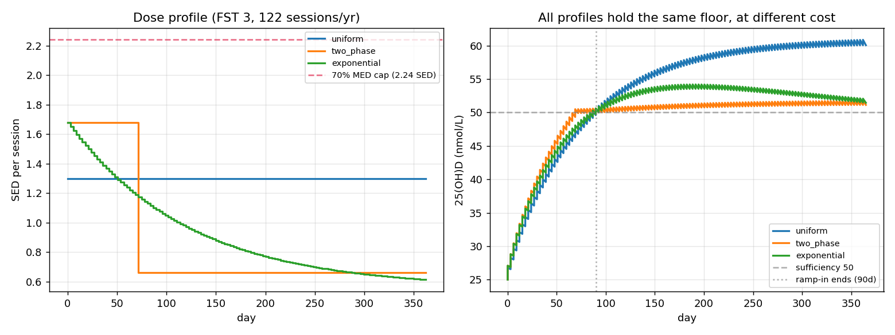
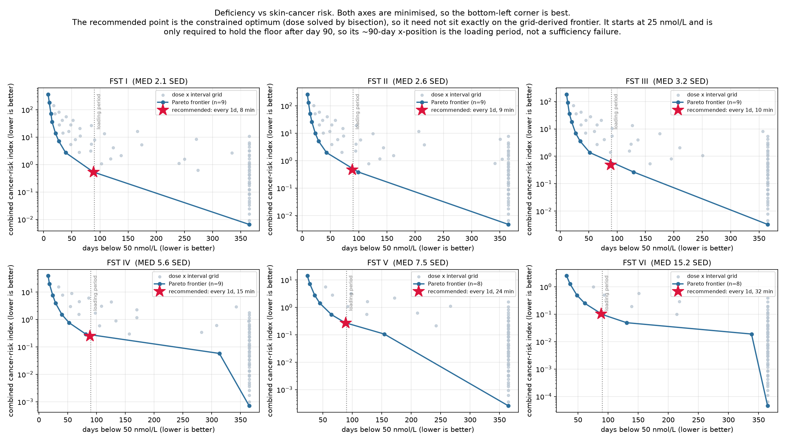

# Vitamin D Scheduling Model — Results

> **AUTO-GENERATED FILE — DO NOT HAND-EDIT.** Rewritten in full on every `run_all.py` run. Any manual edits here will be silently overwritten on the next run.

This report is generated by `run_all.py`. It captures the validation suite output, parameter sweeps, and a brief interpretation.

## 1. Validation

**12 / 15 checks passed.**

```
======================================================================
VALIDATION SUITE
======================================================================
[Sanity 1] D-dependent decay half-life (Datta 2017 power-law fit)
  D=132: t_half=87.8d (expected 89d, ±10%): OK
  D=65:  t_half=146.2d (expected 148d, ±10%): OK
  D=43:  t_half=196.9d (expected 199d, ±10%): OK
  Sim vs analytic ODE, D0=132 @89d:  74.711 vs 74.751 (±1%): OK
  Sim vs analytic ODE, D0=43 @199d:  24.378 vs 24.384 (±1%): OK
  PASS

[Sanity 2] Single bolus, FST III, untanned (computation-integrity check)
  delta-D = 1.27 nmol/L  (expected 1.27, ±2%)
  PASS

[Sanity 3] Photoadaptation reduction (FST III, M 0.21 -> 0.41 [M_ceiling])
  untanned synthesis: 1.27  tanned synthesis: 1.27
  reduction = 0.0%  (guard range 0-10%; evaluated at structural ceiling M_ceiling)
  PASS

[Lit 1] de Boer 2025 - photoadaptation direction (replaces Matsuoka 1990)
  Protocol: 0.8 SED 3x/week x 9 weeks, FST III (de Boer 2025)
  Baseline M=0.210, After M=0.224, increased: YES
  Baseline SC=0.0, After SC=0.1360, increased: YES
  Untanned delta-D=1.075, Tanned delta-D=0.939
  Synthesis decreased after photoadaptation: YES
  PASS

[SC Check] de Boer 2025 SC validation (warning-only)
  Protocol: 0.8 SED 3x/week x 9 weeks (T1 = 35 d, T2 = 63 d)
  FST III (FP I-III proxy, SC_max=0.23): SC=0.1404 (increased: YES, range [0.08,0.23]: OK)
  FST V  (FP IV-VI proxy, SC_max=0.36): SC=0.2198 (increased: YES, range [0.14,0.36]: OK)
  SC_V >= SC_III * 0.8: YES
  SHAPE (reported, not asserted): model T1=+0.134 T2=+0.136 vs observed -0.259 / +0.293
    Observed SC dips ~26% BELOW baseline at week 5. Model cannot
    reproduce that at k_damage=0.0, which is deliberate: the
    parameter is unidentifiable from 3 group medians. See
    scripts/fit_sc_deboer2025.py and MODEL_AND_EVIDENCE.md, 'Remaining gaps', gap 27.
  PASS (warning-only)

[Lit 2] Bogh 2012 - quantitative NB-UVB validation  [C1]
  Protocol: 18 sessions 3x/week x 6 weeks, cohort FST mix, baseline 19.2
  Dose: 9.0 J/cm2 cumulative -> 49.5 erythemal SED (TL-01 x5.5), E_source=2.44, BSA=0.9
  Model D_final = 75.6 nmol/L (delta = +56.4)
  Study observed: 19.2 -> 75.0 nmol/L, delta +55.8 nmol/L
  Acceptance: |delta - 55.8| <= 10.0 nmol/L  (range 45.8-65.8)
  PASS

[Lit 3] Farrar 2013 - FST V, 1.95 SED 3x/week x 6 weeks, baseline 30.0  [C2]
  Baseline proxy <50 nmol/L constraint: YES
  D_final = 45.7 nmol/L  (observed ~39.2 nmol/L; target 25-55)
  delta   = 15.7 nmol/L  (observed ~21.7 nmol/L; target 10-35)
  D_final in [25,55]: YES   delta in [10,35]: YES
  PASS

[Lit 4] Bogh 2010/P5 - baseline-dependent synthesis direction  [C4]
  1 SED, FST III, SC=0:
    delta at D=20:  1.319 nmol/L
    delta at D=80:  0.710 nmol/L
  direction (low-baseline > high-baseline): YES
  model ratio = 1.86  (P5-implied feedback ratio ~1.86; target 1.2-3.0)
  Note: full BSA term (5.5*ln(%BSA)) not modeled; direction check only
  PASS

[Lit 5] Karppinen 2017/P33 - baseline feedback calibration target
  Protocol: 1.18 SED/day x 10 days, FST III, BSA=0.07, E_source=2.0
  Saturating feedback mode (D_half_feedback = 90.0):
    Low baseline (62.4 nmol/L) change:  +3.58 nmol/L (observed +6.0)
    High baseline (116.9 nmol/L) change: -3.79 nmol/L (observed -6.7)
    Low baseline increased: YES
    High baseline decreased: YES
    Within target bounds: YES
  PASS

[New Check] Metric ordering and sanity assertions
  Mild schedule (0.1 SED every 7d, D0=25.0):
    auc_above_sufficiency (threshold 50): 0.0000 (target: 0.0)
    AUC above sufficiency = 0: YES
  Standard schedule (1.0 SED every 2d, D0=25.0):
    auc_above_baseline: 33.9096 (target: > 0.0)
    AUC above baseline > 0: YES
  PASS


[K_ATTEN seasonal amplitude] NH White vs NH Black seasonal rise
  Protocol: daily 0.333 SED x 84d, E_source=1.89, BSA=0.3
  NH White (FST=2, code 3): observed amplitude = 6.46, model amplitude = 11.14
  NH Black (FST=5, code 4): observed amplitude = 4.45, model amplitude = 18.15
  Observed ratio (White/Black): 1.449
  Model ratio (White/Black):    0.614
  Difference: -57.7% (target: within +/-50%)
  FAIL

[Lit 6] Kift 2013 - UK South Asian naturalistic exposure (FST V)
  Protocol: ~1.0 SED/wk (0.333 SED 3x/wk) x 12 weeks, FST V, BSA=0.14, baseline 22.5 nmol/L
  Model D_final = 26.5 nmol/L (delta = +4.0 nmol/L)
  Target bounds: D_final in [20, 40]: YES, delta in [0, 15]: YES
  PASS

[Held-out] Kallioglu 2024 skin-type gradient (WARNING-ONLY)
  1000 IU/d, 25% BSA, annual mean, Antalya 37N / Istanbul 41N
   FST  reported  rep ratio  model min  mod ratio
     1      5.05       1.00        4.5       1.00
     2      6.30       1.25        4.6       1.03
     3      7.60       1.50        4.9       1.09
     4     11.35       2.25        5.7       1.27
     5     15.15       3.00        6.6       1.47
     6     25.25       5.00        7.3       1.62
  FST VI:I  reported 5.00  model 1.62
  FST V:II  reported 2.40  model 1.43   (Webb/Kift independently: 2.5-3.0)
  FAIL - melanin penalty too weak; NOT closable by dosimetry (ratio is E_source-invariant)

======================================================================
PASSED REQUIRED: 9 / 10
PASSED WARNING-ONLY: 2 / 3
Audit change tags active: C1 C2 C3 C4 C6 (see module docstring)
C5 C7 C8: see vitd_model.py docstring and parameter comments
======================================================================

======================================================================
NHANES POPULATION VALIDATION
======================================================================

--- Part A: Seasonal direction check (warning-only) ---
  Group                     FST    Winter   Summer  Direction
  Mexican American           4     52.1    59.1  OK
  Non-Hispanic Asian         4     57.9    62.7  OK
  Non-Hispanic Black         5     43.3    49.0  OK
  Non-Hispanic White         2     68.7    76.4  OK
  Other Hispanic             4     57.5    61.1  OK
  Other/Multiracial          3     50.1    57.4  OK
  -> Direction check: PASS (all groups summer > winter)

--- Part B: Summer steady-state comparison (±10.0 nmol/L) ---
  Protocol: daily 0.333 SED, 84 days, E_source=1.89, BSA=0.3
  D0 = NHANES winter mean for each group.
  Group                     FST  Model_ss NHANES_summer   |diff|  Status
  Mexican American           4     65.7       59.1±0.4    6.7  PASS
  Non-Hispanic Asian         4     68.1       62.7±0.7    5.4  PASS
  Non-Hispanic Black         5     59.7       49.0±0.3   10.6  FAIL
  Non-Hispanic White         2     75.8       76.4±0.3    0.6  PASS
  Other Hispanic             4     67.9       61.1±0.5    6.8  PASS
  Other/Multiracial          3     68.0       57.4±1.0   10.7  FAIL
  -> Summer comparison: 4/6 passed (target: all within ±10.0 nmol/L)

--- Part C: Dietary source residual stratification ---
  Flag                      n  Fraction  Mean resid  Std resid
  UV-only                3702   17.73%      7.56     24.80
  food-only              8207   39.31%      5.21     23.77
  missing                6173   29.57%      8.57     21.40
  supplemented           2796   13.39%    -12.27     26.96
  Total                 20878   100.00%      4.28     24.66


```

## 2. Alpha sensitivity sweep (Priority 1 completed in Session 2)

Varies the photoadaptation rise rate (alpha) and checks whether the optimal inter-session interval shifts. Alpha was calibrated from light-skin Miyamura 2011 data and the handoff flagged that it may be larger in FST V-VI.

```

======================================================================
ANALYSIS A: alpha sensitivity sweep
======================================================================

Optimal interval by alpha (steady-state 25(OH)D framing, fixed 1 SED/session):

FST 5:
  alpha=0.010:  optimal interval = 1d (ss D 60.3, net_eff 0.46)
  alpha=0.025:  optimal interval = 1d (ss D 60.3, net_eff 0.46)
  alpha=0.050:  optimal interval = 1d (ss D 60.3, net_eff 0.46)
  alpha=0.100:  optimal interval = 1d (ss D 60.3, net_eff 0.46)
  alpha=0.200:  optimal interval = 1d (ss D 60.3, net_eff 0.46)
  alpha=0.400:  optimal interval = 1d (ss D 60.3, net_eff 0.46)

FST 6:
  alpha=0.010:  optimal interval = 1d (ss D 58.2, net_eff 0.44)
  alpha=0.025:  optimal interval = 1d (ss D 58.2, net_eff 0.44)
  alpha=0.050:  optimal interval = 1d (ss D 58.2, net_eff 0.44)
  alpha=0.100:  optimal interval = 1d (ss D 58.2, net_eff 0.44)
  alpha=0.200:  optimal interval = 1d (ss D 58.2, net_eff 0.44)
  alpha=0.400:  optimal interval = 1d (ss D 58.2, net_eff 0.44)

```


## 3. beta sensitivity sweep (tanning decay rate, NEW)

Varies beta (tanning decay rate). Ravnbak et al. 2008 (PMID 18480919) measured UVB tanning fade of 4-5 months in Scandinavians and Indians/Pakistanis. The prior citation (Tadokoro 2005, PMID 15955111) only measured 0-7 days post-exposure and does not report a decay timescale. The 56-day half-life (default beta) is a mid-range estimate compatible with Ravnbak 2008 if complete fading requires ~3 e-folding times. The sweep covers half-lives of 21-120 days.

```

======================================================================
ANALYSIS E: beta sensitivity sweep (tanning decay rate)
======================================================================

Optimal interval by beta half-life (steady-state 25(OH)D framing, fixed 1 SED/session):

FST 5:
  t1/2= 21d:  opt interval=1d (D 60.3, net_eff 0.46)
  t1/2= 30d:  opt interval=1d (D 60.3, net_eff 0.46)
  t1/2= 56d:  opt interval=1d (D 60.3, net_eff 0.46)
  t1/2= 80d:  opt interval=1d (D 60.3, net_eff 0.46)
  t1/2=120d:  opt interval=1d (D 60.3, net_eff 0.46)

FST 6:
  t1/2= 21d:  opt interval=1d (D 58.2, net_eff 0.44)
  t1/2= 30d:  opt interval=1d (D 58.2, net_eff 0.44)
  t1/2= 56d:  opt interval=1d (D 58.2, net_eff 0.44)
  t1/2= 80d:  opt interval=1d (D 58.2, net_eff 0.44)
  t1/2=120d:  opt interval=1d (D 58.2, net_eff 0.44)

```


## 4. K_ATTEN sensitivity sweep

Varies the melanin attenuation coefficient (K_ATTEN). The default value is now 0.37 (paper-backed from Young 2020 FST II:VI ratio). The sweep explores sensitivity around this value.

```

======================================================================
ANALYSIS B: K_ATTEN sensitivity sweep
======================================================================

Optimal interval by K_ATTEN (steady-state 25(OH)D framing):

FST 5:
  K=0.2:  opt interval=1d (D 60.3, net_eff 0.46)
  K=0.5:  opt interval=1d (D 60.1, net_eff 0.46)
  K=1.0:  opt interval=1d (D 60.0, net_eff 0.46)
  K=2.0:  opt interval=1d (D 59.6, net_eff 0.45)
  K=4.0:  opt interval=1d (D 58.9, net_eff 0.44)
  K=8.0:  opt interval=1d (D 57.5, net_eff 0.42)

FST 6:
  K=0.2:  opt interval=1d (D 58.1, net_eff 0.44)
  K=0.5:  opt interval=1d (D 58.0, net_eff 0.43)
  K=1.0:  opt interval=1d (D 57.9, net_eff 0.43)
  K=2.0:  opt interval=1d (D 57.5, net_eff 0.43)
  K=4.0:  opt interval=1d (D 56.9, net_eff 0.42)
  K=8.0:  opt interval=1d (D 55.6, net_eff 0.40)

```


## 5. Two-framing schedule comparison

Central handoff finding: the optimal interval depends on what's being optimized.

- **Framing 1**: matched cumulative SED (42 SED over 12 weeks). UV budget is the constraint; we just choose how to distribute it.
- **Framing 2**: matched per-session dose (1 SED per session). Per-session dose is fixed; cumulative UV exposure varies with frequency.

```

======================================================================
ANALYSIS C: two-framing schedule comparison
======================================================================

Framing 1 (matched cumulative SED = 42):
 FST  interval_days  sed_per_session  n_sessions  cumulative_SED  steady_state_D  final_D  final_M  net_final_D_change_per_SED  auc_above_baseline_per_SED  auc_above_sufficiency_per_SED
   5              1             0.50          84           42.00           47.77    50.41     0.79                        0.61                       30.24                           0.02
   5              2             1.00          42           42.00           44.68    46.85     0.79                        0.52                       26.20                           0.00
   5              3             1.50          28           42.00           42.45    44.24     0.79                        0.46                       23.33                           0.00
   5              5             2.47          17           42.00           39.34    40.77     0.80                        0.38                       19.33                           0.00
   5              7             3.50          12           42.00           37.36    38.15     0.80                        0.31                       16.91                           0.00
   5             10             4.67           9           42.00           34.98    36.40     0.81                        0.27                       13.93                           0.00
   5             14             7.00           6           42.00           33.52    33.37     0.82                        0.20                       12.21                           0.00
   5             21            10.50           4           42.00           31.42    30.93     0.83                        0.14                       10.00                           0.00
   6              1             0.50          84           42.00           46.19    48.69     1.01                        0.56                       28.07                           0.00
   6              2             1.00          42           42.00           43.25    45.29     1.01                        0.48                       24.26                           0.00
   6              3             1.50          28           42.00           41.14    42.82     1.01                        0.42                       21.55                           0.00
   6              5             2.47          17           42.00           38.20    39.52     1.01                        0.35                       17.78                           0.00
   6              7             3.50          12           42.00           36.33    37.05     1.02                        0.29                       15.50                           0.00
   6             10             4.67           9           42.00           34.10    35.39     1.02                        0.25                       12.71                           0.00
   6             14             7.00           6           42.00           32.72    32.54     1.03                        0.18                       11.09                           0.00
   6             21            10.50           4           42.00           30.75    30.25     1.05                        0.13                        9.02                           0.00

Framing 2 (matched 1 SED per session):
 FST  interval_days  sed_per_session  n_sessions  cumulative_SED  steady_state_D  final_D  final_M  net_final_D_change_per_SED  auc_above_baseline_per_SED  auc_above_sufficiency_per_SED
   5              1             1.00          84           84.00           60.32    63.92     0.80                        0.46                       23.87                           4.03
   5              2             1.00          42           42.00           44.68    46.85     0.79                        0.52                       26.20                           0.00
   5              3             1.00          28           28.00           38.34    39.74     0.79                        0.53                       26.60                           0.00
   5              5             1.00          17           17.00           32.61    33.37     0.78                        0.49                       25.15                           0.00
   5              7             1.00          12           12.00           29.85    30.06     0.78                        0.42                       23.18                           0.00
   5             10             1.00           9            9.00           27.66    28.07     0.78                        0.34                       17.82                           0.00
   5             14             1.00           6            6.00           26.09    25.69     0.78                        0.12                       12.64                           0.00
   5             21             1.00           4            4.00           24.64    24.09     0.78                       -0.23                        4.28                           0.00
   6              1             1.00          84           84.00           58.20    61.67     1.02                        0.44                       22.34                           3.03
   6              2             1.00          42           42.00           43.25    45.29     1.01                        0.48                       24.26                           0.00
   6              3             1.00          28           28.00           37.26    38.55     1.01                        0.48                       24.42                           0.00
   6              5             1.00          17           17.00           31.87    32.55     1.00                        0.44                       22.72                           0.00
   6              7             1.00          12           12.00           29.29    29.44     1.00                        0.37                       20.54                           0.00
   6             10             1.00           9            9.00           27.24    27.57     1.00                        0.29                       15.17                           0.00
   6             14             1.00           6            6.00           25.77    25.35     1.00                        0.06                        9.60                           0.00
   6             21             1.00           4            4.00           24.42    23.86     1.00                       -0.29                        3.04                           0.00
  Safety [FST 5, framing 1, 21d interval, 10.5 SED/session]: max single dose = 140.0% MED (10.50 SED), cumulative = 42.0 SED over 4 sessions *** OVERDOSE ***
  Safety [FST 5, framing 2, 21d interval, 1.0 SED/session]: max single dose = 13.3% MED (1.00 SED), cumulative = 4.0 SED over 4 sessions

```


## 6. Fine-grid interval sweep

Sweeps intervals from 1–35 days in 1-day steps to find the exact optimal interval under each framing. Complements the coarse integer-interval analysis in the two-framing comparison.

```

======================================================================
ANALYSIS F: fine-grid interval sweep (1-30 days)
======================================================================

Fine-grid optimal interval (steady-state 25(OH)D framing):
  FST 5: optimal interval = 1d (ss_D 60.3, net_eff 0.463)
  FST 6: optimal interval = 1d (ss_D 58.2, net_eff 0.437)
  Safety [Best: FST 5, every 1.0d, 1.0 SED]: max single dose = 13.3% MED (1.00 SED), cumulative = 84.0 SED over 84 sessions

```

## 7. Continuous optimization (scipy.optimize)

Uses scipy.optimize.minimize_scalar (bounded Brent) to find the continuous-valued interval that maximizes net ΔD per SED and, separately, steady-state D, confirming the discrete sweep.

```

======================================================================
ANALYSIS G: continuous optimization (scipy.optimize)
======================================================================

FST 5:
  Net-change optimum: interval=3d, net_change=0.526 nmol/L/SED (31 function evals)
  Absolute D optimum: interval=2d, steady_state_D=44.7 nmol/L (32 function evals)
  Cross-check: ss_D at net-change optimum = 38.3, net_change at D optimum = 0.520
  AUC deficit at 50 nmol/L for optimal schedule: 1355.3
  AUC deficit at 30 nmol/L for optimal schedule: 38.9

FST 6:
  Net-change optimum: interval=3d, net_change=0.484 nmol/L/SED (31 function evals)
  Absolute D optimum: interval=2d, steady_state_D=43.3 nmol/L (32 function evals)
  Cross-check: ss_D at net-change optimum = 37.3, net_change at D optimum = 0.483
  AUC deficit at 50 nmol/L for optimal schedule: 1416.2
  AUC deficit at 30 nmol/L for optimal schedule: 43.8

```

## 8. Maximum interval for sufficiency

Finds the longest inter-session interval where steady-state D stays above 50 nmol/L under 1 SED/session dosing.

```

======================================================================
ANALYSIS H: maximum interval for sufficiency
======================================================================
  FST 5: max interval = 1d (D_ss = 60.3 nmol/L)
  FST 6: max interval = 1d (D_ss = 58.2 nmol/L)
  Saved figs/max_interval_sufficiency.png

```


## 9. Loading dose optimization

For UV budgets of 2-20 SED in the first 14 days, tests splitting that budget across 1-14 sessions. After loading, all schedules switch to 1 SED every 7 days maintenance.

```

======================================================================
ANALYSIS I: loading dose optimization
======================================================================

  Best loading distribution by budget:
    FST 5, 2 SED: 7 sessions × 0.3 SED → D(day14)=26.9, D(day84)=30.4
    FST 6, 2 SED: 7 sessions × 0.3 SED → D(day14)=26.7, D(day84)=29.7
    FST 5, 5 SED: 7 sessions × 0.7 SED → D(day14)=29.5, D(day84)=31.9
    FST 6, 5 SED: 7 sessions × 0.7 SED → D(day14)=29.1, D(day84)=31.2
    FST 5, 10 SED: 7 sessions × 1.4 SED → D(day14)=32.2, D(day84)=33.6
    FST 6, 10 SED: 7 sessions × 1.4 SED → D(day14)=31.7, D(day84)=32.7
    FST 5, 15 SED: 7 sessions × 2.1 SED → D(day14)=34.1, D(day84)=34.6
    FST 6, 15 SED: 7 sessions × 2.1 SED → D(day14)=33.4, D(day84)=33.8
    FST 5, 20 SED: 7 sessions × 2.9 SED → D(day14)=35.4, D(day84)=35.5
    FST 6, 20 SED: 7 sessions × 2.9 SED → D(day14)=34.7, D(day84)=34.5

  Saved figs/loading_dose_D_at_day14.png
  Safety [FST 5, 20 SED loading in 1 session]: max single dose = 266.7% MED (20.00 SED), cumulative = 32.0 SED over 13 sessions *** OVERDOSE ***
  Safety [FST 5, 2 SED daily — aggressive loading]: max single dose = 26.7% MED (2.00 SED), cumulative = 168.0 SED over 84 sessions

```


## 10. Maintenance dose splitting

Compares 1 SED every T days vs 0.5 SED every T/2 days at the same total UV rate. Tests T = 7, 14, 21 days.

```

======================================================================
ANALYSIS J: maintenance dose splitting
======================================================================

  FST 5:
    T= 7d: single D_ss=29.9 | split D_ss=31.2 → split
    T=14d: single D_ss=26.1 | split D_ss=26.6 → split
    T=21d: single D_ss=24.6 | split D_ss=25.1 → split

  FST 6:
    T= 7d: single D_ss=29.3 | split D_ss=30.5 → split
    T=14d: single D_ss=25.8 | split D_ss=26.3 → split
    T=21d: single D_ss=24.4 | split D_ss=24.8 → split

  Saved figs/maintenance_split.png
  Safety [FST 5, single 1 SED every 7d]: max single dose = 13.3% MED (1.00 SED), cumulative = 12.0 SED over 12 sessions

```


## 11. Sun exposure scheduling (no equipment)

Practical sun exposure scheduling: how many minutes of midday sun, how often, to maintain sufficiency? Uses spring/fall moderate conditions (UV index ~5), arms + face exposure (~30% BSA), E_source = 1.0.

```

======================================================================
ANALYSIS K: sun exposure scheduling (no equipment)
======================================================================

  Practical sun exposure schedules (spring/fall, arms+face):
    FST 5: daily_10min          7/wk (actual 7.00/wk)   70 min/wk → D_ss=79.2 [OK]
    FST 5: 3xwk_20min           3/wk (actual 3.50/wk)   60 min/wk → D_ss=67.5 [OK]
    FST 5: 2xwk_30min           2/wk (actual 1.75/wk)   60 min/wk → D_ss=53.2 [OK]
    FST 5: weekly_45min         1/wk (actual 1.00/wk)   45 min/wk → D_ss=44.9 [BELOW]
    FST 5: minimal_15min_3x     3/wk (actual 3.50/wk)   45 min/wk → D_ss=63.6 [OK]
    FST 5: ultra_10min_2x       2/wk (actual 1.75/wk)   20 min/wk → D_ss=43.4 [BELOW]
    FST 6: daily_10min          7/wk (actual 7.00/wk)   70 min/wk → D_ss=76.5 [OK]
    FST 6: 3xwk_20min           3/wk (actual 3.50/wk)   60 min/wk → D_ss=65.1 [OK]
    FST 6: 2xwk_30min           2/wk (actual 1.75/wk)   60 min/wk → D_ss=51.4 [OK]
    FST 6: weekly_45min         1/wk (actual 1.00/wk)   45 min/wk → D_ss=43.5 [BELOW]
    FST 6: minimal_15min_3x     3/wk (actual 3.50/wk)   45 min/wk → D_ss=61.3 [OK]
    FST 6: ultra_10min_2x       2/wk (actual 1.75/wk)   20 min/wk → D_ss=42.1 [BELOW]

  Minimum daily exposure for sufficiency:
    FST 5: 5 min/day (35 min/week, 0.1 hr/day) → D_ss=66.0 nmol/L
    FST 6: 5 min/day (35 min/week, 0.1 hr/day) → D_ss=63.7 nmol/L

  Saved figs/sun_exposure_minutes_vs_D.png
  Saved figs/sun_exposure_weekly_minutes.png
  Safety [FST 5, weekly 45 min sun]: max single dose = 89.6% MED (6.72 SED), cumulative = 80.6 SED over 12 sessions

  NOTE: Assumes spring/fall midday sun (UV index ~5). Summer sun ~2x more efficient; winter ~0.5x.
  Arms + face exposure (~30% BSA). More skin = less time needed.

```


## 12. Example trajectories

D(t) and M(t) under three representative schedules at fixed 1 SED per session. Shows the temporal dynamics directly.


## 13. Constant-sessions analysis

15 sessions over 84 days, varying spacing patterns ranked by AUC deficiency below 50 nmol/L + safety sidecar.

```

======================================================================
ANALYSIS L: constant-sessions optimization sweep
======================================================================

  Using E_source = 1.89 for constant-sessions sweep.

  Saved tables/constant_sessions_analysis.csv

  Optimal schedule: 52 sessions
    SED/session:     1.000
    Interval:        7.0 days
    Max D:           45.0 nmol/L
    AUC deficit @50: 4010.8 nmol/L·days
    Net ΔD/SED:      0.363 nmol/L/SED

    N  SED/sesh  Interval   Max D  Deficit@50  NetΔD/SED  Roll7d                 Flag
  --- --------- --------- ------- ----------- ---------- ------- --------------------
    1   52.000    365.0    32.0     10418.2     -0.198    52.0     UV safety: review
    2   26.000    182.5    30.9      9790.8     -0.139    26.0     UV safety: review
    3   17.333    121.7    30.3      9338.3     -0.094    17.3     UV safety: review
    4   13.000     91.2    29.9      8974.0     -0.058    13.0     UV safety: review
    5   10.400     73.0    29.6      8664.8     -0.027    10.4     UV safety: review
    6    8.667     60.8    29.3      8393.0     -0.001     8.7     UV safety: review
    7    7.429     52.1    29.9      8148.8      0.022     7.4     UV safety: review
    8    6.500     45.6    30.7      7926.0      0.043     6.5     UV safety: review
    9    5.778     40.6    31.5      7720.6      0.061     5.8     UV safety: review
   10    5.200     36.5    32.2      7529.9      0.078     5.2     UV safety: review
   11    4.727     33.2    32.8      7351.7      0.094     4.7                      
   12    4.333     30.4    33.4      7184.5      0.109     4.3                      
   13    4.000     28.1    34.0      7027.0      0.123     4.0                      
   14    3.714     26.1    34.6      6878.2      0.136     3.7                      
   15    3.467     24.3    35.1      6737.2      0.148     3.5                      
   16    3.250     22.8    35.6      6603.2      0.159     3.2                      
   17    3.059     21.5    36.1      6475.8      0.170     3.1                      
   18    2.889     20.3    36.6      6354.2      0.180     2.9                      
   19    2.737     19.2    37.0      6238.1      0.189     2.7                      
   20    2.600     18.2    37.4      6127.0      0.199     2.6                      
   21    2.476     17.4    37.8      6020.6      0.207     2.5                      
   22    2.364     16.6    38.2      5918.5      0.216     2.4                      
   23    2.261     15.9    38.5      5820.4      0.224     2.3                      
   24    2.167     15.2    38.9      5726.1      0.231     2.2                      
   25    2.080     14.6    39.2      5635.4      0.238     2.1                      
   26    2.000     14.0    39.5      5547.9      0.245     2.0                      
   27    1.926     13.5    39.8      5463.5      0.252     1.9                      
   28    1.857     13.0    40.1      5382.1      0.259     1.9                      
   29    1.793     12.6    40.4      5303.4      0.265     1.8                      
   30    1.733     12.2    40.7      5227.4      0.271     1.7                      
   31    1.677     11.8    41.0      5153.8      0.276     1.7                      
   32    1.625     11.4    41.2      5082.5      0.282     1.6                      
   33    1.576     11.1    41.5      5013.5      0.287     1.6                      
   34    1.529     10.7    41.7      4946.5      0.293     1.5                      
   35    1.486     10.4    41.9      4881.6      0.298     1.5                      
   36    1.444     10.1    42.2      4818.6      0.302     1.4                      
   37    1.405      9.9    42.4      4757.4      0.307     1.4                      
   38    1.368      9.6    42.6      4697.9      0.312     1.4                      
   39    1.333      9.4    42.8      4640.1      0.316     1.3                      
   40    1.300      9.1    43.0      4583.8      0.320     1.3                      
   41    1.268      8.9    43.2      4529.1      0.325     1.3                      
   42    1.238      8.7    43.4      4475.8      0.329     1.2                      
   43    1.209      8.5    43.6      4423.9      0.333     1.2                      
   44    1.182      8.3    43.8      4373.3      0.336     1.2                      
   45    1.156      8.1    43.9      4324.0      0.340     1.2                      
   46    1.130      7.9    44.1      4276.0      0.344     1.1                      
   47    1.106      7.8    44.3      4229.1      0.347     1.1                      
   48    1.083      7.6    44.4      4183.3      0.351     1.1                      
   49    1.061      7.4    44.6      4138.7      0.354     1.1                      
   50    1.040      7.3    44.7      4095.0      0.357     1.0                      
   51    1.020      7.2    44.9      4052.4      0.360     1.0                      
   52    1.000      7.0    45.0      4010.8      0.363     1.0                      

```

## 13b. Variable-dose optimisation

Every other analysis in this repository fixes one dose and searches only *when* to dose. This frees the dose of each session and asks what that buys, holding the sufficiency floor and the session count fixed so the comparison cannot be won by dosing less or going outside more.

At a fixed budget **and** session count, variable dose cannot help: the intermittency term is convex in the doses, so equal doses minimise it by Jensen's inequality. The gain instead comes from needing a smaller budget — a single constant dose has to both climb to the target and hold there, so it necessarily overshoots in steady state. Splitting those two jobs is the whole effect, which is also why it shrinks as the session count rises and the per-session dose is already small.

`seasonal` and `gap_coupled` returning the uniform optimum is the correct result, not a search failure: their grids contain the constant-dose special case (amplitude 0, exponent 0) and select it. Seasonality matters here as a *constraint* on achievable dose, not as a free choice — see `dose_seasonal`.

Time-to-sufficiency is now reported because constraint C3 starts at `RAMP_IN_DAYS` and so cannot see how fast a schedule climbs; two schedules that both hold the floor from day 90 are scored identically by C3 even when one reaches sufficiency a month sooner.

```

======================================================================
ANALYSIS M: variable-dose optimisation
======================================================================

  min combined cancer risk  s.t.  min D(t >= ramp) >= 50 nmol/L,
  per-session dose <= 0.7 MED, sessions uniformly spaced.
  Dose framing: absolute SED per session (not fractional MED).

  FST    N       family      risk  vs unif%   totSED  SED sav%  trough  t->suff
  ----------------------------------------------------------------------------------
    2  104      uniform    5.7348       0.0    168.8       0.0   50.00      84d
    2  104    two_phase    2.1812      62.0     96.2      43.0   50.00      77d
    2  104  exponential    2.3350      59.3    104.2      38.3   50.00      84d
    2  104     seasonal    5.7348       0.0    168.8       0.0   50.00      84d
    2  104  gap_coupled    5.7348       0.0    168.8       0.0   50.00      84d

    2  122      uniform    3.8304       0.0    152.2       0.0   50.00      87d
    2  122    two_phase    1.5149      60.5     90.1      40.8   50.00      81d
    2  122  exponential    1.8195      52.5     93.5      38.6   50.00      78d
    2  122     seasonal    3.8304       0.0    152.2       0.0   50.00      87d
    2  122  gap_coupled    3.8304       0.0    152.2       0.0   50.00      87d

    2  146      uniform    2.8270       0.0    144.4       0.0   50.00      85d
    2  146    two_phase    1.4752      47.8     90.3      37.4   50.00      62d
    2  146  exponential    1.3866      51.0    100.2      30.6   50.00      85d
    2  146     seasonal    2.8270       0.0    144.4       0.0   50.00      85d
    2  146  gap_coupled    2.8270       0.0    144.4       0.0   50.00      85d

    2  183      uniform    1.7878       0.0    130.8       0.0   50.00      88d
    2  183    two_phase    0.8299      53.6     81.2      37.9   50.00      68d
    2  183  exponential    0.8854      50.5     91.2      30.3   50.00      88d
    2  183     seasonal    1.7878       0.0    130.8       0.0   50.00      88d
    2  183  gap_coupled    1.7878       0.0    130.8       0.0   50.00      88d

    3  104      uniform    4.8021       0.0    182.8       0.0   50.00      84d
    3  104    two_phase    2.2467      53.2    109.2      40.2   50.00      70d
    3  104  exponential    1.9626      59.1    109.1      40.3   50.00      84d
    3  104     seasonal    4.8021       0.0    182.8       0.0   50.00      84d
    3  104  gap_coupled    4.8021       0.0    182.8       0.0   50.00      84d

    3  122      uniform    3.1671       0.0    163.9       0.0   50.00      87d
    3  122    two_phase    1.5508      51.0    102.1      37.7   50.00      72d
    3  122  exponential    1.5649      50.6    108.1      34.1   50.00      78d
    3  122     seasonal    3.1671       0.0    163.9       0.0   50.00      87d
    3  122  gap_coupled    3.1671       0.0    163.9       0.0   50.00      87d

    3  146      uniform    2.3149       0.0    154.8       0.0   50.00      85d
    3  146    two_phase    0.8661      62.6     90.3      41.7   50.00      80d
    3  146  exponential    1.1359      50.9    107.5      30.5   50.00      85d
    3  146     seasonal    2.3149       0.0    154.8       0.0   50.00      85d
    3  146  gap_coupled    2.3149       0.0    154.8       0.0   50.00      85d

    3  183      uniform    1.4474       0.0    139.5       0.0   50.00      88d
    3  183    two_phase    0.8245      43.0     94.0      32.7   50.00      70d
    3  183  exponential    0.7171      50.5     97.3      30.3   50.00      88d
    3  183     seasonal    1.4474       0.0    139.5       0.0   50.00      88d
    3  183  gap_coupled    1.4474       0.0    139.5       0.0   50.00      88d

    5  104      uniform    1.2630       0.0    306.4       0.0   50.00      84d
    5  104    two_phase    0.5993      52.6    175.3      42.8   50.00      70d
    5  104  exponential    0.5369      57.5    189.5      38.2   50.00      84d
    5  104     seasonal    1.2630       0.0    306.4       0.0   50.00      84d
    5  104  gap_coupled    1.2630       0.0    306.4       0.0   50.00      84d

    5  122      uniform    0.7503       0.0    262.8       0.0   50.00      87d
    5  122    two_phase    0.3298      56.0    152.9      41.8   50.00      75d
    5  122  exponential    0.3225      57.0    163.3      37.8   50.00      87d
    5  122     seasonal    0.7503       0.0    262.8       0.0   50.00      87d
    5  122  gap_coupled    0.7503       0.0    262.8      -0.0   50.00      87d

    5  146      uniform    0.5071       0.0    240.1       0.0   50.00      85d
    5  146    two_phase    0.2997      40.9    153.7      36.0   50.00      58d
    5  146  exponential    0.2126      58.1    147.7      38.5   50.00      85d
    5  146     seasonal    0.5071       0.0    240.1       0.0   50.00      85d
    5  146  gap_coupled    0.5071       0.0    240.1       0.0   50.00      85d

    5  183      uniform    0.2890       0.0    208.1       0.0   50.00      88d
    5  183    two_phase    0.2667       7.7    139.5      33.0   50.00      44d
    5  183  exponential    0.1417      51.0    136.8      34.2   50.00      80d
    5  183     seasonal    0.2890       0.0    208.1       0.0   50.00      88d
    5  183  gap_coupled    0.2890       0.0    208.1       0.0   50.00      88d

  Lowest-risk family at each operating point:
    FST 2, 104 sessions/yr: two_phase (62.0% less risk, 43.0% less total UV)
    FST 2, 122 sessions/yr: two_phase (60.5% less risk, 40.8% less total UV)
    FST 2, 146 sessions/yr: exponential (51.0% less risk, 30.6% less total UV)
    FST 2, 183 sessions/yr: two_phase (53.6% less risk, 37.9% less total UV)
    FST 3, 104 sessions/yr: exponential (59.1% less risk, 40.3% less total UV)
    FST 3, 122 sessions/yr: two_phase (51.0% less risk, 37.7% less total UV)
    FST 3, 146 sessions/yr: two_phase (62.6% less risk, 41.7% less total UV)
    FST 3, 183 sessions/yr: exponential (50.5% less risk, 30.3% less total UV)
    FST 5, 104 sessions/yr: exponential (57.5% less risk, 38.2% less total UV)
    FST 5, 122 sessions/yr: exponential (57.0% less risk, 37.8% less total UV)
    FST 5, 146 sessions/yr: exponential (58.1% less risk, 38.5% less total UV)
    FST 5, 183 sessions/yr: exponential (51.0% less risk, 34.2% less total UV)

  Interpretation. At fixed budget AND session count the
  intermittency term is convex in the doses, so equal doses minimise
  it (Jensen) -- variable dose cannot win on the risk axis alone.
  Every gain below therefore comes from needing LESS total UV:
  a constant dose must both climb to target and hold there, so it
  overshoots in steady state. The gain shrinks as sessions rise,
  because a frequent schedule already runs a small per-session dose.

  Absolute D inherits the uncalibrated SC priors (SC_max, alpha_SC,
  K_SC); rankings within a skin type are more robust than levels.

  Saved tables/variable_dose_optimization.csv
  Saved figs/variable_dose_profiles.png

```



## 13c. Joint timing + dose optimisation

Section 13b frees the dose but keeps sessions uniformly spaced. This searches spacing and dose together, using a one-parameter monotone warp of the session days (`gamma = 1` is uniform) on top of the dose families.

**A session budget is part of the problem, not an add-on.** Without one the joint optimum is degenerate: at fixed cumulative dose the intermittency term is minimised by spreading over as many days as possible, so risk falls monotonically all the way to a daily schedule — which is what section 14b already reports from a different direction. The meaningful object is therefore the frontier over a session budget, and that budget is set by adherence rather than photobiology.

**This does not need to be mixed-integer.** `d_t = 0` already means 'no session that day', so a dose vector encodes timing and dose together with no integer variables — the encoding used in maximum-hands-off control (Nagahara, Quevedo & Nešić 2016, *IEEE TAC* 61:735-747). Their L1 = L0 equivalence is proved for linear dynamics and is not established for this nonlinear system, so it motivates the formulation rather than justifying it; `scripts/joint_schedule_freesolve.py` checks the answer against a direct 365-variable solve instead of assuming it.

**The comparison is against uniform spacing searched by the same solver at the same budget**, not against the coarse grid of 13b. The spacing dimension is present in both arms and merely inert in the control, because `differential_evolution` sizes its population as `popsize × n_parameters` — giving the free arm an extra dimension would also give it ~33% more evaluations and confound spacing with search effort.

```

======================================================================
ANALYSIS N: joint timing + dose optimisation
======================================================================

  min combined cancer risk  s.t.  min D(t >= ramp) >= 50 nmol/L,
  per-session dose <= 0.7 MED, session budget fixed per row.
  Control arm pins spacing to uniform; treatment arm frees the
  spacing exponent. Same solver and budget in both.

  A session budget is part of the problem: without one the optimum
  is degenerate (risk falls monotonically to a daily schedule),
  because at fixed cumulative dose the intermittency term is
  minimised by spreading over as many days as possible.

  FST    N   spacing       family  gamma      risk  vs unif%   totSED  t->suff
  ----------------------------------------------------------------------------------
    2  104   uniform    two_phase   1.00    1.9431       0.0     94.5      84d
    2  104      free  exponential   1.35    1.5937      18.0     97.6      83d

    2  146   uniform    two_phase   1.00    0.9943       0.0     83.4      85d
    2  146      free  exponential   1.38    0.8679      12.7     87.2      85d

    2  183   uniform    two_phase   1.00    0.7333       0.0     79.8      78d
    2  183      free    two_phase   1.28    0.6060      17.4     81.8      85d

    2  260   uniform    two_phase   1.00    0.3903       0.0     73.2      88d
    2  260      free    two_phase   1.55    0.3637       6.8     76.8      86d

    3  104   uniform    two_phase   1.00    1.6092       0.0    101.5      84d
    3  104      free    two_phase   1.32    1.2671      21.3    103.1      83d

    3  146   uniform    two_phase   1.00    0.8110       0.0     89.1      85d
    3  146      free    two_phase   1.36    0.6986      13.9     92.5      83d

    3  183   uniform    two_phase   1.00    0.5498       0.0     84.1      88d
    3  183      free    two_phase   1.28    0.4945      10.1     87.5      88d

    3  260   uniform    two_phase   1.00    0.3165       0.0     77.8      87d
    3  260      free  exponential   1.14    0.3291      -4.0     83.3      86d

    5  104   uniform    two_phase   1.00    0.3914       0.0    159.2      84d
    5  104      free    two_phase   1.33    0.2716      30.6    158.2      82d

    5  146   uniform    two_phase   1.00    0.1759       0.0    137.9      85d
    5  146      free    two_phase   1.29    0.1338      23.9    134.0      78d

    5  183   uniform    two_phase   1.00    0.1051       0.0    120.1      86d
    5  183      free  exponential   1.43    0.0887      15.6    125.8      85d

    5  260   uniform    two_phase   1.00    0.0559       0.0    108.9      88d
    5  260      free  exponential   1.29    0.0518       7.3    115.3      87d

  Free spacing vs uniform spacing, 12 operating points:
    median gain +14.71%   best +30.62%   worst -3.99%
    gamma chosen: median 1.33 (1.00 = uniform), range 1.14-1.55

    A negative entry is not a real loss: gamma = 1 is
    inside the search bounds, so the free arm can reproduce
    the control exactly and cannot truly do worse. The worst
    entry (-4.0%) therefore bounds solver noise, and
    gains below roughly 4% should not be read as real.

  Mechanism. Free spacing does NOT win by lowering cumulative dose
  -- total SED is usually slightly HIGHER. It wins by lowering the
  PEAK per-session dose: bunching sessions more densely early lets
  the loading phase use smaller individual doses. The intermittency
  term is cubic in per-session dose while the SCC term is a 1.7 power
  of the cumulative, so trading a small cumulative increase for a
  large peak reduction is strongly favourable.

  This REVERSES the fixed-dose result: at fixed dose, spacing only
  redistributes an unchangeable per-session intensity, and uniform
  spacing wins by minimising the largest gap. Once dose is free,
  spacing acquires a second job -- setting how much dose each session
  needs to carry -- and front-loading takes over.

  Precisely: the search selected gamma > 1 at 12 of 12 points,
  and beat the uniform control at 11 of 12.
  The 1 remaining point(s) sit inside the solver-noise bound
  above, so they are not evidence against front-loading -- but
  they are not evidence for it either. The claim is 11/12, not unanimous.

  Saved tables/joint_schedule_optimization.csv

```

## 14. Decision problems (recommended objectives)

The sweeps above used to maximise the retired per-SED efficiency metric (removed from the code on 2026-07-31), which rose monotonically as dosing approaches zero and whose reported optima ended *below* their starting 25(OH)D. These are the same questions posed so that cumulative UV is held fixed, or so that cancer risk is scored alongside the vitamin D outcome.

```
==========================================================================
Q1. FIXED SESSION BUDGET: 'I can get outside N times in 12 weeks'
==========================================================================
Cumulative UV is IDENTICAL across every candidate spacing, so no
spacing can win by simply dosing less.

  FST 5, 1.0 SED/session, 84-day horizon, baseline 25 nmol/L:
    sessions  best gap   mean D  final D   min D   d<50  melanoma
           6        1d     27.4     24.8    24.8     84     0.001   (mean D spread across spacings: 1.8)
          12        1d     31.0     28.2    25.0     84     0.001   (mean D spread across spacings: 2.7)
          18        1d     34.0     31.4    25.0     84     0.002   (mean D spread across spacings: 2.7)
          24        1d     36.5     34.4    25.0     84     0.003   (mean D spread across spacings: 3.0)
          36        1d     40.6     40.2    25.0     84     0.004   (mean D spread across spacings: 3.1)

  FST 5, 3.0 SED/session, 84-day horizon, baseline 25 nmol/L:
    sessions  best gap   mean D  final D   min D   d<50  melanoma
           6        1d     31.1     27.9    25.0     84     0.018   (mean D spread across spacings: 2.9)
          12        1d     37.0     33.5    25.0     84     0.036   (mean D spread across spacings: 4.3)
          18        1d     41.9     38.6    25.0     84     0.054   (mean D spread across spacings: 4.3)
          24        1d     46.1     43.4    25.0     57     0.072   (mean D spread across spacings: 4.8)
          36        1d     52.7     52.3    25.0     19     0.108   (mean D spread across spacings: 4.9)

  FST 6, 3.0 SED/session, 84-day horizon, baseline 25 nmol/L:
    sessions  best gap   mean D  final D   min D   d<50  melanoma
           6        1d     30.5     27.5    25.0     84     0.001   (mean D spread across spacings: 2.8)
          12        1d     36.1     32.7    25.0     84     0.002   (mean D spread across spacings: 4.0)
          18        1d     40.8     37.6    25.0     84     0.003   (mean D spread across spacings: 4.1)
          24        1d     44.7     42.1    25.0     66     0.004   (mean D spread across spacings: 4.6)
          36        1d     51.0     50.7    25.0     20     0.007   (mean D spread across spacings: 4.7)

==========================================================================
Q2. STAY SUFFICIENT AT LEAST CANCER RISK (Pareto frontier)
==========================================================================
SCC tracks cumulative dose; melanoma/BCC track intermittent bursts
(Elwood 1997, Leiter 2009). Both are reported.

  FST 2, 1-year horizon, target 50 nmol/L:
    Lowest-risk schedule that stays sufficient: 2.0 SED every 1d (365 sessions, 730 SED total)
      mean D 93.0, days below 50: 16, SCC idx 88.55, melanoma idx 29.366, burn fraction 0%
    Pareto frontier (6 nondominated points):
        SED  interval    d<50     SCC  melanoma
       4.00        1d      11  287.69   234.931
       2.00        1d      16   88.55    29.366
       1.00        1d      27   27.25     3.671
       0.50        1d      51    8.39     0.459
       0.25        1d     122    2.58     0.057
       0.25       28d     365    0.01     0.002

  FST 5, 1-year horizon, target 50 nmol/L:
    Lowest-risk schedule that stays sufficient: 4.0 SED every 1d (365 sessions, 1460 SED total)
      mean D 93.4, days below 50: 16, SCC idx 76.51, melanoma idx 2.603, burn fraction 0%
    Pareto frontier (6 nondominated points):
        SED  interval    d<50     SCC  melanoma
       4.00        1d      16   76.51     2.603
       2.00        1d      24   23.55     0.325
       1.00        1d      41    7.25     0.041
       0.50        1d      81    2.23     0.005
       0.25        1d     254    0.69     0.001
       0.25       28d     365    0.00     0.000

==========================================================================
Q3. MINUTES OF SUN PER DAY
==========================================================================
UV Index -> personal erythemal dose, with the horizontal-to-body
geometry correction applied. 'would burn' flags unusable advice.

   FST   UVI    BSA  target   minutes   %MED   burn
     2   3.5   0.35    50.0         6     5%     no   UK Mar-Sep avg
     2   3.5   0.35    85.8        30    21%     no   UK Mar-Sep avg
     5   3.5   0.35    50.0         9     2%     no   UK Mar-Sep avg
     5   3.5   0.35    85.8        51    12%     no   UK Mar-Sep avg
     6   3.5   0.35    50.0        10     1%     no   UK Mar-Sep avg
     6   3.5   0.35    85.8        58     7%     no   UK Mar-Sep avg
     2   7.0   0.35    50.0         3     5%     no   UK midsummer
     2   7.0   0.35    85.8        15    21%     no   UK midsummer
     5   7.0   0.35    50.0         5     2%     no   UK midsummer
     5   7.0   0.35    85.8        25    12%     no   UK midsummer
     6   7.0   0.35    50.0         5     1%     no   UK midsummer
     6   7.0   0.35    85.8        29     7%     no   UK midsummer
     2   7.0   0.10    50.0         7    10%     no   hands+face only
     2   7.0   0.10    85.8        43    61%     no   hands+face only
     5   7.0   0.10    50.0        11     5%     no   hands+face only
     5   7.0   0.10    85.8        92    45%     no   hands+face only
     6   7.0   0.10    50.0        12     3%     no   hands+face only
     6   7.0   0.10    85.8       110    27%     no   hands+face only

  'n/a' means the target is unreachable at <=600 min/day -- reported
  rather than silently returning the search bound.

```

### 14b. Risk-constrained schedule recommendation (constraint C9)

Q2 above returns a frontier, and a frontier is not advice. This collapses it to one schedule per skin type: minimise the combined cancer-risk index subject to never burning (C1), holding the sufficiency floor after the loading period (C3), a session-length ceiling (C7), and an optional risk cap (C9).

All three axes of the risk index are now literature-anchored, with different evidence status each. Interval and minutes do not depend on the skin-type axis; cross-skin-type comparisons of the index values do.

```
================================================================================================
A. LOWEST-RISK SCHEDULE THAT HOLDS SUFFICIENCY, BY SKIN TYPE
================================================================================================
  Objective:   minimise the combined skin-cancer risk index
  Constraint C1: per-session dose <= 70% of MED (sub-erythemal, never burns)
  Constraint C3: 25(OH)D >= 50 nmol/L every day after day 90
  Constraint C7: session length <= 120 min
  Constraint C9: combined risk index <= unbounded
  Exposed BSA 35%; minutes at UV index 6, geometry factor 0.35

  FST    MED  binding  interval  sess/yr  SED/sess  min/sess   %MED    ss D     SCC  melanoma  combined
  --- ------ -------- --------- -------- --------- --------- ------ ------- ------- --------- ---------
    1    2.1      MED        1d      365      0.30        10     14    64.3    3.61    0.1957    0.8407
    2    2.6      MED        1d      365      0.31        10     12    64.3    3.76    0.1114    0.6472
    3    3.2      MED        1d      365      0.33        10     10    64.3    3.93    0.0672    0.5140
    4    5.6  minutes        1d      365      0.40        13      7    64.1    2.70    0.0110    0.1723
    5    7.5  minutes        1d      365      0.46        15      6    64.1    1.95    0.0040    0.0881
    6   15.2  minutes        1d      365      0.51        16      3    64.1    1.18    0.0003    0.0198

  Saved C:\Users\Ahaan\sunresearch\Sun-Exposure-Intervals\tables\risk_aware_schedule_by_fst.csv

  All skin types land on the shortest interval on the grid (1d). This is not a solver artefact:
  the sufficiency floor eliminates the long intervals outright (they cannot reach the
  target within the erythema and session-length caps), and among what survives, the
  intermittent term is steeply increasing in per-session dose, so the most frequent
  schedule is also the lowest-risk one. Deficiency and cancer risk point the SAME way
  here; the Pareto frontier over the unconstrained grid still trades off, but the
  constrained problem does not. C9 therefore acts as a feasibility test, not a selector.

  Cross-skin-type comparisons of the risk index VALUES rest on the FST susceptibility
  prior in vitd_physiology.cancer_risk, which is an order-of-magnitude guess and is NOT
  anchored by Elwood & Jopson. Interval and minutes columns do not depend on it.
  Minutes carry at least +/-40% geometric uncertainty (gap 26) and assume the UV index
  holds at 6 for the whole session.
Saved C:\Users\Ahaan\sunresearch\Sun-Exposure-Intervals\figs\deficiency_risk_frontier.png

```



### 14c. What anchors the three axes of the risk index

- **Intensity** (`INTERMITTENT_BURN_EXPONENT`): anchored to the Elwood & Jopson 1997 odds ratios, to an *interval* rather than a point — the ORs give one equation in two unknowns.
- **Cumulative dose** (`SCC_DOSE_EXPONENT`): the biological amplification factor. Super-linear, Moan 1989 Ab = 1.6-1.8 for SCC, erythemally weighted. This term used to be linear.
- **Skin type** (`basal_damage_fraction`): derived from measured basal-layer CPD, fitted to one number and checked against three it was not fitted to. It replaced an order-of-magnitude prior.

```

--- Elwood & Jopson 1997 intermittency-exponent check ---
  k = 1 + ln(OR_burst/OR_occupational) / ln(dose_contrast)
  Anchor contrast C = 1 MED / 0.70 MED = 1.429  (erythema threshold vs sub-erythemal ceiling)

         OR arm    OR      R  contrast  implied k
  ------------- ----- ------ --------- ----------
        sunburn  1.91  2.221      1.43      3.237  <- anchor
        sunburn  1.91  2.221      2.00      2.151
        sunburn  1.91  2.221      3.00      1.726
        sunburn  1.91  2.221      5.00      1.496
   intermittent  1.71  1.988      1.43      2.927  <- anchor
   intermittent  1.71  1.988      2.00      1.992
   intermittent  1.71  1.988      3.00      1.626
   intermittent  1.71  1.988      5.00      1.427

  Anchored bracket:  k in [2.93, 3.24]
  Full sensitivity:  k in [1.43, 3.24] as the contrast widens to 5x
  INTERMITTENT_BURN_EXPONENT = 3.00 -> CONSISTENT with the anchored bracket
  Status: OR-CONSISTENT under stated anchors. NOT a fitted value --
  the ORs under-determine k (one equation, two unknowns); the dose
  contrast is an assumption, not a measurement. See the module
  comment for the two opposing biases.


--- Moan 1989 SCC cumulative-dose exponent check ---
  Moan 1989 Ab, erythemally weighted:  SCC 1.6-1.8, BCC 2.1-2.3
  Wider literature range:              1.3-3.0
  SCC_DOSE_EXPONENT = 1.70  -> INSIDE the Moan SCC range, INSIDE the literature range
  Doubling cumulative dose multiplies the SCC index by 3.25 (was 2.00 under the retired linear term)
  Moan computed Ab with an erythema action spectrum AND a basal-
  layer mutagenesis spectrum and got agreement within ~10%, so
  using erythemal SED here is not the dominant error.


--- FST susceptibility check (basal-layer damage fraction) ---
  FITTED to one number: Fajuyigbe 2018 basal:whole CPD protection = 59.0/8.0 = 7.375   (kappa = 0.05367)

   FST  melanin %   derived  retired prior
  ---- ---------- --------- --------------
     1       0.00    1.0000         1.0000
     2       0.28    0.9925         0.6376
     3       2.21    0.9419         0.4066
     4      25.14    0.4727         0.2592
     5      42.04    0.2640         0.1653
     6      59.70    0.1356         0.1054

  CHECK 1  Gandini 2005 III melanoma RR, skin type I vs IV = 2.09 (1.67-2.58)
           derived 2.12  -> PASS   (retired prior gave 3.86)
  CHECK 2  premise: Shih MED ratio VI:I = 7.24 must equal Fajuyigbe whole-epidermis 8.0
           off by 9.5%  -> PASS
  CHECK 3  Shih pooled basal:whole = 0.615 (CI-admissible 0.05-1.00)
           curve implies 0.701  -> PASS
  DIRECTION Ahmed 2025 England White:Black incidence 13.1-25.8
           derived II:VI = 7.32  -> below, as a constitutive factor should be

  Limits: Fajuyigbe is abstract-only and carries the whole
  calibration; Shih's FST V/VI melanin means are n=3 and n=1; no
  epidemiological RR per erythemal episode BY SKIN TYPE exists, so
  a biomarker stands in for one. Curve is conservative for dark
  skin -- neither study could detect basal CPD in FST IV-VI at all.

```

## 15. Held-out external benchmark (Webb/Kift 2018)

Nothing in this repository is calibrated to this study. Every other check in the validation suite is a calibration or debug target, so this is the only out-of-sample evidence available.

```
[HELD-OUT] Webb/Kift 2018 (Nutrients 10:457) -- NOT calibrated to
  FST V : FST II dose ratio for equal response
    model    = 1.40x
    reported = 2.5-3.0x
    FAIL
  FST V : FST II required-minutes ratio (UVI 3.5, 35% BSA, target 85.8)
    model    = 1.78  (69.4 vs 123.2 min)
    reported = 2.78 (25 min / 9 min)
    PASS (+/-40%)
  NOTE: model under-predicts the skin-type penalty. Young 2020's
  FST II:VI ratio of 1.3-1.4 is per-unit-dose at MATCHED BSA under
  lamps; Webb/Kift's 2.5-3.0x is a whole-body naturalistic response.
  These measure different things, and K_const is calibrated to the
  former. See MODEL_AND_EVIDENCE.md, 'Remaining gaps', gap 23.

```

## 16. Sensitivity, identifiability, and uncertainty

Which parameters actually drive results, which pairs cannot be separated by the current data, and what the headline numbers look like as intervals rather than point estimates.

```
==========================================================================
ONE-AT-A-TIME SENSITIVITY (FST 5, 1 SED every 3 d, 84 d)
==========================================================================
  parameter                   range   ss_D swing      rel
  A                       1.6 - 3.8        13.95   36.4%
  K_const                 0.2 - 0.9         7.32   19.1%
  K_SC                      0.5 - 2         3.68    9.6%
  D_max                   116 - 250         2.97    7.8%
  alpha_SC               0.08 - 0.2         1.22    3.2%
  K_ATTEN                     0 - 2         0.12    0.3%
  SC_max                  0.2 - 0.4         0.00    0.0%
  beta           0.005776 - 0.03301         0.00    0.0%

  Interpretation: parameters at the top drive results; those at the
  bottom cannot be blamed for prediction error no matter how
  uncertain their citation trail is.

==========================================================================
PAIRWISE IDENTIFIABILITY (steady-state D response surface)
==========================================================================
  pair                       1-D ridge  ss_D spread  verdict
  alpha_SC~SC_max              1.0000         1.22  UNIDENTIFIABLE (only the combination is constrained)
  K_const~K_ATTEN              0.9998         7.40  UNIDENTIFIABLE (only the combination is constrained)
  K_ATTEN~K_SC                 0.9990         3.78  UNIDENTIFIABLE (only the combination is constrained)
  A~D_max                      0.9466        17.86  separable
  A~K_const                    0.7105        20.34  separable

==========================================================================
UNCERTAINTY PROPAGATION (400 draws, uniform over prior ranges)
==========================================================================
  steady_state_D   median   37.745   95% range [30.600, 47.459]
  net_per_SED      median    0.503   95% range [0.220, 0.885]
  best interval under net-gain-per-SED, frequency across draws:
      1 d :   30 ( 7.5%) ###
      2 d :  136 (34.0%) ##############
      3 d :  143 (35.8%) ##############
      4 d :   63 (15.8%) ######
      5 d :   28 ( 7.0%) ###

  Report these as intervals. A single headline number implies
  precision the evidence does not support.

```

## 17. Interpretation

### Read the decision-problem sections first

Sections 2-13 used to sweep the retired per-SED efficiency metric (removed
from the code on 2026-07-31; see `vitd_model.py`). That metric had **no
interior optimum**: it rose monotonically as dosing approaches zero, and its
reported "optima"
(21-30 d, and ~59 d under continuous optimisation) ended *below* the starting
25(OH)D -- a net loss of vitamin D scored as maximal efficiency. The apparent
optimum drifted upward with the search bound, which is the signature of a
monotone objective rather than a peak. The sweeps now select by
`steady_state_D` instead.

Ablation shows why: setting `K_ATTEN = 0` changes the interval ranking by ~0.3%,
and setting `K_ATTEN = 0` *and* `K_SC = 0` leaves it intact. The ordering comes
from the `(1 - D/D_max)` feedback term, not from photoadaptation. Sparse dosing
keeps mean D low, so each pulse meets less inhibition.

Under `net_final_D_change_per_SED` the optimum is **2-4 days**, and Monte Carlo
over the documented prior ranges puts it at 2-4 days in 86% of draws
(section 16). That is the number to quote.

### What the sweeps do legitimately show

The interval ranking is robust to `alpha` (0.01-0.40), `beta` (21-120 d
half-life), and `K_ATTEN`. This is a real robustness result, but the reason is
not reassuring: those three parameters barely participate in the model at all.
At 1 SED/session the melanin state moves only +0.019 over 84 days. Section 16
quantifies this -- `A` swings steady-state D by 36% across its plausible range
while `K_ATTEN` swings it by 0.3%, despite `K_ATTEN` carrying the longer
citation trail.

### Identifiability

Three parameter pairs are jointly unidentifiable from the current data
(>99% of the response surface explained by a single linear combination):
`alpha_SC ~ SC_max`, `K_const ~ K_ATTEN`, and `K_ATTEN ~ K_SC`. Only their
combinations are constrained. Reporting either member of such a pair as a
separately calibrated value overstates what the data support -- melanin and
stratum corneum are both `exp(-k * saturating state)` terms driven by the same
UV input, so they trade off along a ridge.

### The one out-of-sample test currently fails

Webb/Kift 2018 report that skin type V needs 2.5-3.0x the dose of white
Caucasians for an equivalent 25(OH)D rise. The model gives 1.40x (section 15).
`K_const` is calibrated to Young 2020's FST II:VI ratio of 1.3-1.4, which is a
per-unit-dose ratio at *matched BSA under lamps*; Webb/Kift's 2.5-3.0x is a
whole-body naturalistic response. These measure different quantities, and the
model currently only reproduces the former. The required-minutes ratio (1.77 vs
2.78) passes a looser +/-40% band. This is the clearest evidence that the
skin-type penalty is under-modelled for real-world use.

### Skin cancer is now scored, not just flagged

The risk model separates the two epidemiologically distinct pathways: SCC tracks
**cumulative** dose, while melanoma and BCC track **intermittent** intensity
(Elwood 1997: intermittent OR 1.71, heavy occupational OR 0.86 -- i.e.
*protective*; Leiter 2009; Calzavara-Pinton 2015). The scheduling consequence is
the opposite of naive dose-minimisation: at a fixed total UV budget, many small
sub-erythemal sessions carry far less melanoma/BCC risk than a few large ones.
Frequent-and-small beats rare-and-large, and this now agrees with the vitamin D
objective rather than opposing it.

All three axes are literature-anchored as of 2026-08-09. The cumulative axis is
a power law, not linear -- incidence follows `dose ** Ab` with the biological
amplification factor `Ab` = 1.6-1.8 for SCC (Moan 1989, erythemally weighted),
so doubling cumulative dose costs 3.25x rather than 2x. The skin-type axis is no
longer a prior: it is the measured fraction of DNA damage reaching the
germinative basal layer, derived from Shih 2018 and Fajuyigbe 2018, and it
reproduces Gandini 2005's melanoma RR for skin type I vs IV (2.09 measured,
2.12 derived) without having been fitted to it. Recommended schedules did not
move; the index values did. See section 14c and MODEL_AND_EVIDENCE.md gap 15.

### What still needs better data

- **The skin-type penalty**: the real discrepancy is between two *lamp* studies
  (Young 2020's 1.3-1.4x against Farrar 2013's 2.5-3x at equal 25(OH)D gain),
  not between lamp and naturalistic exposure as previously recorded. See
  MODEL_AND_EVIDENCE.md gap 23.
- **`D_max`** drives the headline result and has unconfirmed origin. The
  mechanistic alternative (`feedback_mode='biphasic'`) is implemented but not
  the default, and its ~56 nmol/L inflection is an *output* of a breakpoint
  fitted on the vitamin D3 axis (Scholze 2026, Commun Med 6:105), not a
  regressor -- the Hill exponent cannot be fitted from that paper at all.
- **Fajuyigbe 2018 (FASEB J 32:3700)** is abstract-only and its basal:whole CPD
  protection ratio is the single fitted number behind the whole skin-type risk
  axis.
- **de Boer 2025 individual-level SC/MI trajectories** would break the
  `alpha_SC ~ SC_max` and `K_ATTEN ~ K_SC` ridges.
- **Ambient-to-personal UV dosimetry** for upright activity: the 0.55 geometry
  factor is a mid-range prior and directly scales every minutes recommendation.
