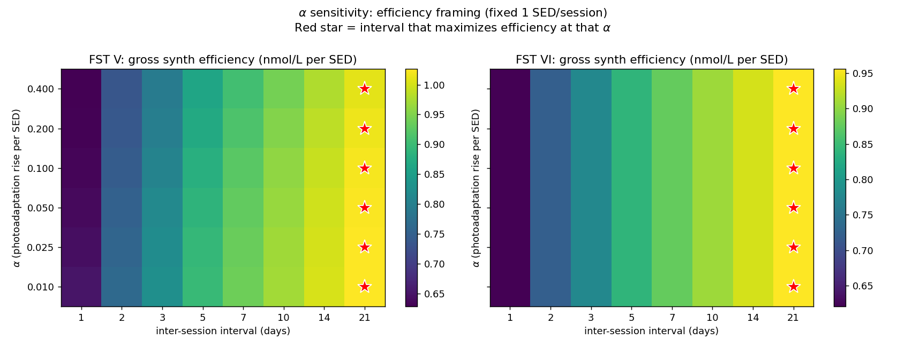
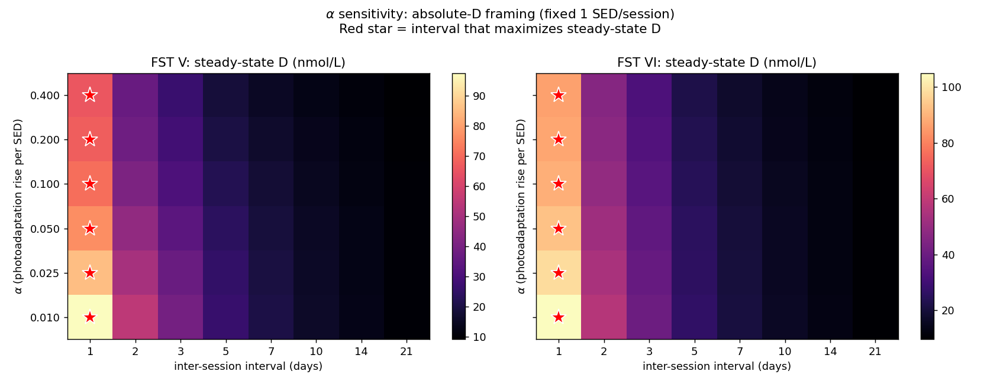
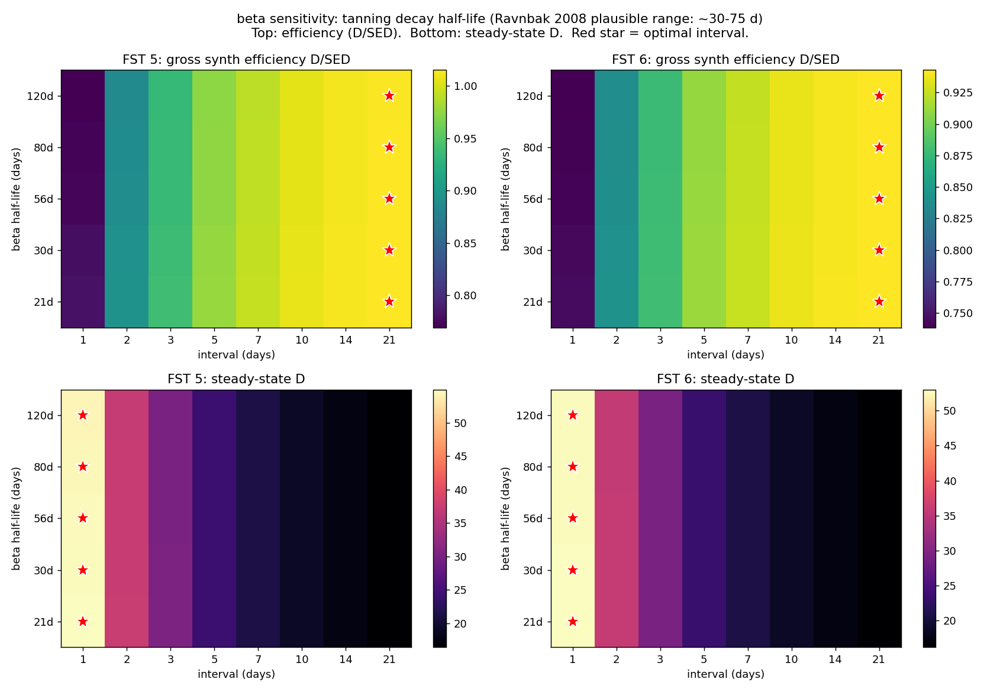
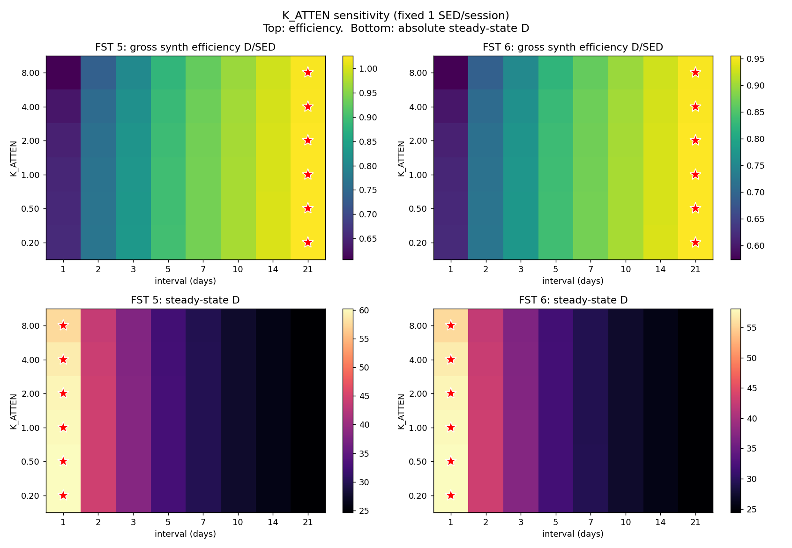
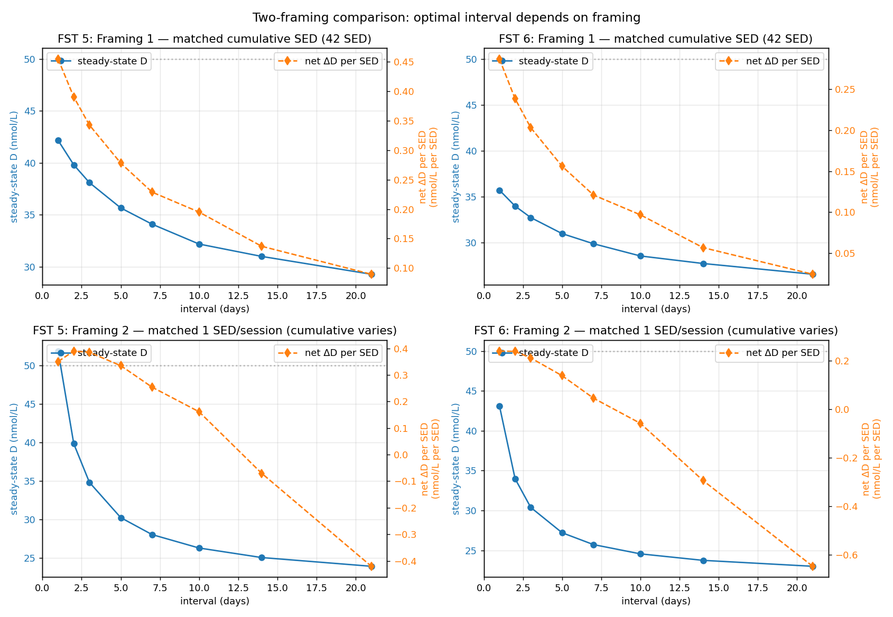
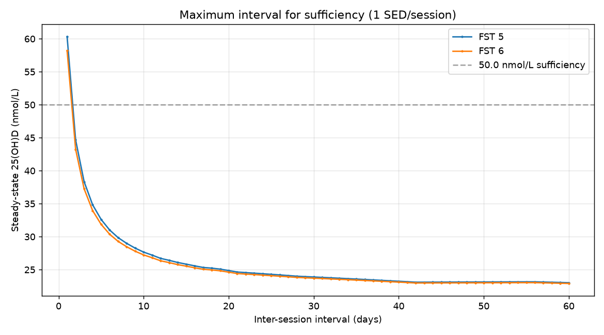
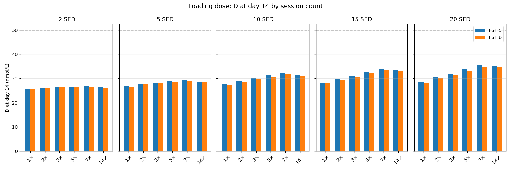
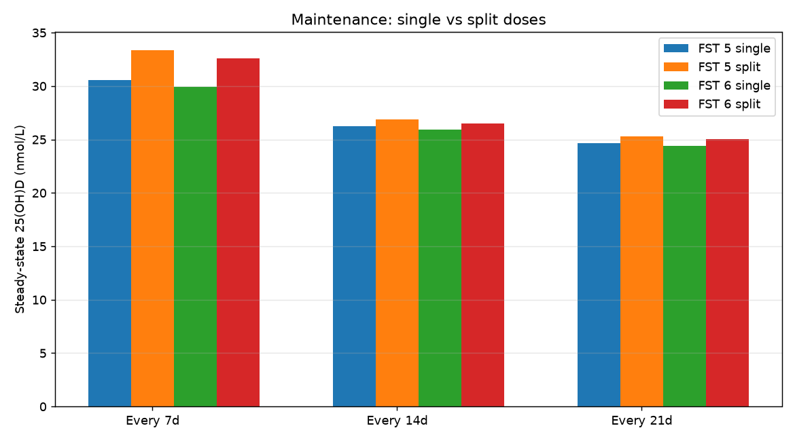
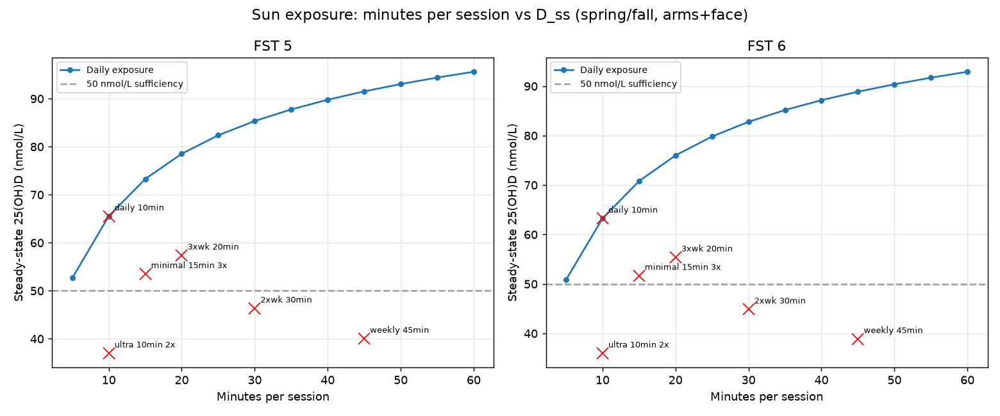
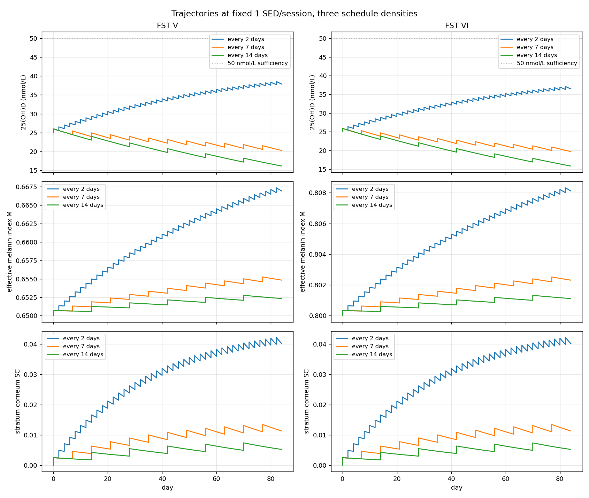

# Vitamin D Scheduling Model — Results

> **AUTO-GENERATED FILE — DO NOT HAND-EDIT.** Rewritten in full on every `run_all.py` run. Any manual edits here will be silently overwritten on the next run.

This report is generated by `run_all.py`. It captures the validation suite output, parameter sweeps, and a brief interpretation.

## 1. Validation

**13 / 14 checks passed.**

```
======================================================================
VALIDATION SUITE
======================================================================
[Sanity 1] D-dependent decay half-life (Datta 2017 power-law fit)
  D=132: t_half=87.8d (expected 89d, ±10%): OK
  D=65:  t_half=146.2d (expected 148d, ±10%): OK
  D=43:  t_half=196.9d (expected 199d, ±10%): OK
  Sim vs analytic ODE, D0=132 @89d:  74.711 vs 74.751 (±1%): OK
  Sim vs analytic ODE, D0=43 @199d:  24.378 vs 24.384 (±1%): OK
  PASS

[Sanity 2] Single bolus, FST III, untanned (computation-integrity check)
  delta-D = 1.27 nmol/L  (expected 1.27, ±2%)
  PASS

[Sanity 3] Photoadaptation reduction (FST III, M 0.30 -> 0.70)
  untanned synthesis: 1.27  tanned synthesis: 1.06
  reduction = 16.6%  (guard range 10-30%; Young 2020 supports small melanin effect)
  PASS

[Lit 1] de Boer 2025 - photoadaptation direction (replaces Matsuoka 1990)
  Protocol: 0.8 SED 3x/week x 9 weeks, FST III (de Boer 2025)
  Baseline M=0.210, After M=0.224, increased: YES
  Baseline SC=0.0, After SC=0.1360, increased: YES
  Untanned delta-D=1.075, Tanned delta-D=0.934
  Synthesis decreased after photoadaptation: YES
  PASS

[SC Check] de Boer 2025 SC validation (warning-only)
  Protocol: 0.8 SED 3x/week x 9 weeks (T1 = 35 d, T2 = 63 d)
  FST III (FP I-III proxy, SC_max=0.23): SC=0.1404 (increased: YES, range [0.08,0.23]: OK)
  FST V  (FP IV-VI proxy, SC_max=0.36): SC=0.2198 (increased: YES, range [0.14,0.36]: OK)
  SC_V >= SC_III * 0.8: YES
  SHAPE (reported, not asserted): model T1=+0.134 T2=+0.136 vs observed -0.259 / +0.293
    Observed SC dips ~26% BELOW baseline at week 5. Model cannot
    reproduce that at k_damage=0.0, which is deliberate: the
    parameter is unidentifiable from 3 group medians. See
    scripts/fit_sc_deboer2025.py and OPEN_QUESTIONS gap 27.
  PASS (warning-only)

[Lit 2] Bogh 2012 - quantitative NB-UVB validation  [C1]
  Protocol: 18 sessions 3x/week x 6 weeks, cohort FST mix, baseline 19.2
  Dose: 9.0 J/cm2 cumulative -> 49.5 erythemal SED (TL-01 x5.5), E_source=2.44, BSA=0.9
  Model D_final = 75.2 nmol/L (delta = +56.0)
  Study observed: 19.2 -> 75.0 nmol/L, delta +55.8 nmol/L
  Acceptance: |delta - 55.8| <= 10.0 nmol/L  (range 45.8-65.8)
  PASS

[Lit 3] Farrar 2013 - FST V, 1.95 SED 3x/week x 6 weeks, baseline 30.0  [C2]
  Baseline proxy <50 nmol/L constraint: YES
  D_final = 45.7 nmol/L  (observed ~39.2 nmol/L; target 25-55)
  delta   = 15.7 nmol/L  (observed ~21.7 nmol/L; target 10-35)
  D_final in [25,55]: YES   delta in [10,35]: YES
  PASS

[Lit 4] Bogh 2010/P5 - baseline-dependent synthesis direction  [C4]
  1 SED, FST III, SC=0:
    delta at D=20:  1.319 nmol/L
    delta at D=80:  0.710 nmol/L
  direction (low-baseline > high-baseline): YES
  model ratio = 1.86  (P5-implied feedback ratio ~1.86; target 1.2-3.0)
  Note: full BSA term (5.5*ln(%BSA)) not modeled; direction check only
  PASS

[Lit 5] Karppinen 2017/P33 - baseline feedback calibration target
  Protocol: 1.18 SED/day x 10 days, FST III, BSA=0.07, E_source=2.0
  Saturating feedback mode (D_half_feedback = 90.0):
    Low baseline (62.4 nmol/L) change:  +3.57 nmol/L (observed +6.0)
    High baseline (116.9 nmol/L) change: -3.80 nmol/L (observed -6.7)
    Low baseline increased: YES
    High baseline decreased: YES
    Within target bounds: YES
  PASS

[New Check] Metric ordering and sanity assertions
  Sparse schedule (10.5 SED every 21d):
    gross_synth_per_SED:        0.2916
    net_final_D_change_per_SED: 0.0911
    Gross >= Net: YES
  Mild schedule (0.1 SED every 7d, D0=25.0):
    auc_above_sufficiency (threshold 50): 0.0000 (target: 0.0)
    AUC above sufficiency = 0: YES
  Standard schedule (1.0 SED every 2d, D0=25.0):
    auc_above_baseline: 33.7625 (target: > 0.0)
    AUC above baseline > 0: YES
  PASS


[K_ATTEN seasonal amplitude] NH White vs NH Black seasonal rise
  Protocol: daily 0.333 SED x 84d, E_source=1.0, BSA=0.3
  NH White (FST=2, code 3): observed amplitude = 6.46, model amplitude = 1.45
  NH Black (FST=5, code 4): observed amplitude = 4.45, model amplitude = 8.57
  Observed ratio (White/Black): 1.449
  Model ratio (White/Black):    0.169
  Difference: -88.3% (target: within +/-50%)
  FAIL

[Lit 6] Kift 2013 - UK South Asian naturalistic exposure (FST V)
  Protocol: ~1.0 SED/wk (0.333 SED 3x/wk) x 12 weeks, FST V, BSA=0.14, baseline 22.5 nmol/L
  Model D_final = 26.5 nmol/L (delta = +4.0 nmol/L)
  Target bounds: D_final in [20, 40]: YES, delta in [0, 15]: YES
  PASS

======================================================================
PASSED REQUIRED: 9 / 10
PASSED WARNING-ONLY: 2 / 2
Audit change tags active: C1 C2 C3 C4 C6 (see module docstring)
C5 C7 C8: see vitd_model.py docstring and parameter comments
======================================================================

======================================================================
NHANES POPULATION VALIDATION
======================================================================

--- Part A: Seasonal direction check (warning-only) ---
  Group                     FST    Winter   Summer  Direction
  Mexican American           4     52.1    59.1  OK
  Non-Hispanic Asian         4     57.9    62.7  OK
  Non-Hispanic Black         5     43.3    49.0  OK
  Non-Hispanic White         2     68.7    76.4  OK
  Other Hispanic             4     57.5    61.1  OK
  Other/Multiracial          3     50.1    57.4  OK
  -> Direction check: PASS (all groups summer > winter)

--- Part B: Summer steady-state comparison (±10.0 nmol/L) ---
  Protocol: daily 0.333 SED, 84 days, E_source=1.0, BSA=0.3
  D0 = NHANES winter mean for each group.
  Group                     FST  Model_ss NHANES_summer   |diff|  Status
  Mexican American           4     56.4       59.1±0.4    2.7  PASS
  Non-Hispanic Asian         4     59.2       62.7±0.7    3.4  PASS
  Non-Hispanic Black         5     50.4       49.0±0.3    1.3  PASS
  Non-Hispanic White         2     66.7       76.4±0.3    9.7  PASS
  Other Hispanic             4     59.0       61.1±0.5    2.0  PASS
  Other/Multiracial          3     57.6       57.4±1.0    0.2  PASS
  -> Summer comparison: PASS (6/6 within ±10.0)

--- Part C: Dietary source residual stratification ---
  Flag                      n  Fraction  Mean resid  Std resid
  UV-only                3702   17.73%     -1.61     24.79
  food-only              8207   39.31%     -3.97     23.76
  missing                6173   29.57%     -0.68     21.38
  supplemented           2796   13.39%    -21.43     26.96
  Total                 20878   100.00%     -4.92     24.65


```

## 2. Alpha sensitivity sweep (Priority 1 completed in Session 2)

Varies the photoadaptation rise rate (alpha) and checks whether the optimal inter-session interval shifts. Alpha was calibrated from light-skin Miyamura 2011 data and the handoff flagged that it may be larger in FST V-VI.

```

======================================================================
ANALYSIS A: alpha sensitivity sweep
======================================================================

Optimal interval by alpha (efficiency framing, fixed 1 SED/session):

FST 5:
  alpha=0.010:  optimal interval = 21d (gross_eff 1.03, net_eff -0.23, ss D 24.6)
  alpha=0.025:  optimal interval = 21d (gross_eff 1.02, net_eff -0.23, ss D 24.6)
  alpha=0.050:  optimal interval = 21d (gross_eff 1.02, net_eff -0.23, ss D 24.6)
  alpha=0.100:  optimal interval = 21d (gross_eff 1.02, net_eff -0.23, ss D 24.6)
  alpha=0.200:  optimal interval = 21d (gross_eff 1.01, net_eff -0.24, ss D 24.6)
  alpha=0.400:  optimal interval = 21d (gross_eff 1.01, net_eff -0.25, ss D 24.6)

FST 6:
  alpha=0.010:  optimal interval = 21d (gross_eff 0.95, net_eff -0.29, ss D 24.4)
  alpha=0.025:  optimal interval = 21d (gross_eff 0.95, net_eff -0.29, ss D 24.4)
  alpha=0.050:  optimal interval = 21d (gross_eff 0.95, net_eff -0.29, ss D 24.4)
  alpha=0.100:  optimal interval = 21d (gross_eff 0.95, net_eff -0.29, ss D 24.4)
  alpha=0.200:  optimal interval = 21d (gross_eff 0.94, net_eff -0.30, ss D 24.4)
  alpha=0.400:  optimal interval = 21d (gross_eff 0.94, net_eff -0.30, ss D 24.4)

```





## 3. beta sensitivity sweep (tanning decay rate, NEW)

Varies beta (tanning decay rate). Ravnbak et al. 2008 (PMID 18480919) measured UVB tanning fade of 4-5 months in Scandinavians and Indians/Pakistanis. The prior citation (Tadokoro 2005, PMID 15955111) only measured 0-7 days post-exposure and does not report a decay timescale. The 56-day half-life (default beta) is a mid-range estimate compatible with Ravnbak 2008 if complete fading requires ~3 e-folding times. The sweep covers half-lives of 21-120 days.

```

======================================================================
ANALYSIS E: beta sensitivity sweep (tanning decay rate)
======================================================================

Optimal interval by beta half-life (efficiency framing, fixed 1 SED/session):

FST 5:
  t1/2= 21d:  opt-eff interval=21d (gross_eff 1.03, net_eff -0.23); opt-D interval=1d (D 60.2)
  t1/2= 30d:  opt-eff interval=21d (gross_eff 1.03, net_eff -0.23); opt-D interval=1d (D 60.2)
  t1/2= 56d:  opt-eff interval=21d (gross_eff 1.03, net_eff -0.23); opt-D interval=1d (D 60.2)
  t1/2= 80d:  opt-eff interval=21d (gross_eff 1.03, net_eff -0.23); opt-D interval=1d (D 60.2)
  t1/2=120d:  opt-eff interval=21d (gross_eff 1.03, net_eff -0.23); opt-D interval=1d (D 60.2)

FST 6:
  t1/2= 21d:  opt-eff interval=21d (gross_eff 0.96, net_eff -0.29); opt-D interval=1d (D 58.1)
  t1/2= 30d:  opt-eff interval=21d (gross_eff 0.96, net_eff -0.29); opt-D interval=1d (D 58.1)
  t1/2= 56d:  opt-eff interval=21d (gross_eff 0.96, net_eff -0.29); opt-D interval=1d (D 58.1)
  t1/2= 80d:  opt-eff interval=21d (gross_eff 0.96, net_eff -0.29); opt-D interval=1d (D 58.1)
  t1/2=120d:  opt-eff interval=21d (gross_eff 0.96, net_eff -0.29); opt-D interval=1d (D 58.1)

```



## 4. K_ATTEN sensitivity sweep

Varies the melanin attenuation coefficient (K_ATTEN). The default value is now 0.37 (paper-backed from Young 2020 FST II:VI ratio). The sweep explores sensitivity around this value.

```

======================================================================
ANALYSIS B: K_ATTEN sensitivity sweep
======================================================================

Optimal interval by K_ATTEN (efficiency framing):

FST 5:
  K=0.2:  opt-eff interval=21d (gross_eff 1.03, net_eff -0.23); opt-D interval=1d (D 60.3)
  K=0.5:  opt-eff interval=21d (gross_eff 1.03, net_eff -0.23); opt-D interval=1d (D 60.1)
  K=1.0:  opt-eff interval=21d (gross_eff 1.03, net_eff -0.23); opt-D interval=1d (D 60.0)
  K=2.0:  opt-eff interval=21d (gross_eff 1.03, net_eff -0.23); opt-D interval=1d (D 59.6)
  K=4.0:  opt-eff interval=21d (gross_eff 1.02, net_eff -0.23); opt-D interval=1d (D 58.9)
  K=8.0:  opt-eff interval=21d (gross_eff 1.02, net_eff -0.23); opt-D interval=1d (D 57.5)

FST 6:
  K=0.2:  opt-eff interval=21d (gross_eff 0.96, net_eff -0.29); opt-D interval=1d (D 58.1)
  K=0.5:  opt-eff interval=21d (gross_eff 0.96, net_eff -0.29); opt-D interval=1d (D 58.0)
  K=1.0:  opt-eff interval=21d (gross_eff 0.95, net_eff -0.29); opt-D interval=1d (D 57.9)
  K=2.0:  opt-eff interval=21d (gross_eff 0.95, net_eff -0.29); opt-D interval=1d (D 57.5)
  K=4.0:  opt-eff interval=21d (gross_eff 0.95, net_eff -0.29); opt-D interval=1d (D 56.9)
  K=8.0:  opt-eff interval=21d (gross_eff 0.95, net_eff -0.29); opt-D interval=1d (D 55.6)

```



## 5. Two-framing schedule comparison

Central handoff finding: the optimal interval depends on what's being optimized.

- **Framing 1**: matched cumulative SED (42 SED over 12 weeks). UV budget is the constraint; we just choose how to distribute it.
- **Framing 2**: matched per-session dose (1 SED per session). Per-session dose is fixed; cumulative UV exposure varies with frequency.

```

======================================================================
ANALYSIS C: two-framing schedule comparison
======================================================================

Framing 1 (matched cumulative SED = 42):
 FST  interval_days  sed_per_session  n_sessions  cumulative_SED  steady_state_D  final_D  final_M  gross_synth_per_SED  net_final_D_change_per_SED  auc_D_per_SED  auc_above_baseline_per_SED  auc_above_sufficiency_per_SED
   5              1             0.50          84           42.00           47.72    50.35     0.79                 0.88                        0.60          80.19                       30.19                           0.02
   5              2             1.00          42           42.00           44.63    46.79     0.79                 0.77                        0.52          76.15                       26.15                           0.00
   5              3             1.50          28           42.00           42.41    44.18     0.79                 0.69                        0.46          73.28                       23.28                           0.00
   5              5             2.47          17           42.00           39.29    40.70     0.80                 0.58                        0.37          69.28                       19.28                           0.00
   5              7             3.50          12           42.00           37.30    38.08     0.80                 0.51                        0.31          66.84                       16.84                           0.00
   5             10             4.67           9           42.00           34.92    36.31     0.81                 0.45                        0.27          63.87                       13.87                           0.00
   5             14             7.00           6           42.00           33.43    33.27     0.82                 0.37                        0.20          62.13                       12.13                           0.00
   5             21            10.50           4           42.00           31.34    30.84     0.83                 0.30                        0.14          59.92                        9.92                           0.00
   6              1             0.50          84           42.00           46.15    48.64     1.01                 0.82                        0.56          78.03                       28.03                           0.00
   6              2             1.00          42           42.00           43.21    45.24     1.01                 0.72                        0.48          74.22                       24.22                           0.00
   6              3             1.50          28           42.00           41.10    42.77     1.01                 0.65                        0.42          71.51                       21.51                           0.00
   6              5             2.47          17           42.00           38.16    39.47     1.01                 0.55                        0.34          67.74                       17.74                           0.00
   6              7             3.50          12           42.00           36.29    36.99     1.02                 0.48                        0.29          65.45                       15.45                           0.00
   6             10             4.67           9           42.00           34.05    35.33     1.02                 0.42                        0.25          62.66                       12.66                           0.00
   6             14             7.00           6           42.00           32.65    32.47     1.03                 0.35                        0.18          61.03                       11.03                           0.00
   6             21            10.50           4           42.00           30.68    30.18     1.05                 0.28                        0.12          58.95                        8.95                           0.00

Framing 2 (matched 1 SED per session):
 FST  interval_days  sed_per_session  n_sessions  cumulative_SED  steady_state_D  final_D  final_M  gross_synth_per_SED  net_final_D_change_per_SED  auc_D_per_SED  auc_above_baseline_per_SED  auc_above_sufficiency_per_SED
   5              1             1.00          84           84.00           60.19    63.75     0.80                 0.66                        0.46          48.79                       23.79                           3.97
   5              2             1.00          42           42.00           44.63    46.79     0.79                 0.77                        0.52          76.15                       26.15                           0.00
   5              3             1.00          28           28.00           38.32    39.71     0.79                 0.83                        0.53         101.56                       26.56                           0.00
   5              5             1.00          17           17.00           32.60    33.36     0.78                 0.90                        0.49         148.66                       25.13                           0.00
   5              7             1.00          12           12.00           29.85    30.06     0.78                 0.94                        0.42         198.16                       23.16                           0.00
   5             10             1.00           9            9.00           27.66    28.06     0.78                 0.97                        0.34         251.14                       17.81                           0.00
   5             14             1.00           6            6.00           26.09    25.69     0.78                 1.00                        0.12         362.63                       12.63                           0.00
   5             21             1.00           4            4.00           24.64    24.09     0.78                 1.03                       -0.23         525.79                        4.28                           0.00
   6              1             1.00          84           84.00           58.07    61.52     1.02                 0.62                        0.43          47.28                       22.28                           2.98
   6              2             1.00          42           42.00           43.21    45.24     1.01                 0.72                        0.48          74.22                       24.22                           0.00
   6              3             1.00          28           28.00           37.24    38.53     1.01                 0.78                        0.48          99.39                       24.39                           0.00
   6              5             1.00          17           17.00           31.86    32.54     1.00                 0.84                        0.44         146.23                       22.70                           0.00
   6              7             1.00          12           12.00           29.28    29.44     1.00                 0.88                        0.37         195.53                       20.53                           0.00
   6             10             1.00           9            9.00           27.23    27.57     1.00                 0.91                        0.29         248.49                       15.16                           0.00
   6             14             1.00           6            6.00           25.77    25.35     1.00                 0.93                        0.06         359.59                        9.59                           0.00
   6             21             1.00           4            4.00           24.41    23.86     1.00                 0.96                       -0.29         522.47                        3.04                           0.00
  Safety [FST 5, framing 1, 21d interval, 10.5 SED/session]: max single dose = 140.0% MED (10.50 SED), cumulative = 42.0 SED over 4 sessions *** OVERDOSE ***
  Safety [FST 5, framing 2, 21d interval, 1.0 SED/session]: max single dose = 13.3% MED (1.00 SED), cumulative = 4.0 SED over 4 sessions

```



## 6. Fine-grid interval sweep

Sweeps intervals from 1–35 days in 1-day steps to find the exact optimal interval under each framing. Complements the coarse integer-interval analysis in the two-framing comparison.

```

======================================================================
ANALYSIS F: fine-grid interval sweep (1-30 days)
======================================================================

Fine-grid optimal interval (efficiency framing):
  FST 5: optimal interval = 30d (gross_eff 1.040, ss_D 23.9)
  FST 6: optimal interval = 30d (gross_eff 0.968, ss_D 23.7)
  Safety [Best: FST 5, every 30.0d, 1.0 SED]: max single dose = 13.3% MED (1.00 SED), cumulative = 3.0 SED over 3 sessions

```

## 7. Continuous optimization (scipy.optimize)

Uses scipy.optimize.minimize (Nelder-Mead) to find the continuous-valued interval that maximizes per-SED efficiency, confirming the discrete sweep.

```

======================================================================
ANALYSIS G: continuous optimization (scipy.optimize)
======================================================================

FST 5:
  Efficiency optimum: interval=59d, efficiency=1.055 nmol/L/SED (32 function evals)
  Absolute D optimum: interval=2d, steady_state_D=44.6 nmol/L (32 function evals)
  Cross-check: ss_D at eff optimum = 23.1, gross_eff at D optimum = 0.769
  AUC deficit at 50 nmol/L for optimal schedule: 2188.4
  AUC deficit at 30 nmol/L for optimal schedule: 508.4

FST 6:
  Efficiency optimum: interval=59d, efficiency=0.982 nmol/L/SED (32 function evals)
  Absolute D optimum: interval=2d, steady_state_D=43.2 nmol/L (32 function evals)
  Cross-check: ss_D at eff optimum = 22.9, gross_eff at D optimum = 0.720
  AUC deficit at 50 nmol/L for optimal schedule: 2195.4
  AUC deficit at 30 nmol/L for optimal schedule: 515.4

```

## 8. Maximum interval for sufficiency

Finds the longest inter-session interval where steady-state D stays above 50 nmol/L under 1 SED/session dosing.

```

======================================================================
ANALYSIS H: maximum interval for sufficiency
======================================================================
  FST 5: max interval = 1d (D_ss = 60.2 nmol/L)
  FST 6: max interval = 1d (D_ss = 58.1 nmol/L)
  Saved figs/max_interval_sufficiency.png

```



## 9. Loading dose optimization

For UV budgets of 2-20 SED in the first 14 days, tests splitting that budget across 1-14 sessions. After loading, all schedules switch to 1 SED every 7 days maintenance.

```

======================================================================
ANALYSIS I: loading dose optimization
======================================================================

  Best loading distribution by budget:
    FST 5, 2 SED: 7 sessions × 0.3 SED → D(day14)=26.9, D(day84)=30.4
    FST 6, 2 SED: 7 sessions × 0.3 SED → D(day14)=26.7, D(day84)=29.7
    FST 5, 5 SED: 7 sessions × 0.7 SED → D(day14)=29.5, D(day84)=31.9
    FST 6, 5 SED: 7 sessions × 0.7 SED → D(day14)=29.1, D(day84)=31.2
    FST 5, 10 SED: 7 sessions × 1.4 SED → D(day14)=32.2, D(day84)=33.5
    FST 6, 10 SED: 7 sessions × 1.4 SED → D(day14)=31.7, D(day84)=32.7
    FST 5, 15 SED: 7 sessions × 2.1 SED → D(day14)=34.1, D(day84)=34.6
    FST 6, 15 SED: 7 sessions × 2.1 SED → D(day14)=33.4, D(day84)=33.7
    FST 5, 20 SED: 7 sessions × 2.9 SED → D(day14)=35.4, D(day84)=35.4
    FST 6, 20 SED: 7 sessions × 2.9 SED → D(day14)=34.7, D(day84)=34.5

  Saved figs/loading_dose_D_at_day14.png
  Safety [FST 5, 20 SED loading in 1 session]: max single dose = 266.7% MED (20.00 SED), cumulative = 32.0 SED over 13 sessions *** OVERDOSE ***
  Safety [FST 5, 2 SED daily — aggressive loading]: max single dose = 26.7% MED (2.00 SED), cumulative = 168.0 SED over 84 sessions

```



## 10. Maintenance dose splitting

Compares 1 SED every T days vs 0.5 SED every T/2 days at the same total UV rate. Tests T = 7, 14, 21 days.

```

======================================================================
ANALYSIS J: maintenance dose splitting
======================================================================

  FST 5:
    T= 7d: single D_ss=29.8 | split D_ss=31.2 → split
    T=14d: single D_ss=26.1 | split D_ss=26.6 → split
    T=21d: single D_ss=24.6 | split D_ss=25.1 → split

  FST 6:
    T= 7d: single D_ss=29.3 | split D_ss=30.5 → split
    T=14d: single D_ss=25.8 | split D_ss=26.3 → split
    T=21d: single D_ss=24.4 | split D_ss=24.8 → split

  Saved figs/maintenance_split.png
  Safety [FST 5, single 1 SED every 7d]: max single dose = 13.3% MED (1.00 SED), cumulative = 12.0 SED over 12 sessions

```



## 11. Sun exposure scheduling (no equipment)

Practical sun exposure scheduling: how many minutes of midday sun, how often, to maintain sufficiency? Uses spring/fall moderate conditions (UV index ~5), arms + face exposure (~30% BSA), E_source = 1.0.

```

======================================================================
ANALYSIS K: sun exposure scheduling (no equipment)
======================================================================

  Practical sun exposure schedules (spring/fall, arms+face):
    FST 5: daily_10min          7/wk (actual 7.00/wk)   70 min/wk → D_ss=65.5 [OK]
    FST 5: 3xwk_20min           3/wk (actual 3.50/wk)   60 min/wk → D_ss=57.4 [OK]
    FST 5: 2xwk_30min           2/wk (actual 1.75/wk)   60 min/wk → D_ss=46.3 [BELOW]
    FST 5: weekly_45min         1/wk (actual 1.00/wk)   45 min/wk → D_ss=40.0 [BELOW]
    FST 5: minimal_15min_3x     3/wk (actual 3.50/wk)   45 min/wk → D_ss=53.5 [OK]
    FST 5: ultra_10min_2x       2/wk (actual 1.75/wk)   20 min/wk → D_ss=37.0 [BELOW]
    FST 6: daily_10min          7/wk (actual 7.00/wk)   70 min/wk → D_ss=63.2 [OK]
    FST 6: 3xwk_20min           3/wk (actual 3.50/wk)   60 min/wk → D_ss=55.4 [OK]
    FST 6: 2xwk_30min           2/wk (actual 1.75/wk)   60 min/wk → D_ss=44.9 [BELOW]
    FST 6: weekly_45min         1/wk (actual 1.00/wk)   45 min/wk → D_ss=38.9 [BELOW]
    FST 6: minimal_15min_3x     3/wk (actual 3.50/wk)   45 min/wk → D_ss=51.7 [OK]
    FST 6: ultra_10min_2x       2/wk (actual 1.75/wk)   20 min/wk → D_ss=36.0 [BELOW]

  Minimum daily exposure for sufficiency:
    FST 5: 5 min/day (35 min/week, 0.1 hr/day) → D_ss=52.7 nmol/L
    FST 6: 5 min/day (35 min/week, 0.1 hr/day) → D_ss=50.8 nmol/L

  Saved figs/sun_exposure_minutes_vs_D.png
  Saved figs/sun_exposure_weekly_minutes.png
  Safety [FST 5, weekly 45 min sun]: max single dose = 89.6% MED (6.72 SED), cumulative = 80.6 SED over 12 sessions

  NOTE: Assumes spring/fall midday sun (UV index ~5). Summer sun ~2x more efficient; winter ~0.5x.
  Arms + face exposure (~30% BSA). More skin = less time needed.

```



## 12. Example trajectories

D(t) and M(t) under three representative schedules at fixed 1 SED per session. Shows the temporal dynamics directly.



## 13. Constant-sessions analysis

15 sessions over 84 days, varying spacing patterns ranked by AUC deficiency below 50 nmol/L + safety sidecar.

```

======================================================================
ANALYSIS L: constant-sessions optimization sweep
======================================================================

  E_source=2.5 (NB-UVB 311 nm placeholder)
  WARNING: E_source=2.5 is a placeholder. Per-study calibration
  from SOURCE_CALIBRATION_TABLE should be used for absolute predictions.

  Saved tables/constant_sessions_analysis.csv

  Optimal schedule: 52 sessions
    SED/session:     1.000
    Interval:        7.0 days
    Max D:           48.8 nmol/L
    AUC deficit @50: 2951.2 nmol/L·days
    Gross eff:       1.463 nmol/L/SED
    Net ΔD/SED:      0.432 nmol/L/SED

    N  SED/sesh  Interval   Max D  Deficit@50  GrossEff  NetΔD/SED  Roll7d                 Flag
  --- --------- --------- ------- ----------- --------- ---------- ------- --------------------
    1   52.000    365.0    32.4     10338.7     0.142     -0.196    52.0     UV safety: review
    2   26.000    182.5    31.4      9659.9     0.248     -0.133    26.0     UV safety: review
    3   17.333    121.7    30.7      9166.8     0.332     -0.085    17.3     UV safety: review
    4   13.000     91.2    30.3      8766.2     0.402     -0.046    13.0     UV safety: review
    5   10.400     73.0    30.0      8423.1     0.463     -0.013    10.4     UV safety: review
    6    8.667     60.8    30.2      8119.3     0.517      0.016     8.7     UV safety: review
    7    7.429     52.1    31.2      7844.2     0.566      0.041     7.4     UV safety: review
    8    6.500     45.6    32.1      7591.9     0.611      0.064     6.5     UV safety: review
    9    5.778     40.6    32.9      7358.1     0.653      0.085     5.8     UV safety: review
   10    5.200     36.5    33.7      7140.0     0.692      0.104     5.2     UV safety: review
   11    4.727     33.2    34.5      6935.5     0.729      0.122     4.7                      
   12    4.333     30.4    35.2      6742.9     0.763      0.138     4.3                      
   13    4.000     28.1    35.9      6560.8     0.796      0.154     4.0                      
   14    3.714     26.1    36.5      6388.3     0.827      0.168     3.7                      
   15    3.467     24.3    37.1      6224.4     0.857      0.182     3.5                      
   16    3.250     22.8    37.7      6068.2     0.885      0.195     3.2                      
   17    3.059     21.5    38.3      5919.3     0.912      0.207     3.1                      
   18    2.889     20.3    38.8      5776.8     0.938      0.219     2.9                      
   19    2.737     19.2    39.3      5640.4     0.963      0.229     2.7                      
   20    2.600     18.2    39.8      5509.6     0.987      0.240     2.6                      
   21    2.476     17.4    40.2      5384.0     1.010      0.250     2.5                      
   22    2.364     16.6    40.7      5263.2     1.032      0.259     2.4                      
   23    2.261     15.9    41.1      5147.0     1.053      0.269     2.3                      
   24    2.167     15.2    41.5      5035.0     1.074      0.277     2.2                      
   25    2.080     14.6    41.9      4926.9     1.094      0.286     2.1                      
   26    2.000     14.0    42.3      4822.6     1.113      0.294     2.0                      
   27    1.926     13.5    42.6      4721.7     1.132      0.302     1.9                      
   28    1.857     13.0    43.0      4624.2     1.150      0.309     1.9                      
   29    1.793     12.6    43.3      4529.8     1.167      0.316     1.8                      
   30    1.733     12.2    43.6      4438.4     1.184      0.323     1.7                      
   31    1.677     11.8    43.9      4349.8     1.201      0.330     1.7                      
   32    1.625     11.4    44.2      4263.8     1.217      0.336     1.6                      
   33    1.576     11.1    44.5      4180.4     1.232      0.343     1.6                      
   34    1.529     10.7    44.8      4099.4     1.247      0.349     1.5                      
   35    1.486     10.4    45.1      4020.6     1.262      0.355     1.5                      
   36    1.444     10.1    45.4      3944.1     1.276      0.360     1.4                      
   37    1.405      9.9    45.6      3869.6     1.290      0.366     1.4                      
   38    1.368      9.6    45.9      3797.1     1.304      0.371     1.4                      
   39    1.333      9.4    46.1      3726.6     1.317      0.376     1.3                      
   40    1.300      9.1    46.4      3657.8     1.330      0.381     1.3                      
   41    1.268      8.9    46.6      3590.8     1.342      0.386     1.3                      
   42    1.238      8.7    46.8      3525.5     1.355      0.391     1.2                      
   43    1.209      8.5    47.0      3461.8     1.367      0.396     1.2                      
   44    1.182      8.3    47.2      3399.6     1.378      0.400     1.2                      
   45    1.156      8.1    47.5      3338.9     1.390      0.405     1.2                      
   46    1.130      7.9    47.7      3279.7     1.401      0.409     1.1                      
   47    1.106      7.8    47.9      3221.8     1.412      0.413     1.1                      
   48    1.083      7.6    48.1      3165.2     1.423      0.417     1.1                      
   49    1.061      7.4    48.2      3109.9     1.433      0.421     1.1                      
   50    1.040      7.3    48.4      3055.8     1.443      0.425     1.0                      
   51    1.020      7.2    48.6      3002.9     1.453      0.429     1.0                      
   52    1.000      7.0    48.8      2951.2     1.463      0.432     1.0                      

```

## 14. Decision problems (recommended objectives)

The sweeps above maximise `gross_synth_per_SED`, which rises monotonically as dosing approaches zero and whose reported optima end *below* their starting 25(OH)D. These are the same questions posed so that cumulative UV is held fixed, or so that cancer risk is scored alongside the vitamin D outcome.

```
==========================================================================
Q1. FIXED SESSION BUDGET: 'I can get outside N times in 12 weeks'
==========================================================================
Cumulative UV is IDENTICAL across every candidate spacing, so no
spacing can win by simply dosing less.

  FST 5, 1.0 SED/session, 84-day horizon, baseline 25 nmol/L:
    sessions  best gap   mean D  final D   min D   d<50  melanoma
           6        1d     27.4     24.8    24.8     84     0.115   (mean D spread across spacings: 1.8)
          12        1d     31.0     28.2    25.0     84     0.231   (mean D spread across spacings: 2.7)
          18        1d     34.0     31.4    25.0     84     0.346   (mean D spread across spacings: 2.7)
          24        1d     36.5     34.3    25.0     84     0.462   (mean D spread across spacings: 3.0)
          36        1d     40.6     40.1    25.0     84     0.692   (mean D spread across spacings: 3.1)

  FST 5, 3.0 SED/session, 84-day horizon, baseline 25 nmol/L:
    sessions  best gap   mean D  final D   min D   d<50  melanoma
           6        1d     31.1     27.9    25.0     84     3.115   (mean D spread across spacings: 2.9)
          12        1d     37.0     33.5    25.0     84     6.231   (mean D spread across spacings: 4.2)
          18        1d     41.8     38.5    25.0     84     9.346   (mean D spread across spacings: 4.3)
          24        1d     45.9     43.2    25.0     58    12.462   (mean D spread across spacings: 4.8)
          36        1d     52.4     52.0    25.0     19    18.692   (mean D spread across spacings: 4.8)

  FST 6, 3.0 SED/session, 84-day horizon, baseline 25 nmol/L:
    sessions  best gap   mean D  final D   min D   d<50  melanoma
           6        1d     30.5     27.5    25.0     84     3.115   (mean D spread across spacings: 2.7)
          12        1d     36.1     32.7    25.0     84     6.231   (mean D spread across spacings: 4.0)
          18        1d     40.7     37.5    25.0     84     9.346   (mean D spread across spacings: 4.1)
          24        1d     44.6     42.0    25.0     68    12.462   (mean D spread across spacings: 4.6)
          36        1d     50.8     50.4    25.0     20    18.692   (mean D spread across spacings: 4.6)

==========================================================================
Q2. STAY SUFFICIENT AT LEAST CANCER RISK (Pareto frontier)
==========================================================================
SCC tracks cumulative dose; melanoma/BCC track intermittent bursts
(Elwood 1997, Leiter 2009). Both are reported.

  FST 2, 1-year horizon, target 50 nmol/L:
    Lowest-risk schedule that stays sufficient: 2.0 SED every 1d (365 sessions, 730 SED total)
      mean D 91.8, days below 50: 16, SCC idx 8.95, melanoma idx 56.154, burn fraction 0%
    Pareto frontier (6 nondominated points):
        SED  interval    d<50     SCC  melanoma
       4.00        1d      11   17.90   449.231
       2.00        1d      16    8.95    56.154
       1.00        1d      27    4.48     7.019
       0.50        1d      51    2.24     0.877
       0.25        1d     123    1.12     0.110
       0.25       28d     365    0.04     0.004

  FST 5, 1-year horizon, target 50 nmol/L:
    Lowest-risk schedule that stays sufficient: 4.0 SED every 1d (365 sessions, 1460 SED total)
      mean D 92.3, days below 50: 16, SCC idx 4.64, melanoma idx 449.231, burn fraction 0%
    Pareto frontier (6 nondominated points):
        SED  interval    d<50     SCC  melanoma
       4.00        1d      16    4.64   449.231
       2.00        1d      24    2.32    56.154
       1.00        1d      41    1.16     7.019
       0.50        1d      81    0.58     0.877
       0.25        1d     256    0.29     0.110
       0.25       28d     365    0.01     0.004

==========================================================================
Q3. MINUTES OF SUN PER DAY
==========================================================================
UV Index -> personal erythemal dose, with the horizontal-to-body
geometry correction applied. 'would burn' flags unusable advice.

   FST   UVI    BSA  target   minutes   %MED   burn
     2   3.5   0.35    50.0        13     9%     no   UK Mar-Sep avg
     2   3.5   0.35    85.8        60    43%     no   UK Mar-Sep avg
     5   3.5   0.35    50.0        19     5%     no   UK Mar-Sep avg
     5   3.5   0.35    85.8       104    26%     no   UK Mar-Sep avg
     6   3.5   0.35    50.0        20     2%     no   UK Mar-Sep avg
     6   3.5   0.35    85.8       118    14%     no   UK Mar-Sep avg
     2   7.0   0.35    50.0         6     9%     no   UK midsummer
     2   7.0   0.35    85.8        30    43%     no   UK midsummer
     5   7.0   0.35    50.0         9     5%     no   UK midsummer
     5   7.0   0.35    85.8        52    26%     no   UK midsummer
     6   7.0   0.35    50.0        10     2%     no   UK midsummer
     6   7.0   0.35    85.8        59    14%     no   UK midsummer
     2   7.0   0.10    50.0        14    20%     no   hands+face only
     2   7.0   0.10    85.8        93   131%    YES   hands+face only
     5   7.0   0.10    50.0        22    11%     no   hands+face only
     5   7.0   0.10    85.8       206   101%    YES   hands+face only
     6   7.0   0.10    50.0        24     6%     no   hands+face only
     6   7.0   0.10    85.8       249    60%     no   hands+face only

  'n/a' means the target is unreachable at <=600 min/day -- reported
  rather than silently returning the search bound.

```

## 15. Held-out external benchmark (Webb/Kift 2018)

Nothing in this repository is calibrated to this study. Every other check in the validation suite is a calibration or debug target, so this is the only out-of-sample evidence available.

```
[HELD-OUT] Webb/Kift 2018 (Nutrients 10:457) -- NOT calibrated to
  FST V : FST II dose ratio for equal response
    model    = 1.40x
    reported = 2.5-3.0x
    FAIL
  FST V : FST II required-minutes ratio (UVI 3.5, 35% BSA, target 85.8)
    model    = 1.77  (72.0 vs 127.6 min)
    reported = 2.78 (25 min / 9 min)
    PASS (+/-40%)
  NOTE: model under-predicts the skin-type penalty. Young 2020's
  FST II:VI ratio of 1.3-1.4 is per-unit-dose at MATCHED BSA under
  lamps; Webb/Kift's 2.5-3.0x is a whole-body naturalistic response.
  These measure different things, and K_const is calibrated to the
  former. See OPEN_QUESTIONS gap 23.

```

## 16. Sensitivity, identifiability, and uncertainty

Which parameters actually drive results, which pairs cannot be separated by the current data, and what the headline numbers look like as intervals rather than point estimates.

```
==========================================================================
ONE-AT-A-TIME SENSITIVITY (FST 5, 1 SED every 3 d, 84 d)
==========================================================================
  parameter                   range   ss_D swing      rel
  A                       1.6 - 3.8        13.93   36.4%
  K_const                 0.2 - 0.9         7.31   19.1%
  K_SC                      0.5 - 2         3.67    9.6%
  D_max                   116 - 250         2.97    7.7%
  alpha_SC               0.08 - 0.2         1.22    3.2%
  K_ATTEN                     0 - 2         0.12    0.3%
  beta           0.005776 - 0.03301         0.01    0.0%
  SC_max                  0.2 - 0.4         0.00    0.0%

  Interpretation: parameters at the top drive results; those at the
  bottom cannot be blamed for prediction error no matter how
  uncertain their citation trail is.

==========================================================================
PAIRWISE IDENTIFIABILITY (steady-state D response surface)
==========================================================================
  pair                       1-D ridge  ss_D spread  verdict
  alpha_SC~SC_max              1.0000         1.22  UNIDENTIFIABLE (only the combination is constrained)
  K_const~K_ATTEN              0.9998         7.40  UNIDENTIFIABLE (only the combination is constrained)
  K_ATTEN~K_SC                 0.9990         3.78  UNIDENTIFIABLE (only the combination is constrained)
  A~D_max                      0.9466        17.84  separable
  A~K_const                    0.7105        20.32  separable

==========================================================================
UNCERTAINTY PROPAGATION (400 draws, uniform over prior ranges)
==========================================================================
  steady_state_D   median   37.745   95% range [30.600, 47.459]
  net_per_SED      median    0.503   95% range [0.220, 0.885]
  best interval under net-gain-per-SED, frequency across draws:
      1 d :   30 ( 7.5%) ###
      2 d :  136 (34.0%) ##############
      3 d :  143 (35.8%) ##############
      4 d :   63 (15.8%) ######
      5 d :   28 ( 7.0%) ###

  Report these as intervals. A single headline number implies
  precision the evidence does not support.

```

## 17. Interpretation

### Read the decision-problem sections first

Sections 2-13 sweep `gross_synth_per_SED`. That metric has **no interior
optimum**: it rises monotonically as dosing approaches zero, and its reported
"optima" (21-30 d, and ~59 d under continuous optimisation) end *below* the
starting 25(OH)D -- a net loss of vitamin D scored as maximal efficiency. The
apparent optimum drifts upward with the search bound, which is the signature of
a monotone objective rather than a peak.

Ablation shows why: setting `K_ATTEN = 0` changes the interval ranking by ~0.3%,
and setting `K_ATTEN = 0` *and* `K_SC = 0` leaves it intact. The ordering comes
from the `(1 - D/D_max)` feedback term, not from photoadaptation. Sparse dosing
keeps mean D low, so each pulse meets less inhibition.

Under `net_final_D_change_per_SED` the optimum is **2-4 days**, and Monte Carlo
over the documented prior ranges puts it at 2-4 days in 86% of draws
(section 16). That is the number to quote.

### What the sweeps do legitimately show

The interval ranking is robust to `alpha` (0.01-0.40), `beta` (21-120 d
half-life), and `K_ATTEN`. This is a real robustness result, but the reason is
not reassuring: those three parameters barely participate in the model at all.
At 1 SED/session the melanin state moves only +0.019 over 84 days. Section 16
quantifies this -- `A` swings steady-state D by 36% across its plausible range
while `K_ATTEN` swings it by 0.3%, despite `K_ATTEN` carrying the longer
citation trail.

### Identifiability

Three parameter pairs are jointly unidentifiable from the current data
(>99% of the response surface explained by a single linear combination):
`alpha_SC ~ SC_max`, `K_const ~ K_ATTEN`, and `K_ATTEN ~ K_SC`. Only their
combinations are constrained. Reporting either member of such a pair as a
separately calibrated value overstates what the data support -- melanin and
stratum corneum are both `exp(-k * saturating state)` terms driven by the same
UV input, so they trade off along a ridge.

### The one out-of-sample test currently fails

Webb/Kift 2018 report that skin type V needs 2.5-3.0x the dose of white
Caucasians for an equivalent 25(OH)D rise. The model gives 1.40x (section 15).
`K_const` is calibrated to Young 2020's FST II:VI ratio of 1.3-1.4, which is a
per-unit-dose ratio at *matched BSA under lamps*; Webb/Kift's 2.5-3.0x is a
whole-body naturalistic response. These measure different quantities, and the
model currently only reproduces the former. The required-minutes ratio (1.77 vs
2.78) passes a looser +/-40% band. This is the clearest evidence that the
skin-type penalty is under-modelled for real-world use.

### Skin cancer is now scored, not just flagged

The risk model separates the two epidemiologically distinct pathways: SCC tracks
**cumulative** dose, while melanoma and BCC track **intermittent** intensity
(Elwood 1997: intermittent OR 1.71, heavy occupational OR 0.86 -- i.e.
*protective*; Leiter 2009; Calzavara-Pinton 2015). The scheduling consequence is
the opposite of naive dose-minimisation: at a fixed total UV budget, many small
sub-erythemal sessions carry far less melanoma/BCC risk than a few large ones.
Frequent-and-small beats rare-and-large, and this now agrees with the vitamin D
objective rather than opposing it.

### What still needs better data

- **The skin-type penalty for whole-body naturalistic exposure** (the Webb/Kift
  gap above) is the highest-value calibration target.
- **`D_max`** drives the headline result and has unconfirmed origin. The
  mechanistic alternative (`feedback_mode='biphasic'`, inflection ~56 nmol/L
  from Comms Med 2025) is implemented but not yet the default.
- **Matsuoka 1990 (J Lab Clin Med, PMID 2165512)** is the sole source for
  `K_ATTEN` and is absent from the repository.
- **de Boer 2025 individual-level SC/MI trajectories** would break the
  `alpha_SC ~ SC_max` and `K_ATTEN ~ K_SC` ridges.
- **Ambient-to-personal UV dosimetry** for upright activity: the 0.55 geometry
  factor is a mid-range prior and directly scales every minutes recommendation.
